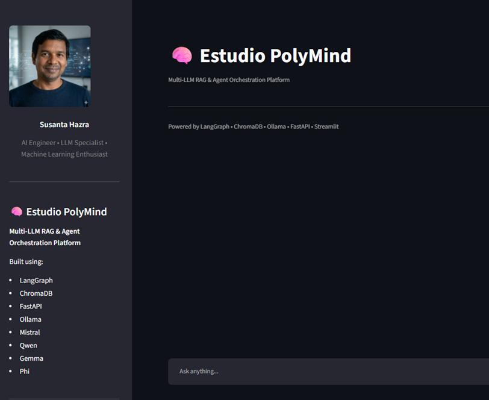
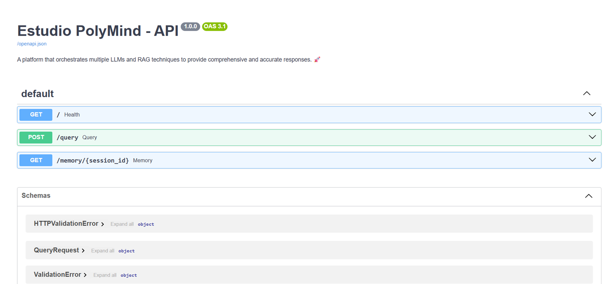
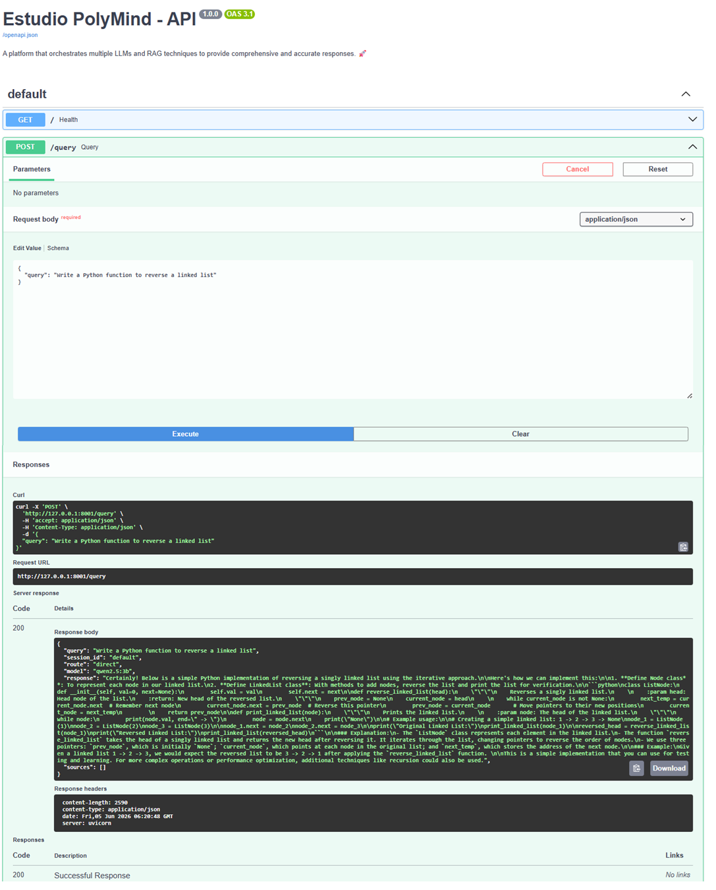
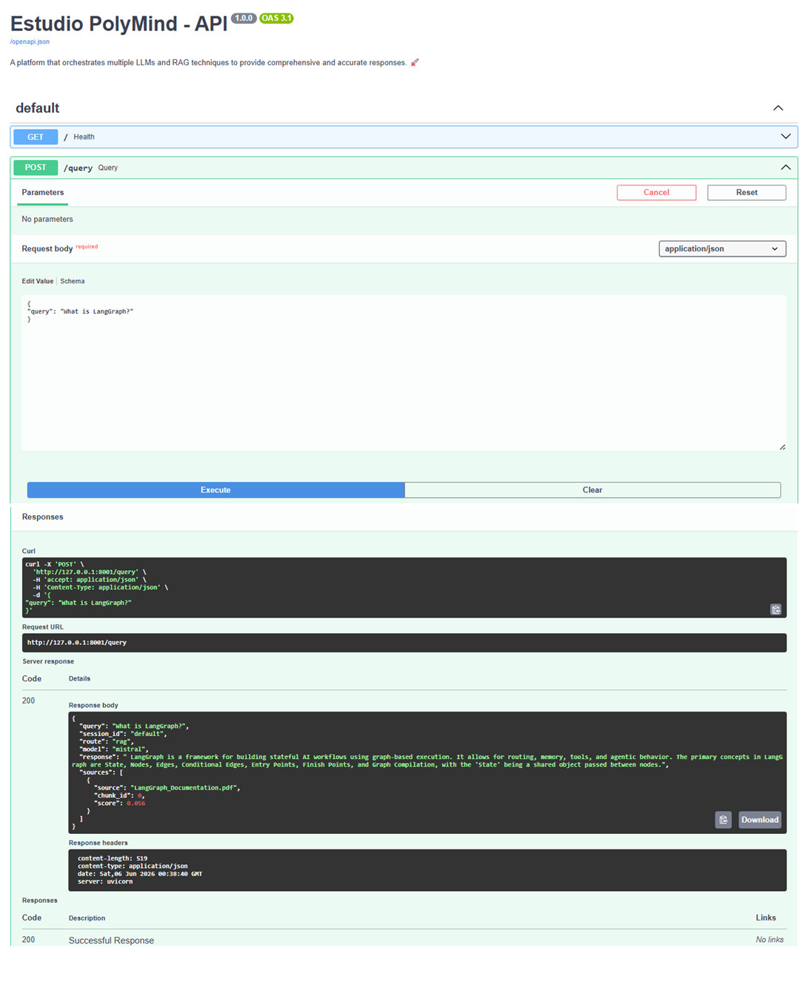

# 🧠 Estudio PolyMind

### Multi-LLM RAG, Agent Orchestration & Document Intelligence Platform

[](https://www.python.org/)
[](https://fastapi.tiangolo.com/)
[](https://streamlit.io/)
[](https://langchain-ai.github.io/langgraph/)
[](https://www.trychroma.com/)
[](https://redis.io/)
[](https://ollama.com/)

[](https://azure.microsoft.com/)
[](https://kubernetes.io/)
[](https://helm.sh/)
[](https://prometheus.io/)
[](https://www.docker.com/)
[](https://docs.vllm.ai/)
[](https://github.com/Susanta2025-lab/estudio-polymind-llm-orchestration/actions/workflows/ci.yml)

Estudio PolyMind is a production-style AI engineering platform for **multi-LLM orchestration**, **hybrid RAG**, **semantic routing**, **streaming inference**, **conversation memory**, and a growing **evidence-grounded document-intelligence pipeline**.

The project is deliberately provider-neutral. Local development can use **Ollama**; external inference uses the existing **OpenAI-compatible adapter**, which can target services such as **Azure Foundry**, **OpenAI-style endpoints**, or a separately operated **vLLM** server.

## Current engineering status — 14 November 2026

Phase 18 local engineering and documentation are complete within the **private,
synthetic, owning-operator** scope: `PHASE_18_ENGINEERING_COMPLETE_LOCAL_SCOPE`
and `PHASE_18_3_DOCUMENTATION_PASS`. Operator administrative acceptance of the
closure documents remains pending. The authenticated Streamlit Documents view
supports approved source selection, durable processing, validated COMPLETE
digests, explicit publication, canonical evidence/citations, selected-document
Q&A and closure/withdrawal under local security and financial governance.
Synthetic offline inference and a private Docker demonstration are supported.

The [local operator guide](docs/operations/phase_18_local_document_demo.md) gives
Python/Compose initialization, TLS/login, workflow and same-path backup/restore.
The [implemented API reference](docs/operations/phase_18_operator_api.md) covers
all eleven operator contracts. The [completion decision](docs/evaluation/phase_18_engineering_completion_and_deferred_deployment.md)
records the exact baseline, evidence and deferred deployment obligations.
`AKS_NOT_REQUIRED`; the initial cloud candidate remains a private Linux VM with
Docker and persistent storage. `AZURE_DEPLOYMENT_NOT_PERFORMED` and
`PRODUCTION_READINESS_NOT_ESTABLISHED` remain explicit. This is not a public SaaS,
general upload portal or production multi-user deployment.

Recorded Phase 18.2 verification: **3,128 passed** (2,192 unit / 936 integration,
including 76 new tests), zero failures/errors/skips/pytest warnings, **1,130.78 s**;
T01–T15 PASS in local scope. Actual Chromium authentication/workflow and local
container checks are separate evidence, not extra pytest cases or new Stage 18.3
runs. Implementation commit `f7d091ad16a458c4d4a7403e3fe3ad2b47fafc67` has
[successful CI run 43543837534](https://github.com/Susanta2025-lab/estudio-polymind-llm-orchestration/actions/runs/43543837534).
The [historical implementation report](docs/codex/reports/phase_18_2_implementation_and_verification.md)
retains its original uncommitted handoff statements; the closure decision records
the subsequently committed baseline. Earlier Phase 17 results below retain their
own scope and acceptance obligations.

Phase 17 engineering is complete, including successful v11 offline validation and controlled Azure Foundry live evaluation. Independent human semantic review is deferred and remains a prerequisite for formal Phase 17 acceptance. Development may proceed to subsequent phases.

| Scope | Current status |
|---|---|
| Phase 17 engineering, within the implemented reference scope | `PHASE_17_ENGINEERING_COMPLETE` |
| Independent human semantic review | `DEFERRED_PENDING_TWO_INDEPENDENT_REVIEWERS` — 0/2 completed |
| Official administrative acceptance | `PHASE_17_FORMAL_CLOSURE_PENDING` |
| Phase 17 engineering progression | `NEXT_PHASE_DEVELOPMENT_PERMITTED` — subject to its own prerequisites |
| Phase 17H v11 | 2,996 offline tests passed; controlled Azure Foundry 4/4 calls, 3/3 checkpoints, G1/G2, durable provenance, complete digest, publication and grounded Q&A PASS |
| Bounded source-grounded semantic assessment | PASS as preliminary independent-assistant evidence; human acceptance deferred |
| Phase 17I bounded engineering | `PHASE_17I_ENGINEERING_COMPLETE` — Stage 1 assessment, Stage 2 implementation/offline verification and Stage 3 documentation complete |
| Phase 17I documentation | `PHASE_17I_DOCUMENTATION_COMPLETE`; `PHASE_17I_STAGE3_DOCUMENTATION_PASS` |
| Phase 17I external-user verification | `PHASE_17I_EXTERNAL_VERIFICATION_DEFERRED` — 0 actual participants; `PHASE_17I_FORMAL_ACCEPTANCE_PENDING` |
| Subsequent engineering | `SUBSEQUENT_ENGINEERING_PERMITTED` — subject to its own prerequisites |

Phase 17I implements **Option A — Private, Operator-Supervised Local Verification**
through `documents.pilot.SupervisedPilot`. This trusted local workflow covers
approved native PDF/text intake, durable v11 synthesis, COMPLETE digest publication,
selected-document Q&A/canonical citations, inert presentation, structured feedback
and closure/withdrawal with residual inventory. It is bounded to three approved
sessions, one open job and one exclusive admitted provider request within the
supported shared authority. It is not a public SaaS deployment or participant
login/upload portal.

The [Stage 2 implementation report](docs/codex/reports/phase_17i_implementation_and_verification.md)
records **3,052 tests passed** (2,163 unit / 889 integration, including 56 new
Phase 17I cases), zero failures/errors/skips. Its synthetic end-to-end rehearsal
reached COMPLETE with coverage 1.0, four deterministic provider calls and zero
outstanding synthetic reservations. These are recorded Stage 2 outcomes, not
reruns or actual-model semantic acceptance. New billable inference and actual
participants remain zero.

The [Phase 17I completion decision](docs/evaluation/phase_17i_engineering_completion_and_deferred_acceptance.md)
owns the engineering/documentation classifications. The
[operator guide](docs/evaluation/phase_17i_operator_workflow.md),
[current gate reconciliation](docs/evaluation/phase_17i_external_user_readiness_gates.md#post-implementation--stage-3-reconciliation--13-november-2026)
and [deferred external-acceptance record](docs/evaluation/phase_17i_deferred_external_verification.md)
retain pending independent real-document/answer quality, consent, privacy,
retention, exposure and financial decisions. New paid model authorization is
not granted; actual external sessions and formal external acceptance remain
pending. Phase 17H's separate two-human-review obligation remains **0/2**.

The earlier [Phase 17A–17H completion decision and handoff](docs/evaluation/phase_17_engineering_completion_and_deferred_acceptance.md)
define that reference scope; the [deferred acceptance register](docs/evaluation/phase_17_deferred_human_semantic_review.md)
tracks the two required human reviews. No separate 17J–17L completion is inferred.
Production readiness and general semantic reliability are **NOT ESTABLISHED** by
one four-page benchmark. Local token settlement is not final Azure invoice verification.
Operational boundaries remain in the [security contract](docs/security/phase_17g.md),
[Entra v2 profile](docs/security/entra_v2.md), [evaluation governance](docs/governance/evaluation-policy.md),
[Foundry runbook](docs/evaluation/phase_17h_foundry_validation.md) and
[independent operator approval procedure](docs/evaluation/phase_17hl_operator_approval.md).

---

## Why this project exists

PolyMind is built to demonstrate more than a simple chatbot. The repository focuses on production-oriented AI engineering concerns such as:

- provider-neutral inference and logical model routing;
- RAG with dense + sparse retrieval and reranking;
- deterministic streaming and failure handling;
- shared conversation state;
- Kubernetes/Helm deployment boundaries;
- observability and autoscaling contracts;
- durable document-processing jobs;
- immutable provenance and evidence tracking;
- hierarchical long-document synthesis;
- rate-limit, retry and usage accounting;
- explicit separation between retrieval representations and canonical source evidence.

---

# System architecture

PolyMind currently has two complementary application planes.

## 1. Interactive query plane

```text
User Query
    │
    ▼
Semantic Router
    │
    ▼
Model Router
    │
    ├───────────────┬────────────────┐
    ▼               ▼                ▼
   RAG           Tool Node       Direct LLM
    │
    ▼
Dense Retrieval (Chroma)
    +
BM25 Sparse Retrieval
    │
    ▼
Reciprocal Rank Fusion
    │
    ▼
Cross-Encoder Reranker
    │
    ▼
Conversation Memory / Prompt Construction
    │
    ▼
InferenceProvider
    ├── Ollama
    └── OpenAI-compatible
          ├── Azure Foundry
          ├── OpenAI-style service
          └── external vLLM
    │
    ▼
Final Response
```

## 2. Document-intelligence plane

Core document services implemented through Phase 17, with the authenticated local
operator integration completed in Phase 18:

```text
PDF / Text
   │
   ▼
Canonical extraction + immutable provenance
   │
   ▼
Durable job orchestration
   │
   ▼
Deterministic structural map
   │
   ▼
Bounded analysis chunks
   │
   ▼
Hierarchical evidence-grounded synthesis
   │
   ▼
Coverage / qualification / contradiction validation
   │
   ▼
Managed provider-neutral inference
   │
   ▼
Immutable document digest + evidence lineage
   │
   ▼
Versioned RAG publication + canonical citations
   │
   ▼
Selected-document interactive analysis
```

The canonical document plane is intentionally separate from Chroma, BM25 and conversation memory. **Chroma is derived retrieval state, not the authoritative document store.**

---

# Core capabilities

## Multi-LLM orchestration

Application routing uses logical roles rather than provider-specific model names:

- `general`
- `coding`
- `summarization`
- `fast`

The default Ollama mapping uses Mistral, Qwen 2.5, Gemma 2 and Phi-3 Mini. Each provider maintains its own logical-role-to-served-model mapping, so LangGraph nodes remain independent of Ollama tags, Azure deployment aliases or vLLM model IDs.

## Semantic routing

Sentence Transformer embeddings and cosine similarity route requests into:

- RAG;
- tool execution;
- direct LLM response.

## Hybrid RAG

The current retrieval path combines:

1. dense retrieval through Chroma;
2. BM25 keyword retrieval;
3. Reciprocal Rank Fusion (RRF);
4. cross-encoder reranking.

Dense embedding model:

```text
sentence-transformers/all-MiniLM-L6-v2
```

Reranker:

```text
cross-encoder/ms-marco-MiniLM-L-6-v2
```

Vector access is provider-neutral. Serving uses read-only vector access; collection creation, upserts, reset and corpus-version publication require an explicit administrative client.

## Conversation memory

Two memory backends are supported:

- `file` — local/single-host development;
- `redis` — shared ordered conversation state for multiple application replicas.

Redis conversation state is independent of Phase 17 document-job state.

## Streaming API

FastAPI exposes:

- `POST /query` — non-streaming response;
- `POST /query/stream` — NDJSON streaming;
- `POST /documents/analyze` — selected-document analysis with canonical citations (requires explicit service composition);
- `GET /health` — process liveness;
- `GET /ready` — dependency readiness;
- `GET /metrics` — Prometheus-format metrics.

Streaming emits bounded `metadata`, `chunk`, `done` and sanitized `error` events. Incomplete streams are not persisted as successful conversation exchanges.

## Streamlit UI

The legacy Chat interface provides:

- chat history;
- source display;
- route/model visualization;
- session management;
- streaming responses.

The explicit synthetic Documents profile adds native OIDC login, verified
operator context, approved text/PDF selection, backend job polling, COMPLETE
digest/evidence presentation, publication, bounded Q&A, cancel/close/withdraw,
logout and durable stop. Browser state holds display IDs/action keys; backend
authorities own document, financial, publication and revocation truth. Native
identity/token cookies are signed and browser-readable, not an encrypted opaque
session vault. The local issuer/TLS are development fixtures; real Entra browser
authentication and public/confidential use remain separately gated.

---

# Provider-neutral inference

The central boundary remains:

```text
Application / LangGraph / RAG / Document Digestion
                     │
                     ▼
              InferenceProvider
              ┌──────┴────────┐
              ▼               ▼
           Ollama      OpenAI-compatible
```

Provider-specific HTTP/authentication behavior stays inside `llm/`.

| Provider path | Current status |
|---|---|
| Ollama | Supported for local inference |
| OpenAI-compatible | Supported for generation, streaming and bounded structured execution |
| Azure Foundry | Phase 16 inference, Attempt 6 single analysis and controlled v11 full live digestion/publication/Q&A validated; human semantic acceptance deferred |
| OpenAI-style endpoint | Protocol compatibility validated locally; no live OpenAI account required |
| External vLLM | Protocol compatibility validated locally; vLLM is not deployed by this repository |

The repository does **not** bundle vLLM, download a large vLLM-served model, or provision GPU infrastructure.

### Main inference settings

| Environment variable | Purpose |
|---|---|
| `INFERENCE_PROVIDER` | `ollama` or `openai_compatible` |
| `OLLAMA_URL` | Ollama chat endpoint |
| `OLLAMA_MODEL_MAP` | Logical-role-to-Ollama-model mapping |
| `OPENAI_COMPATIBLE_BASE_URL` | External OpenAI-compatible base URL |
| `OPENAI_COMPATIBLE_API_KEY` | Optional bearer credential |
| `OPENAI_COMPATIBLE_MODEL_MAP` | Logical-role-to-served-model mapping |
| `OPENAI_COMPATIBLE_GENERATION_PARAMETERS` | Optional generation parameters |
| `OPENAI_COMPATIBLE_READINESS_MODEL_CHECK` | Toggle strict model-membership checking for `/models` |

See `.env.example` and `config/settings.py` for the complete configuration contract.

---

# Production Document Digestion & Intelligence — Phase 17

Phase 17 adds a durable, provenance-aware long-document processing plane without replacing the existing interactive RAG stack.

## Phase 17B — canonical document plane

Implemented:

- immutable document/version identities;
- scoped object references;
- canonical PDF/text extraction;
- page-aware PDF accountability;
- exact text spans and line coordinates;
- evidence references;
- immutable local object storage reference adapter;
- explicit extraction/resource limits.

Current native extraction does **not** perform OCR or image understanding.

## Phase 17C — durable orchestration

Implemented:

- durable jobs and steps;
- idempotent admission;
- SQLite reference ledger;
- leases and monotonically increasing fences;
- retry scheduling;
- cancellation;
- transactional outbox;
- immutable artifact manifests;
- crash/recovery behavior;
- compatible checkpoint reuse.

SQLite is a **reference/local implementation**, not the final shared AKS production database.

## Phase 17D — evidence-grounded hierarchical digestion

Implemented:

- deterministic structural map;
- structure-aware analysis chunks;
- fixed reduction DAG;
- evidence-grounded claims;
- qualification preservation;
- contradiction tracking;
- open questions/limitations;
- COMPLETE / PARTIAL / FAILED digest semantics;
- immutable synthesis checkpoints;
- original-source evidence lineage;
- resume without unnecessary re-analysis.

The full suite after Phase 17D passed **446 tests**.

## Phase 17E — managed inference integration

Implemented:

- `ManagedSynthesisInference` over the existing provider layer;
- deterministic control/data-separated prompts;
- structured-output modes;
- explicit model capability profiles;
- input/output bound enforcement;
- estimated/reserved vs actual token accounting;
- durable per-job inference observations;
- shared reference RPM/TPM/concurrency admission;
- interactive headroom;
- normalized 429 / Retry-After / timeout handling;
- checkpoint compatibility tied to model/profile/capability configuration;
- OpenAI-compatible and external-vLLM protocol tests.

The complete local suite passed:

```text
543 passed
```

### Live evaluation boundary

Phase 17E closed with offline protocol/application integration and zero live calls.
Later diagnostic attempts culminated in **Attempt 6 CLOSED/PASS** under then-active
`managed-prompt/4`: one first-chunk analysis passed both strict provider output and
application validation, with known usage settled once and no automatic retries.
See the [closure and complete failure history](docs/codex/reports/phase_17hl_attempt6_closure_and_phase17h_gate_assessment.md).

The [7 November four-call evaluation](docs/codex/reports/phase_17h_final_approval_signing_and_controlled_execution.md)
stopped after one call: G2 rejected a foreign qualification evidence ID before
an analysis checkpoint was accepted. The approval was consumed. The subsequent
[9 November v5 evaluation](docs/codex/reports/phase_17h_v5_execution_window_renewal_and_rsa_authorization.md)
made two calls and stopped on first-reducer child sizing. Its approval is consumed.
Offline replay also exposed eight invalid child-stage origins in that reducer.
The [later v7 evaluation](docs/codex/reports/phase_17h_v7_controlled_four_call_execution.md)
accepted chunk and first-reducer checkpoints, then rejected all eight root lineage
pairs: immediate-child stage IDs were combined with earlier chunk claim IDs.
Its three calls are settled and its approval is consumed.
The [v8 evaluation](docs/codex/reports/phase_17h_v8_controlled_four_call_execution.md)
then stopped after one chunk call on a foreign source UUID; no checkpoint or
reducer was accepted. Its usage is settled and its approval is consumed.
The application-owned wire introduced in [managed-prompt/10](docs/codex/reports/phase_17h_v10_application_owned_evidence_and_lineage_implementation.md)
uses `stage-proposal/1`: the model selects request-local E source keys and atomic
C child-pair keys. Application code resolves only explicit authorized selections,
assigns current-stage/positional identities and constructs unchanged canonical
`stage-result/1`. Strict source enums now contain exact allowed E keys; every
mode uses the same fail-closed decoder. Additive immutable provider records and
decoding receipts accompany the fenced checkpoint manifest and are verified on
reopening and publication. Historical v5–v9 results remain readable.
G1/G2 and the 24,800 input, 28,000 context, 7,000 complete-child, 3,000 output and
four-call L1 limits remain. See the [receipt decision](docs/adr/phase_17h_v10_generation_wire_receipt_decision.md).
Explicit `managed-prompt/11` adds content-focused structural/root synthesis to this
wire. The [v11 execution report](docs/codex/reports/phase_17h_v11_controlled_live_execution_and_reconciliation.md)
records successful controlled live hierarchical digestion, complete digest,
publication and grounded Q&A on 12 November. The default remains v10 unless v11
is explicitly selected. No successful run needs repeating for human review.
Independent human semantic acceptance is deferred; representative reliability
remains unestablished. Provider JSON Schema
conformance and application domain acceptance are separate checks; neither alone
certifies semantic support. The broader historical prompt proposal is inactive;
v4 implements the narrower subject-contract correction.

The L1 composition now retains its 10,000-byte raw/canonical result allowance
and separately admits at most 7,000 rendered bytes per child, including claim
links, evidence IDs, JSON escaping and reference/inherited metadata. The opt-in
`DOCUMENT_INFERENCE_CHILD_INPUT_BYTES` setting binds this policy into the managed
configuration and plan; unset settings omit this policy. Prompt-version changes
still require fresh bindings.
Planning derives reducer capacity from the complete fixed prompt/schema envelope
plus these child budgets and structural paths. Results that exceed the embedded
budget fail before checkpoint acceptance; no evidence or annotations are trimmed.
The historical fixed 1,024-byte output-wrapper reservation is replaced by measured
reference/inherited metadata with the maximum artifact-size integer reserved.
Q&A independently checks its complete retrieved evidence and derived annotation
envelope using the same estimator as governance, before reservation or inference.
See the [G1/G2 offline engineering report](docs/codex/reports/phase_17h_g1_g2_offline_engineering_and_integration_hardening.md)
for the strict two-chunk/five-call and existing four-call synthetic verification.
These offline checks do not close Phase 17H or establish live semantic quality.

---

# RAG publication model

Legacy ingestion retains its deterministic upserts, `BM25_CORPUS_VERSION` gating and controlled replica rollout.

Phase 17F adds an isolated document collection with generation-filtered dense retrieval and one matching process-local BM25 snapshot. Immutable ObjectStore manifests preserve canonical provenance; a local transactional publication authority validates candidates and fences logical activation using the expected generation and a monotonically increasing epoch.

Implemented lifecycle behavior includes idempotent retry, durable candidate recovery, supersession, retrieval revocation and validated rollback. Candidate writes are physically incremental; **logical activation does not claim a transaction across Chroma and object storage**. Stale replicas remain alive but unready, and admitted requests retain one intact generation throughout retrieval and citation resolution. No request-time BM25 rebuild occurs.

The first retrieval profile publishes **COMPLETE original-source material only**, with explicit tokenizer bounds. Generated qualifications/conflicts remain separately labelled derived context. Selected-document analysis reuses the existing provider and returns application-controlled citations resolved to canonical PDF pages or text spans. **Provenance validity is not semantic entailment certification, and document filtering is not authorization.**

The document-analysis service is opt-in through trusted application composition; the default application does not create runtime stores or publish documents. See the [Phase 17F report](docs/codex/reports/phase_17f_report.md#37-interactive-analysis-architecture-and-composition) for composition, generation rollout and reference-adapter limitations. Legacy `/query` and streaming behavior remain unchanged in disabled/static-bearer modes; OIDC restrictions are described below.

---

# Azure / Kubernetes validation

PolyMind includes a production control-plane Helm chart under:

```text
deployment/helm/polymind/
```

The chart deploys PolyMind application pods and intentionally does **not** own the lifecycle of external inference, Redis, Chroma, Prometheus or cloud infrastructure.

Phase 16 validated the application in a real AKS environment with:

- two healthy PolyMind replicas;
- Azure Foundry inference;
- shared Redis conversation state;
- shared Chroma + BM25 retrieval;
- Prometheus / Adapter / custom-metrics path;
- fixed two-replica runtime.

HPA was left disabled because the observed Foundry limit of **10 requests / 60 seconds** constrained useful higher-load autoscaling calibration. That observation is historical Phase 16 evidence, not a claim about current quota.

Production HA, durable Chroma storage, complete network isolation and broad production-readiness certification are **not** claimed.

For local Kubernetes validation, guarded Kind workflows remain under `deployment/kind/`.

**AKS was previously validated during Phase 16, but is not required for the initial
Phase 18 document application deployment.** Phase 18 verified local Docker only;
conditional Kind workload validation was unavailable. The historical chart is not
a deployment of the single-host Documents runtime. Current Azure VM sizing,
regional prices, identity/networking and production restore/monitoring remain
unverified; the [deployment status addendum](docs/evaluation/phase_18_1_azure_deployment_readiness.md#implementation-status--14-november-2026)
preserves the private-VM candidate and separate review requirements.

---

# Observability

The application exposes process-local Prometheus metrics for areas including:

- inference requests, latency and normalized failures;
- streaming lifetime and TTFT;
- provider-reported token usage;
- memory operations;
- vector operations/readiness;
- component readiness;
- BM25 snapshot behavior;
- active application requests and streams.

Phase 14/15 added deployment-neutral monitoring, recording/alert rules, Prometheus Adapter contracts and optional HPA support. The chart does not install a monitoring stack.

See:

- [Observability runbook](docs/operations/observability.md)
- [Production security](docs/security/production-security.md)
- [Threat model](docs/security/threat-model.md)

---

# Security boundaries

Current application protections include bounded request IDs, sanitized provider failures, production bearer-token support, secret-safe logging, read-only serving vector access and Helm security controls.

Phase 17G adds verified OIDC access tokens, immutable server-derived principals,
SQLite `SecurityAuthority` ownership/grant/security-epoch authority, same-tenant sharing, authorized
document analysis, scoped memory, owner/tenant reservations, operator-supplied
decimal pricing, and usage reconciliation through the existing provider admission
boundary. It does **not claim production multi-user deployment or public-user
readiness**. Phase 17G passed its accepted local/reference scope; distributed and public-user gates remain open.

Legacy disabled/static-bearer workflows remain available. In OIDC mode,
`/query` and `/query/stream` fail closed because the legacy corpus and generation
paths lack the required authorization/accounting contract. Selected-document
analysis requires explicit authorized service composition; mixed-owner selections
are rejected. Sharing retains canonical ownership and the owner's publication.

Tombstones override publication rollback. Tracked physical deletion remains
`PURGE_PENDING`: current adapters cannot establish complete safe per-document
purge. Unknown provider usage retains reservations across restart; it is never
converted to zero. SQLite authorities remain single-host reference adapters.
See the [Phase 17G operator contract](docs/security/phase_17g.md) for authentication
modes, required configuration/pricing, memory isolation, quotas, audit, readiness,
purge and deployment limitations. The explicit Entra v2 profile verifies a
tenant-specific issuer, exact API audience, delegated scope and assigned operator
role. Identity authentication, resource authorization, financial approval and
independent RSA approval of an exact configuration digest remain separate gates.
The evaluation launchers retain persistent approval consumption/replay protection,
RPM/TPM admission, reservations and settlement. Unknown usage retains obligations;
zero automatic paid retries does not imply zero billable failed calls.

---

# Repository structure

```text
estudio-polymind-llm-orchestration/
├── api/                    # FastAPI application
├── config/                 # Settings and model configuration
├── documents/              # Phase 17 canonical docs, jobs and digestion
│   ├── digestion/
│   └── jobs/
├── graph/                  # LangGraph routing/orchestration
├── llm/                    # Provider-neutral inference + adapters/admission
├── memory/                 # File / Redis conversation memory
├── rag/                    # Dense, BM25, fusion, reranking, vector adapters
├── tools/                  # Utility tools
├── ui/                     # Streamlit interface
├── deployment/             # Helm, Kind and monitoring assets
├── docs/                   # Architecture, operations, security, phase reports
├── tests/
│   ├── unit/
│   └── integration/
├── experiments/            # Evaluation/experimental scripts
├── results/                # Benchmark outputs
└── data/docs/              # Legacy/local RAG documents
```

---

# Tech stack

| Area | Technology |
|---|---|
| Language | Python |
| Backend | FastAPI |
| Frontend | Streamlit |
| Workflow / orchestration | LangGraph + explicit durable Phase 17 workflows |
| Vector retrieval | ChromaDB |
| Sparse retrieval | BM25 |
| Fusion | Reciprocal Rank Fusion |
| Reranking | Cross Encoder |
| Embeddings | Sentence Transformers |
| Conversation state | File / Redis |
| Durable document state | SQLite reference ledger + immutable object-store abstraction |
| Local inference | Ollama |
| External inference | OpenAI-compatible adapter |
| Deployment | Docker, Kubernetes, Helm |
| Cloud validation | Azure AKS + Azure Foundry |
| Observability | Prometheus metrics / rules / adapter contracts |
| CI | GitHub Actions |

---

# Quick start

The commands below start the **legacy Chat/RAG** configuration. For authenticated
Documents, use the [dedicated local guide](docs/operations/phase_18_local_document_demo.md).
Its supported Python entrypoint, after activating the pinned environment, is:

```bash
python -m development.document_demo initialize /tmp/polymind-documents
python -m development.document_demo serve /tmp/polymind-documents
```

Choose a new private runtime; open `https://localhost:9443` using only its local
test certificate. Initialize refuses existing state. Approval/token/certificate
lifetimes and restart reauthorization are detailed in the guide. Do not substitute
`make dev` or expose internal loopback API/Streamlit ports for that profile.

## Clone

```bash
git clone https://github.com/Susanta2025-lab/estudio-polymind-llm-orchestration.git
cd estudio-polymind-llm-orchestration
```

## Create an environment

```bash
python -m venv .venv
source .venv/bin/activate
```

## Install dependencies

The Makefile installs the pinned CPU ML dependencies first:

```bash
make install
```

Equivalent:

```bash
pip install --no-deps -r requirements-ml-cpu.txt
pip install -r requirements.txt
```

## Run the API

```bash
make api
```

FastAPI documentation is available locally at:

```text
http://localhost:8001/docs
```

## Run the UI

```bash
make ui
```

## Run API + UI

```bash
make dev
```

---

# Local RAG ingestion

Put local PDF/text documents under:

```text
data/docs/
```

Then:

```bash
make ingest
```

For local persistence, the default Chroma configuration can be used. Shared deployment uses `chroma_http` and a controlled corpus version.

Administrative reset is explicit:

```bash
python -m rag.admin reset
```

Serving/API startup never performs ingestion or reset.

---

# Testing and validation

Run the automated suite:

```bash
make test
# or
python -m pytest
```

See [test execution and isolation](tests/README.md) for offline unit/integration
tests, synthetic Foundry harnesses and frozen v3 versus active v4 contracts.
Ordinary regression testing does not use live launcher flags. Live Azure execution
requires a separately reviewed configuration, identity, financial and independent
operator approvals; prior consumed approvals grant no further calls.

Validate the Helm chart:

```bash
make helm-validate
```

Validate Compose:

```bash
docker compose config --quiet
```

GitHub Actions currently performs:

1. Python compile validation;
2. complete pytest suite;
3. Helm lint/template validation;
4. Docker Compose configuration validation;
5. Docker image build.

Phase 17F closure recorded **590 passing tests** locally, including 47 new publication and analysis cases. Phase 17G closure recorded **690 passing tests**.

Phase 17H adds explicitly invoked [offline benchmarks and a quality rubric](docs/evaluation/phase_17h.md). Real 4/200/500/1000-page low-density PDFs completed with fake inference; 1001 pages were safely refused by the unchanged limit. Native completeness does not certify OCR, visual fidelity or semantic support. Large cases stay outside default pytest; generated PDFs and databases stay outside Git.

---

# Phase roadmap

| Phase | Scope | Status |
|---|---|---|
| 1–7 | Multi-LLM, RAG, LangGraph, memory, routing, hybrid retrieval, API/UI, Docker, CI | ✅ Complete |
| 8A | Provider-neutral inference contract | ✅ Complete |
| 8B | OpenAI-compatible / external vLLM adapter | ✅ Complete |
| 8C–8G | Provider reliability, shared-state/vector boundaries and production topology hardening | ✅ Complete |
| 9–15 | Kubernetes/Helm, security hardening, deterministic model packaging, observability and autoscaling contracts | ✅ Complete |
| 16 | Target-environment capacity/dependency validation on Azure/AKS | ✅ Closed |
| 17A | Architecture, Cost & Risk Assessment | ✅ Complete |
| 17B | Canonical Document Model, Object Storage & Extraction Plane | ✅ Complete |
| 17C | Durable Job Orchestration, Idempotency & Recovery | ✅ Complete |
| 17D | Hierarchical Evidence-Grounded Digestion | ✅ Complete |
| 17E | Managed Inference Integration | ✅ Engineering complete — controlled v11 full live workflow subsequently PASS |
| 17F | RAG Publication, Provenance & Interactive Document Analysis | ✅ Complete |
| 17G | Multi-User Security, Quotas & Cost Governance | ✅ PASS — local/reference scope |
| 17H | 200–1000+ Page Reliability, Failure & Quality Validation | ENGINEERING_COMPLETE_REVIEW_DEFERRED — bounded offline/live evidence PASS; two human reviews and formal closure pending; representative production reliability unestablished |
| 17I | External User Verification | Bounded engineering and all three development stages complete; actual external verification DEFERRED, formal acceptance PENDING; subsequent engineering permitted |
| 18 | Secure Document Productization and Azure Deployment Readiness | 18.1 assessment COMPLETE; 18.2 local implementation/verification ENGINEERING PASS; 18.3 documentation/engineering closure COMPLETE in local synthetic scope, operator acceptance pending. `AKS_NOT_REQUIRED`; Azure deployment NOT PERFORMED; production readiness NOT ESTABLISHED |

Overall Phase 17 status: `ENGINEERING_COMPLETE_REVIEW_DEFERRED`. The
[acceptance register](docs/evaluation/phase_17_deferred_human_semantic_review.md)
keeps formal closure pending. This engineering decision covers the implemented
17A–17H reference scope. The separate
[Phase 17I decision and handoff](docs/evaluation/phase_17i_engineering_completion_and_deferred_acceptance.md#operator-ownership-and-handoff)
completes bounded 17I engineering/documentation while preserving its external
acceptance obligation. Exactly three formal development stages apply; deferred
acceptance is an outstanding obligation, not a fourth stage. Historical reports
retain their contemporaneous planned/not-started statements.

Phase 18's [local engineering decision](docs/evaluation/phase_18_engineering_completion_and_deferred_deployment.md)
and [operator guide](docs/operations/phase_18_local_document_demo.md) provide the
current handoff. Broader Azure productionization, shared cloud state/distributed
workers, identity hardening and production reliability remain future work with
their own reviewed scope. Exactly three formal Phase 18 stages apply; no further
Phase 18 stage or new deployment authorization is created.

---

# Phase reports

Detailed engineering evidence is retained in `docs/codex/reports/`.

Current key reports:

- [Phase 18.3 documentation and closure](docs/codex/reports/phase_18_3_documentation_and_closure.md)
- [Phase 18 local engineering completion and deferred deployment](docs/evaluation/phase_18_engineering_completion_and_deferred_deployment.md)
- [Phase 18.2 implementation and verification](docs/codex/reports/phase_18_2_implementation_and_verification.md)
- [Phase 18.1 assessment](docs/codex/reports/phase_18_1_assessment.md)

- [Phase 17I documentation and closure](docs/codex/reports/phase_17i_documentation_and_closure.md)
- [Phase 17I engineering completion and deferred acceptance](docs/evaluation/phase_17i_engineering_completion_and_deferred_acceptance.md)
- [Phase 17I implementation and offline verification](docs/codex/reports/phase_17i_implementation_and_verification.md)
- [Phase 17I deferred external-user acceptance](docs/evaluation/phase_17i_deferred_external_verification.md)

- [Phase 17 engineering completion and deferred acceptance](docs/evaluation/phase_17_engineering_completion_and_deferred_acceptance.md)
- [Deferred human semantic-review register](docs/evaluation/phase_17_deferred_human_semantic_review.md)
- [V11 controlled live execution and reconciliation](docs/codex/reports/phase_17h_v11_controlled_live_execution_and_reconciliation.md)
- [Frozen human semantic-validation protocol](docs/evaluation/phase_17h_v11_live_semantic_validation_protocol.md)

- [Phase 16 — Target Environment Validation](docs/codex/reports/phase_16_report.md)
- [Phase 17A — Architecture, Cost & Risk Assessment](docs/codex/reports/phase_17a_report.md)
- [Phase 17B — Canonical Document Model / Extraction Plane](docs/codex/reports/phase_17b_report.md)
- [Phase 17C — Durable Job Orchestration](docs/codex/reports/phase_17c_report.md)
- [Phase 17D — Hierarchical Evidence-Grounded Digestion](docs/codex/reports/phase_17d_report.md)
- [Phase 17E — Managed Inference Integration](docs/codex/reports/phase_17e_report.md)
- [Phase 17F — RAG Publication, Provenance & Interactive Document Analysis](docs/codex/reports/phase_17f_report.md)
- [Phase 17G — Multi-User Security, Quotas & Cost Governance](docs/codex/reports/phase_17g_report.md)
- [Phase 17H — Large-Document Reliability & Quality Evaluation](docs/codex/reports/phase_17h_report.md)
- [managed-prompt/4 — Subject-Contract Implementation](docs/codex/reports/phase_17hl_managed_prompt4_subject_contract_implementation.md)
- [managed-prompt/5 — R0/R1 Evidence-Provenance Hardening](docs/codex/reports/phase_17h_r0_r1_evidence_provenance_hardening.md)
- [managed-prompt/6 — Offline Reducer Sizing Reconciliation](docs/codex/reports/phase_17h_v5_reducer_sizing_offline_reconciliation.md)
- [managed-prompt/10 — Application-Owned Evidence and Lineage](docs/codex/reports/phase_17h_v10_application_owned_evidence_and_lineage_implementation.md)
- [managed-prompt/9 — Source Identity Reliability and Offline Readiness](docs/codex/reports/phase_17h_v9_source_identity_reliability_and_offline_readiness.md)
- [managed-prompt/8 — Lineage Hardening and Offline Readiness](docs/codex/reports/phase_17h_v8_lineage_hardening_and_offline_readiness.md)
- [managed-prompt/7 — Claim-Identity Hardening and Offline Readiness](docs/codex/reports/phase_17h_v7_claim_identity_hardening_and_readiness.md)
- [Attempt 6 — Closure and Phase 17H Gate Assessment](docs/codex/reports/phase_17hl_attempt6_closure_and_phase17h_gate_assessment.md)

The reports distinguish verified behavior from deferred production claims.

---

# Current limitations

The repository should **not** currently be interpreted as claiming:

- actual Phase 18 Azure deployment, real Entra browser login or public SaaS acceptance;
- unrestricted document uploads, confidential-data suitability or physical erasure;
- production multi-user document authorization;
- Azure Blob-backed canonical document storage;
- a production distributed document-job database/queue;
- production distributed inference admission;
- representative large-document production reliability beyond the accepted four-page v11 live workflow;
- live OpenAI validation;
- live external vLLM validation;
- self-hosted vLLM/GPU infrastructure;
- OCR/image understanding;
- 1000-page real-model production certification;
- production distributed publication authority or automatic replica refresh;
- semantic citation entailment certification;
- full production HA/DR.

These are explicit roadmap items rather than hidden assumptions.

---

# Screenshots

### Streamlit Interface



### Swagger API



### Model Routing



### RAG Query



---

# Author

**Susanta Hazra**

AI Engineer | ML Engineer | Generative AI

Focus areas:

- Large Language Models
- Retrieval-Augmented Generation
- Document Intelligence
- LangGraph / Agentic AI
- FastAPI / MLOps
- Production AI Engineering

- GitHub: https://github.com/Susanta2025-lab
- LinkedIn: https://www.linkedin.com/in/susantahazra/

---

# Project status

**Status:** Active development — production-style portfolio platform

**Current milestone:** `PHASE_18_ENGINEERING_COMPLETE_LOCAL_SCOPE` and
`PHASE_18_3_DOCUMENTATION_PASS`; operator administrative acceptance pending.
[Phase 18 completion and handoff](docs/evaluation/phase_18_engineering_completion_and_deferred_deployment.md).
`AKS_NOT_REQUIRED`, `AZURE_DEPLOYMENT_NOT_PERFORMED` and
`PRODUCTION_READINESS_NOT_ESTABLISHED`. Phase 17I retains
`PHASE_17I_ENGINEERING_COMPLETE`, `PHASE_17I_DOCUMENTATION_COMPLETE`,
`PHASE_17I_EXTERNAL_VERIFICATION_DEFERRED`, `PHASE_17I_FORMAL_ACCEPTANCE_PENDING`
and `SUBSEQUENT_ENGINEERING_PERMITTED`. Phase 17 engineering/live technical
evidence remains complete; separate human review stays
`DEFERRED_PENDING_TWO_INDEPENDENT_REVIEWERS` (0/2), with
`PHASE_17_FORMAL_CLOSURE_PENDING`. No actual external participants are recorded.

The strongest current capabilities are provider-neutral multi-LLM inference,
hybrid RAG, shared memory, Kubernetes/Helm operations, historical Azure target
validation, durable document processing, evidence-grounded synthesis, authorized
publication/canonical citations and the locally verified authenticated Documents
interface with synthetic inference and bounded selected-document Q&A.

If you find the project useful, consider starring the repository.
