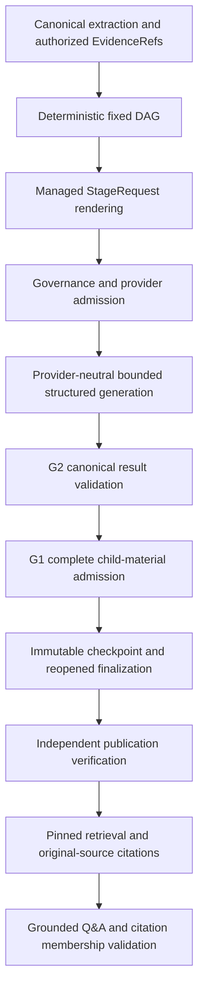

# Phase 17H post-v9 architecture review and inference simplification

10 November 2026. **PASS — POST-V9 ARCHITECTURE REVIEW COMPLETE; IMPLEMENTATION DEFERRED.**

## 1. Executive summary and disposition

Authoritative identifiers should be application-owned. PolyMind already computes
source, stage and positional claim identities, but asks the LLM to reproduce them
and combine immediate-child pair components in canonical output. The historical
failures show three distinct model-output violations of these responsibilities;
they do not establish one internal model cause. Independent application validation
correctly rejected each invalid response.

Recommend a small generation-wire model plus deterministic constructor, with
request-bound source keys, atomic child-pair keys and application-assigned current
stage/claim identities. Keep canonical `stage-result/1`, original evidence,
G1/G2, publication/retrieval, Q&A, governance and the four-call benchmark. Do not
add another orchestration framework or depend on the researched projects.

Implementation is deferred because the proposed wire-to-canonical transformation
needs an explicit audited request/table/response/checkpoint association. Bare
`E1`/`C1` keys do not provide cross-request isolation, and the existing checkpoint
does not contain a proposal/table/decoder receipt. A preferred additive receipt
design can probably avoid checkpoint migration; its crash/replay/commit and
generation-inventory binding must be reviewed before activation. This is a design
decision about the new evidence contract, not a claim that a decoder inherently
requires a database migration. The supplied task explicitly requires deferral
where durable storage or approval binding must be redesigned. No such redesign
was silently introduced, and no intermediate prompt-only release was created.

**Actual changes are three documentation files only.** There is no decoder,
active wire contract, prompt change, new generation version or runtime hardening
implemented by this task. V9 remains active, including its source enums. The
[initial assessment and separate critical self-review](../../adr/phase_17h_post_v9_generation_wire_assessment.md)
contain the detailed proposed boundary. The [scope record](../prompts/phase_17h_post_v9_architecture_review_and_inference_simplification.md)
preserves the task restrictions.

## 2. Verified starting state and review coverage

Actual HEAD matches `6e0319e29984ad019edced0e076b3b0a4ae8c007`, on `master`.
Entry status had **16 modified tracked files and 42 untracked files**, including
the completed uncommitted v8/v9 work. The index was empty. A read-only Git/file
inventory captured 491 existing source, test and documentation file hashes under
versioned/nonignored paths, excluding runtime/private trees. No pre-existing file
was selected for editing. This inventory is not a claim to have opened or hashed
private authority databases or all ignored runtime artifacts.

The [complete v9 report](phase_17h_v9_source_identity_reliability_and_offline_readiness.md)
was read, along with the v5 evidence hardening/sizing, v6 origin diagnosis, v7
identity hardening/execution, v8 lineage hardening/execution and structural sizing
records. The current [Foundry runbook](../../evaluation/phase_17h_foundry_validation.md)
and earlier [identity ADR](../../adr/phase_17hl_application_owned_identifiers_assessment.md)
were inspected. The earlier ADR predates the now-observed origin/lineage/source
failures; its UNKNOWN attempt-4 diagnosis is preserved as historical, not rewritten.

Implementation and consumers inspected include:

| Boundary | Principal files/functions |
| --- | --- |
| Extraction/source authority | `documents/extraction.py`, `documents/models.py::EvidenceRef/stable_id`, `digestion/models.py::SourcePiece.evidence_id` |
| Deterministic DAG and sizing | `documents/digestion/planning.py::build_plan/check_request/reduce_group`, `sizing.py::analysis_size/child_contribution/reduction_size` |
| Generation and transport | `documents/digestion/managed.py::generation_schema/render/analyze`, `llm/azure_schema.py::provider_schema`, `llm/openai_compatible.py::execute`, `llm/structured.py` |
| Acceptance/recovery | `documents/digestion/codec.py`, `validation.py::validate_result/validate_child_material/inherited_summary/make_digest`, `workflow.py::DigestionHandler`, `documents/jobs/worker.py` |
| Publication/retrieval | `documents/publication/planning.py::accepted/records`, `service.py::PublicationReader/PublicationService`, `retrieval.py::PublicationReplica` |
| Grounded Q&A | `documents/publication/analysis.py::DocumentAnalysis.analyze` |
| Governance/evaluation binding | `governance/execution.py::GovernedExecution`, `llm/admission.py`, `tests/performance/foundry_l1.py::generation_contract_digest/LaunchConfiguration`, `foundry_preflight.py`, `foundry_approval.py` |
| Historical/permanent tests | `tests/fixtures/digestion_contracts/`, source/claim/child/sizing tests and synthetic L1/failure/recovery/publication suites |

## 3. Current v9 execution architecture and limitations

Extraction produces immutable scoped evidence containing document version,
extraction, source, block and offset/line information. A source evidence UUID is
derived deterministically from that EvidenceRef. The plan binds configuration,
structure, chunks, reduction nodes and immutable inputs before admission.



G1 checks the full escaped ChildInput contribution, including immutable artifact
reference, inherited metadata, required child pairs and source metadata. G2 checks
current identity, positional IDs, membership, duplicates, coverage, fact support
contracts, qualification sources and exact child-pair authority. Finalization and
publication reconstruct/revalidate the accepted graph; provider success alone
cannot create a publishable digest.

V9's strict schema authorizes the sorted unique union of current SourcePiece IDs
and immediate-child claims' direct supporting/contradicting IDs. One shared
SourceEvidence definition serves direct, contradictory and qualification arrays.
At most 256 IDs are split into at most two 128-ID enum branches. Empty authority
uses null items, whose intersection with canonical UUID fields permits only empty
reference arrays. Null elements are still invalid application output.

Strict mode omits duplicate schema/source lists from CONTROL; prompt modes retain
them. Stored models and G2 remain generic and independent. A schema-conforming
strict response cannot select a foreign source UUID, but can choose a wrong
authorized source, omit coverage, duplicate a reference, produce incorrect current
identity or mix child pairs. Prompt modes retain UUID-copying risks. Exact new-v9
Azure schema acceptance and downstream live L1 compliance remain unverified.

## 4. Historical Azure failure analysis

This review used preserved engineering/execution evidence and permanent synthetic
regressions. It did not reopen private raw live responses, credentials, signing
keys or operational ledgers. Exact private reconstruction was already performed
in the historical reports; those observations are attributed to those reports.

| Failure | Actual recorded violation | Architectural contributor and uncertainty |
| --- | --- | --- |
| Earlier v5 first reducer, exposed by v6 sizing replay | All eight positional IDs correct; all eight origins equal the child stage | Model reproduced inherited origins instead of current generation metadata. No application ID-algorithm mismatch was found. Historical excess sizing was a separate earlier rejection. |
| V7 root | Eight current origins/IDs correct; eight pairs combine immediate reducer stage with chunk claim IDs; `invalid_child_link` | Pair components and multiple hierarchy levels were visible independently. Individual UUID validity does not authorize a relationship. Internal reason remains unknown. |
| V8 first chunk | Foreign UUID at `claims[6].evidence_ids[1]`; all four allowed IDs also appear elsewhere; `foreign_evidence` | Provider schema allowed arbitrary source strings. Returned UUID groups match parts of two allowed IDs; intended source cannot be determined or repaired. No child ambiguity exists in this chunk. |

The [v7 live record](phase_17h_v7_controlled_four_call_execution.md) reports three
provider-successful calls, two accepted checkpoints and no accepted root,
publication or Q&A. The [v8 live record](phase_17h_v8_controlled_four_call_execution.md)
reports one provider-successful call, no accepted checkpoint and settled known
usage. These are historical observations, not new calls or renewed authorizations.
Neither failure was demonstrated to be caused by prompt injection, network
serialization, model intent or a common internal model mechanism. V9's exact
source enums address the unconstrained source-value domain, not every failure.

## 5. RAPTOR source findings

Inspected commit `7da1d48a7e1d7dec61a63c9d9aae84e2dfaa5767` through read-only
public GitHub access. [Node/Tree](https://github.com/parthsarthi03/raptor/blob/7da1d48a7e1d7dec61a63c9d9aae84e2dfaa5767/raptor/tree_structures.py)
store text, integer indices, child-index sets, embeddings and layer dictionaries.
[TreeBuilder.create_node/build_from_text](https://github.com/parthsarthi03/raptor/blob/7da1d48a7e1d7dec61a63c9d9aae84e2dfaa5767/raptor/tree_builder.py#L158)
assigns leaf indices in application code, embeds source chunks and builds layers.
The model does not return node IDs or edges.

[ClusterTreeBuilder.construct_tree/process_cluster](https://github.com/parthsarthi03/raptor/blob/7da1d48a7e1d7dec61a63c9d9aae84e2dfaa5767/raptor/cluster_tree_builder.py#L55)
summarizes cluster text, then constructs a parent with the known cluster members'
indices. Nominal summary calls equal the sum of created clusters across layers;
leaf embedding and parent embedding calls are additional operations. Construction
stops according to configured layers and clustering population, not a mandatory
summary call for every source leaf. Some model adapters include retries, so this
nominal count is not a hard paid-attempt bound.

[TreeRetriever.retrieve_information_collapse_tree/retrieve_information](https://github.com/parthsarthi03/raptor/blob/7da1d48a7e1d7dec61a63c9d9aae84e2dfaa5767/raptor/tree_retriever.py#L158)
retrieve across all levels or descend selected parents' child indices using
embeddings. Retrieval itself does not require another summary call.
[RetrievalAugmentation.answer_question](https://github.com/parthsarthi03/raptor/blob/7da1d48a7e1d7dec61a63c9d9aae84e2dfaa5767/raptor/RetrievalAugmentation.py#L263)
passes retrieved context to a separate QA model.

Useful principle: application-owned identity/topology and optional multilevel
retrieval. PolyMind must retain selected claim-level support rather than attach
all cluster members to every generated statement. Clustering, soft membership,
pickle persistence, extra embedding/model packages and automatic retries are not
appropriate replacements for its scoped immutable graph or budgets. Adapting the
ownership principle is low complexity; adopting RAPTOR's pipeline would be high
complexity and unnecessary. [MIT license](https://github.com/parthsarthi03/raptor/blob/7da1d48a7e1d7dec61a63c9d9aae84e2dfaa5767/LICENSE.txt)
was inspected; no implementation was copied.

## 6. wdoc source findings

Inspected commit `e3cb2dc4e78a3cdb9db7d6be235659c23bb9a0da`.
[summarize_documents/_summarize](https://github.com/thiswillbeyourgithub/wdoc/blob/e3cb2dc4e78a3cdb9db7d6be235659c23bb9a0da/wdoc/utils/tasks/summarize.py#L123)
process source chunks sequentially with previous-summary context, retain intermediate
summaries by recursion level and optionally split/condense earlier summaries until
the configured bound or convergence. Nominal calls are the initial chunk count
plus the counts at each executed recursive pass; caching may avoid some calls,
whereas fallback/retry paths can add attempts. This is not simply a balanced
tree with one map and one root invocation.

[summary_task and task dispatch](https://github.com/thiswillbeyourgithub/wdoc/blob/e3cb2dc4e78a3cdb9db7d6be235659c23bb9a0da/wdoc/wdoc.py#L650)
retain summary results and expose query methods over loaded source documents and
reused embeddings. At this revision, the combined-task initialization branch logs
a switch to query, whereas the ordinary query-execution loop is in the sibling
else branch. That control flow is not evidence that combined initialization
automatically completes a query. Explicit query_task uses the source-document
retrieval path; no inspected code establishes that summarize_then_query indexes
the generated summary as authoritative source evidence. Its query path
can evaluate documents, generate intermediate answers and combine them in batches;
it is not necessarily cheaper than PolyMind's retrieved single Q&A call.

[get_splitter/ChonkieSemanticSplitter](https://github.com/thiswillbeyourgithub/wdoc/blob/e3cb2dc4e78a3cdb9db7d6be235659c23bb9a0da/wdoc/utils/misc.py#L752)
allocate chunks according to token/context heuristics; recursive summary splitting
reserves a fraction of context and overlap. [create_parent_retriever](https://github.com/thiswillbeyourgithub/wdoc/blob/e3cb2dc4e78a3cdb9db7d6be235659c23bb9a0da/wdoc/utils/retrievers.py#L45)
stores parent/child documents programmatically. The query path also constructs
WDOC_N source labels around selected intermediate answers. These are useful
examples of local source labels and reusable intermediates, not evidence that
arbitrary labels supply authorization or exact immutable claim lineage.

A particularly relevant incompatibility is automatic page-citation insertion in
[_summarize](https://github.com/thiswillbeyourgithub/wdoc/blob/e3cb2dc4e78a3cdb9db7d6be235659c23bb9a0da/wdoc/utils/tasks/summarize.py#L780):
missing bullet citations can be supplied from chunk metadata. PolyMind must reject
missing explicit selections rather than adopt that behavior. Summary cleanup,
retry-without-cache and query retries are also unsuitable as evidence repair or
paid retry policy. Reuse/convergence principles are moderate-complexity future
planning ideas; the full package is unnecessary. [AGPL-3.0 license](https://github.com/thiswillbeyourgithub/wdoc/blob/e3cb2dc4e78a3cdb9db7d6be235659c23bb9a0da/LICENSE)
was inspected; only independently expressed design principles are used here.

## 7. LangChain source findings

Inspected commit `1b8828043b185fb0d9e15f5e5c79f0f694b39230`.
[BaseMedia/Document](https://github.com/langchain-ai/langchain/blob/1b8828043b185fb0d9e15f5e5c79f0f694b39230/libs/core/langchain_core/documents/base.py#L34)
separate content from optional IDs and arbitrary application metadata; they do
not enforce scoped immutable provenance by themselves.
[MapReduceDocumentsChain.combine_docs](https://github.com/langchain-ai/langchain/blob/1b8828043b185fb0d9e15f5e5c79f0f694b39230/libs/langchain/langchain_classic/chains/combine_documents/map_reduce.py#L224)
maps model text over documents, creates new Document objects and copies original
metadata in Python before reduction. This directly supports separating generated
content from application metadata. Classic chains at this revision are legacy/
deprecated APIs; this review does not recommend migrating PolyMind into them.

[split_list_of_docs/collapse_docs/ReduceDocumentsChain._collapse](https://github.com/langchain-ai/langchain/blob/1b8828043b185fb0d9e15f5e5c79f0f694b39230/libs/langchain/langchain_classic/chains/combine_documents/reduce.py)
partition using a supplied length function, recursively collapse while oversized,
then invoke the final combination. Nominal calls are N map generations plus
necessary collapse groups and one final combine. The implementation exposes
collapse retry behavior that must not replace PolyMind's fixed no-retry budget.
Its default metadata merging converts values to strings and concatenates matching
keys; that loses typed pair structure and is unsuitable for ClaimLink authority.

[BaseChatModel.with_structured_output](https://github.com/langchain-ai/langchain/blob/1b8828043b185fb0d9e15f5e5c79f0f694b39230/libs/core/langchain_core/language_models/chat_models.py#L2407)
and [PydanticOutputParser](https://github.com/langchain-ai/langchain/blob/1b8828043b185fb0d9e15f5e5c79f0f694b39230/libs/core/langchain_core/output_parsers/pydantic.py)
illustrate schema parsing and retention of raw/parsed errors. A parsed Pydantic
object still does not establish request-specific source membership or semantic
support. Keep PolyMind's existing provider port and independent G2 rather than
add another structured-output stack. Adapting the metadata/content boundary is
low complexity; adopting chain machinery adds unnecessary maintenance.
[MIT license](https://github.com/langchain-ai/langchain/blob/1b8828043b185fb0d9e15f5e5c79f0f694b39230/LICENSE)
was inspected; no code or dependency is added.

## 8. AI Document Assistant source findings

Inspected commit `0e5fd7bc55409aa13a2a9dbfd4df97dec73be468`.
[Assistant](https://github.com/prakash22-26/ai-document-assistant/blob/0e5fd7bc55409aa13a2a9dbfd4df97dec73be468/src/chatbot.py)
owns extract/chunk/embed/store/summarize and chat, shared by
[FastAPI](https://github.com/prakash22-26/ai-document-assistant/blob/0e5fd7bc55409aa13a2a9dbfd4df97dec73be468/api.py)
and [Streamlit](https://github.com/prakash22-26/ai-document-assistant/blob/0e5fd7bc55409aa13a2a9dbfd4df97dec73be468/app.py).
[build_graph](https://github.com/prakash22-26/ai-document-assistant/blob/0e5fd7bc55409aa13a2a9dbfd4df97dec73be468/src/graph.py)
uses question understanding, retrieval and answer nodes with injected LLM/store.
It may spend a separate rewrite call when history warrants it. With no hits it
returns an application abstention without answer generation.

[load_pdf/chunk_document](https://github.com/prakash22-26/ai-document-assistant/blob/0e5fd7bc55409aa13a2a9dbfd4df97dec73be468/src/chunking.py)
and [VectorStore.add_chunks/similarity_search](https://github.com/prakash22-26/ai-document-assistant/blob/0e5fd7bc55409aa13a2a9dbfd4df97dec73be468/src/vector_store.py)
keep document/chunk/page/source metadata in Python/Chroma and filter retrieval
by document ID. The graph formats retrieved page labels for the LLM, then derives
the returned source-page list from retrieved hits. This does not independently
verify each generated statement's citation or provide PolyMind-equivalent
owner/tenant, immutable offset, governance, reservation or replay controls.

[summarize_document/_make_batches/_reduce_summaries](https://github.com/prakash22-26/ai-document-assistant/blob/0e5fd7bc55409aa13a2a9dbfd4df97dec73be468/src/summarizer.py)
uses a direct call below 15,000 characters, 5,000-character map batches and
6,000-character reduction input. Large reductions may use an intermediate group
pass followed by a final call. These are heuristic character thresholds, not
PolyMind's complete serialized context guarantee; _make_batches does not itself
split an individually oversized item. Calls use a retry helper, unsuitable for L1.

Useful principles are one injected application service, simple graph nodes,
programmatic metadata, direct small-document processing and bounded batching.
PolyMind already has the service/provider boundaries; replacing FastAPI,
Streamlit, Chroma or LangGraph would add churn. Algorithmic adaptations are low to
moderate complexity, but provenance/authorization must remain PolyMind's. The
inspected [repository tree](https://github.com/prakash22-26/ai-document-assistant/tree/0e5fd7bc55409aa13a2a9dbfd4df97dec73be468)
has no license file and repository metadata reports no license. Public visibility
is not assumed to grant code-reuse rights; no code is copied.

## 9. Recommended application-owned evidence, identity and lineage

The application should continue owning authoritative source UUIDs and immutable
EvidenceRefs. The model needs a selection vocabulary, not responsibility for
reconstructing those UUIDs. Recommend strict string namespaces E1..En for source
selections and C1..Cm for exact immediate-child pairs; integers are marginally
smaller but introduce boolean/numeric coercion hazards and poorer audit readability.
Use request-specific enums in strict mode and identical fail-closed decoding in
prompt/non-strict modes. This preserves or strengthens v9 membership enforcement;
it does not remove the generic independent G2 check.

Source ordering is canonical sorted UUID order using exactly v9 authority.
Pair ordering is the bound plan's child order followed by each accepted child's
stored claim order. Qualification-only ancestor evidence never expands the direct
table. Maps are immutable per request, derived from authorized plan/extraction
and verified child hashes, never globals or completion-order collections.

Each C key resolves an indivisible pair; the model cannot independently choose
a valid stage component and an unrelated claim component. The application
resolves only selected relationships. Missing all-child coverage, duplicate keys,
grandchild keys, cross-child mixtures and source IDs used as child keys fail.
Qualification inheritance remains through existing child links and immutable
claims; there is no invented canonical qualification-lineage field.

The generated ordered claim list retains substantive content, kind/status,
subject/stance, source selections, qualifiers, contradictory selections, child
selections, questions and limitations. The constructor supplies current kind,
stage, schema version, origin and `stable_id(str(stage_id), str(position))`.
It never invents/reorders/drops claims or rewrites historical IDs. Unavailable
analysis still requires empty claims and explicit limitations; empty analyzed
analysis remains invalid. All bounded claim limits and downstream sizes still apply.

Citation publication/Q&A consumes resolved canonical EvidenceRefs, never E/C
aliases. Original block spans, line offsets, excerpts and source meaning are
unchanged. A valid key proves membership only; an incorrect but authorized
selection remains a model semantic error requiring independent review.

## 10. Wire model, deterministic decoder and audit/recovery decision

One provider-neutral proposal model and one constructor at the managed/domain
boundary are sufficient; no parallel orchestrator is proposed. Before constructing
StageResult, validate bounded raw bytes, unique JSON object keys, required fields,
exact types, wire version, request binding, collection bounds and exact reference
membership/uniqueness. Resolve explicit selections, construct current identities,
then run unchanged G2 and complete child-material admission. The generic canonical
model and all existing publication readers can remain unchanged.

A transplanted response containing E1 can otherwise select a different source
under another request's E1. Therefore the decoder's trusted input must include a
verified envelope/receipt binding exact raw-response hash to exact request/table
manifest, plan/stage and decoder version. For detached model wire, an exact
request-binding field is an alternative; a singleton hash is a consistency value,
not authentication or proof of intent. Wrong valid selections made within the
correct binding remain semantic errors. No decoder can infer where an unbound
bare key was intended to point.

The preferred no-migration design derives tables from immutable inputs, records
an additive immutable per-call proposal receipt and links it to the accepted
canonical artifact in audit. It must specify response-versus-checkpoint commit
order, orphan receipts, crash windows, idempotent replay, lease fencing and
receipt verification after restart. Generation digest must cover every decoder/
mapping source. An unlisted imported helper would escape the current fixed
15-file source inventory. Existing approval schema need not gain a new credential
or mutable table, but new generation bindings and receipt verification semantics
must be reviewed together. Embedding receipts into a new checkpoint version is
a broader alternative and is deferred explicitly.

The separate self-review found no reason to relax source authorization, G2 or
financial controls, but did identify this unresolved two-representation audit
decision. That is why the recommended migration is documented instead of
activated here. Simply replacing UUID strings and claiming request isolation
would be incomplete. No unknown-reference repair, automatic coverage filling,
new paid fallback or hidden evidence selection is acceptable.

## 11. Architecture alternatives and decision matrix

The following are prospective engineering judgments, not measured model
acceptance probabilities. F is a planning axis that can later combine with E.

| Criterion | A: v9 unchanged | B: more schema constraints | C: source keys | D: source + atomic pair keys | E: semantic wire + app IDs | F: adaptive map-reduce |
| --- | --- | --- | --- | --- | --- | --- |
| Structural reliability | Source enum benefit; other copying remains | Singleton origins help; exact positions/pairs harder | Removes source UUID reproduction | Also removes pair mixing | Removes current/claim ID reproduction too | Fewer exposure points possible; larger stages may fail more |
| Original provenance | G2 scoped source authority | Same | Exact table resolution + G2 | Same | Same; no invented evidence | Must preserve full source coverage |
| Immediate lineage | G2 rejects wrong pairs after generation | Independent enums insufficient | Unchanged pair risk | Atomic authorized pairs | Atomic pairs plus app-owned current IDs | Topology/root expectations change |
| Semantic attribution | Not proved | Not proved | Wrong valid key still possible | Wrong valid pair still possible | Same semantic responsibility | Compression can omit nuance |
| Maintenance | Lowest | Low for origins; grows for pair unions | Moderate mapping/decoder | Moderate extension of same decoder | Moderate coherent boundary; audit integration needed | Higher planning/publication review |
| Token efficiency | Measured v9 baseline | May increase schema | Shorter repeated source selections | Shorter pair output too | Removes identity instructions/output fields | Saves calls only where semantic reduction is unnecessary |
| Provider compatibility | Current converter; exact Azure v9 unverified | New composition needs review | Existing enum subset; exact schema new | Same | Exact wire schema and completion behavior new | Same port, different envelopes |
| Historical compatibility | Already preserved | New generation binding | Canonical models can stay | Canonical models can stay | Explicit new wire; old readers stay | New planning profile; no old-plan rewrite |
| Governance | Existing controls | Preserve controls | Bound maps are not authorization | Same | Receipt/code binding required | Recompute calls/reservations; exclude controlled L1 |
| Offline testability | Existing full suite | Deterministic schema/G2 tests | Membership/isolation/replay | Add exact pair/coverage tests | Constructor/raw/canonical/recovery tests | DAG/cost/coverage strategies |
| Migration risk | None now; live risks remain | Low-moderate | Moderate | Moderate | Moderate generation-to-audit change | High relative to current task |

**Selected direction is E with C/D inside a single constructor**, rather than
three separate active migrations. B is a valid interim containment option, but
retains most opaque-output bookkeeping and would require another version before
the recommended wire change. A remains the active baseline during deferral.
F is separately deferred because it changes planning/cost/publication assumptions.

## 12. Inference simplification and framework assessment

Source/stage/claim authority, positional candidates and required pairs are
serialized alongside child results containing earlier identities. A generation
projection can present substantive child claims and local keys without requiring
the model to reproduce immutable artifact metadata or canonical origin fields.
Keep the complete wrapper as application authority and keep semantically relevant
qualifications/conflicts visible. Removing metadata from model output must not
remove canonical admission accounting or inherited graph traversal.

The current reduce_group loop emits a reduction even for a single child at a
structural unit, then another at root. Some such calls compress or produce a
distinct section/document synthesis; a pure wrapper need not be a semantic model
operation. In a new ordinary-production policy, small documents could use direct
analysis plus grounded retrieval/Q&A, medium documents chunk analysis plus one
reduction, and larger documents recursive bounded fan-in. Structure and measured
context/coverage needs should determine depth. Reuse already accepted intermediates
under exact source/configuration/plan hashes and current authorization. More
aggressive batching may hurt evidence selection or overflow, so fewer calls are
not automatically better.

Do not replace a reducer by programmatically writing prose or attaching all
children to a fabricated claim. A future planner could eliminate a redundant
node before admission, but that changes deterministic plan/stage identities,
published section/root expectations and cost reservations. The existing controlled
L1 intentionally tests both reducer levels and remains **chunk → first reducer →
root → Q&A**, maximum four calls, zero paid retries and no fallback. No production
strategy or paid benchmark sequence is changed.

FastAPI and Streamlit remain justified API/UI boundaries; existing Chroma/hybrid
retrieval retains original-source indexing; LangGraph remains the conversational
orchestrator. Digestion already uses a fixed-plan durable executor. No framework,
microservice, database, Kubernetes/AKS resource or cloud service is needed for a
generation constructor. Their wholesale replacement would increase scope/risk.

## 13. Fresh production serialization and sizing analysis

Measurements below invoke unchanged v9 renderers, canonical serialization,
the real strict converter and OpenAI-compatible execute request builder with
injected fake HTTP. No network or model executes. The complete conservative
envelope includes nested system/data/schema escaping; provider HTTP size differs
because conversion strips generation annotations. `json=` default serialized
HTTP-body length was also measured separately from compact canonical length.

| Empty-material profile | System UTF-8 | Data | Generation schema | Converted schema | Complete envelope | Compact HTTP / requests JSON bytes |
| --- | ---: | ---: | ---: | ---: | ---: | ---: |
| Chunk | 4,159 | 91 | 2,850 | 1,871 | 7,222 | 6,488 / 6,681 |
| Intermediate | 4,176 | 91 | 2,850 | 1,871 | 7,239 | 6,505 / 6,698 |
| Structural | 4,185 | 91 | 2,850 | 1,871 | 7,248 | 6,514 / 6,707 |
| Root | 4,188 | 91 | 2,850 | 1,871 | 7,251 | 6,517 / 6,710 |

Empty chunk material is a render-only fixed-envelope diagnostic, following the
production profile measurement mechanism; it is not an admissible analysis
request or accepted empty analysis. Planner base remains **7,379**, including
128 schema-scaffolding bytes. One/two-child empty-path reservations remain
**14,379 / 21,379**, so two children leave **3,421 path bytes** under 24,800.
Input estimate adds 200 overhead/safety; complete context adds 3,200 including
the reserved output. These are conservative byte-based token estimates, not
tokenizer measurements or provider-billed usage.

For 36 additional diagnostic reducer cases, complete native-extraction children
were created through existing test helpers, validated and stored in disposable
stores. All intermediate/structural/root profiles were rendered for one/two
children and empty, ordinary, quote/backslash/newline, Unicode and exact ASCII
path boundaries. Children here retain their original plain_result content; they
differ from the shorter-prose witnesses in the historical v9 report.

| Root example | Complete envelope | Planner input | Child contributions | Compact HTTP | Result |
| --- | ---: | ---: | --- | ---: | --- |
| One child, empty path | 13,355 | 14,379 | 6,112 | 12,621 | Admit |
| Two children, empty path | 19,130 | 21,379 | 5,948 each | 18,396 | Admit |
| Two children, ordinary path | 19,142 | 21,391 | 5,948 each | 18,408 | Admit |
| Two children, escaped or Unicode path | 19,162 | 21,411 | 5,948 each | 18,428 | Admit |
| Two children, 3,417 ASCII path chars | 22,551 | 24,800 | 5,948 each | 21,817 | Admit |
| Two children, 3,418 ASCII path chars | 22,552 | 24,801 | 5,948 each | 21,818 | Reject |

The one-child canonical result/wrapper are 5,108/5,668 bytes; two-child cases
use 5,030/5,590 each. Inherited-summary metadata uses 144 bytes per child;
immediate-child pair counts are respectively one/two in these particular plain
witnesses. The last rejection is deliberate conservative planning admission even
though diagnostic serialized bytes fit. No reservation is weakened to force fit.
Maximum complete child acceptance at 6,999/7,000 and rejection at 7,001, escaped
paths and Unicode exact boundaries remain independently covered by permanent
tests in the fresh suites. The eight-claim 4,783-canonical/6,867-child witness
and synthetic four-call workflow remain separate quality/lineage regressions.

Source cardinality measurements use real distinct one-character spans from
native text extraction, preserving source metadata and exact source IDs:

| Authorized source count | Generation / converted schema | Complete envelope | HTTP compact bytes | Checked L1 admission |
| --- | ---: | ---: | ---: | --- |
| 0 | 2,850 / 1,871 | 7,222 | 6,488 | Empty analysis invalid |
| 1 | 2,900 / 1,921 | 7,402 | 6,668 | Admit |
| 4 | 3,017 / 2,038 | 7,912 | 7,178 | Admit |
| 128 | 7,853 / 6,874 | 28,992 | 28,258 | Reject input |
| 129 | 7,931 / 6,952 | 29,201 | 28,467 | Reject input |
| 256 | 12,884 / 11,905 | 50,791 | 50,057 | Reject input |

The schema cardinality bound is not a promise that a full request fits L1.
At 256 the serialized source-data list alone is 28,929 bytes; deduplicated source
authority list is 9,985 bytes, embedded once in strict schema. This identifies
real metadata growth without claiming the limits should be increased. The
permanent schema tests reject 257 before provider execution and test both enum
branches, empty authority and independent G2 duplicate/coverage rejection.

Three exact copying-instruction spans measure **249 source + 345 identity +
254 pair bytes = 848 prose bytes**. Isolating their removal and the four current
identity/control fields from the empty renderer reduces its nested envelope by
1,305 bytes for chunk and 1,306 for reducer profiles. This is a measured removal
opportunity only: it excludes replacement instructions, tables, request binding,
new wire schema and projected child data, so it is **not** an implemented net
saving or a measured inference performance improvement.

A quoted UUID scalar uses 38 compact JSON bytes versus 4 for E1 or 6 for E256;
a canonical stage/claim pair object uses 101 bytes versus 4 for C1. These are
serialization arithmetic, not end-to-end savings. Canonical storage remains full
size and proposal binding/table input has a cost. No active v10 schema/payload
exists, so net wire savings, actual completion tokens, billing, latency and
model-acceptance improvements are deliberately unclaimed. Limits and costs are
unchanged by this documentation-only task.

## 14. Offline validation and coverage boundary

Fresh validation is recorded below. Historical v9 counts are
not substituted for current results. Full/focused selections overlap and are not
added. Both use the existing pre-collection socket/DNS denial plugin, disabled
plugin autoload/cache, isolated application settings and disposable stores.

```bash
PYTHONDONTWRITEBYTECODE=1 PYTEST_DISABLE_PLUGIN_AUTOLOAD=1 \
  PYTHONPATH=.:/tmp/phase17h-g1-g2 python -m pytest \
  -p offline_guard -p no:cacheprovider \
  --basetemp=/tmp/phase17h-post-v9-review/full \
  --junitxml=/tmp/phase17h-post-v9-review/full.xml \
  -o junit_family=xunit1 -q
```

The focused command uses the same flags with separate `focused` directories and
these twelve modules: source_reference_schema, source_identity_workflow,
claim_stage_identity, claim_stage_identity_workflow, direct_child_lineage,
direct_child_lineage_workflow, managed_prompt9_sizing,
reducer_sizing_reconciliation, managed_prompt9_contract,
phase17hl_offline_e2e, final_offline_azure_compatibility and publication/test_analysis.

| Fresh check | Actual result |
| --- | --- |
| Full offline pytest, command above | Exit 0; **2,206 passed**: 1,501 unit, 705 integration; zero failures/errors/skips; **467.31 seconds**; zero network attempts |
| Twelve-module focused selection | Exit 0; **357 passed**: 131 unit, 226 integration; zero failures/errors/skips; **168.31 seconds**; zero network attempts |
| Supplemental production-builder sizing diagnostic | Exit 0; four fixed profiles, 36 reducer/path cases and six source-cardinality cases; zero network attempts |
| Critical Ruff `E9,F63,F7,F82` | Exit 0, all checks passed for digestion/publication modules and strict schema/structured ports |
| Scoped mypy | Exit 0; no issues in five baseline source/test files; skipped import following, ignored missing imports, explicit package bases, project Python interpreter |
| Whole-repository `python -m compileall -q .` | Exit 0; external `PYTHONPYCACHEPREFIX`, no ownership changes |
| `docker compose config --quiet` | Exit 0; no services started |
| `git diff --check` | Exit 0 |
| Initial-file hash comparison | All **491** inventoried pre-existing files unchanged |
| V9 renderer source fingerprint | `6ed23248084f4f31fb6fcc16dcf25baceb54db9d55396c3fef8f9df49b9f85df`, matches unchanged v9 fixture |

The full suite reports one existing OpenTelemetry SelectableGroups deprecation
warning in the real local Chroma test; focused tests report no warnings. JUnit
independently confirms counts. Mypy checked managed.py and the source-schema,
v9-sizing, v9-contract and source-workflow modules using the installed
`/home/home/.pyenv/versions/iberian_shakti/bin/mypy` executable with the project
Python selected through `--python-executable`. This is scoped baseline checking,
not an unrestricted repository-wide typing claim. No new Python module needs
format validation; no Docker rebuild is applicable to documentation-only changes.
Logs, XML and diagnostic measurements are retained under
`/tmp/phase17h-post-v9-review/` outside the checkout.

The exercised baseline includes foreign/mixed UUIDs, wrong claim/stage evidence,
qualifications/contradictions, duplicates/coverage, identity/order, atomic G2 pair
rejection, multilevel inheritance, strict converter/builder, historical v5-v9,
chunk/reducer/root failure boundaries, accepted checkpoints, restart/replay,
known-usage settlement, no automatic retries/fallback, invalid-digestion publication
denial, original-source citations and synthetic four-call L1 with eight claims.
These tests establish **unchanged v9 application behavior**. They do not test
nonexistent E/C decoding or claim assignment. The mandatory proposed migration
test matrix remains required before implementation: malformed/unknown/cross-bound
keys, exact type/uniqueness, missing source/child coverage, maximum/empty claims,
canonical expansion limits, request/table order determinism, detached-response
replay refusal, receipt crash/recovery, historic binding refusal, all source
offsets/qualifiers/conflicts, settlement and no downstream work after rejection.

## 15. Local model-behavior assessment

Read-only local inspection found an Ollama executable but an empty standard model
manifest directory. Hugging Face cache entries include embedding/reranking,
translation, ASR, BERT, and a DistilBART summarization model. The apparent
Llama-2-70B cache entry has no config, safetensors/bin weights or GGUF files.
DistilBART is not a suitable chat/instruction model for strict schema/reference
selection. Cache names alone are not proof of a loadable constrained-generation
model. No suitable local instruction-model installation was verified in the
standard locations inspected; no local inference, service start, download or
package installation was attempted. This is not an exhaustive search of every
custom model directory or Docker image.

Once a suitable model is independently available, propose a bounded offline
experiment: pin model/config/tokenizer hashes and request corpus; deny external
network; compare v9 and the implemented wire contract on the same synthetic
chunk, first-reducer, root, cross-child, qualified and contradictory cases.
Use a fixed maximum of twelve paired prompts (24 local generations), fixed
seeds/settings, bounded context/output/time and zero regeneration on failure.
Record first-pass schema membership, G2 acceptance, evidence/pair selection
correctness against authored labels, coverage, byte expansion, truncation and
local latency. Keep semantic wrong-but-valid selections in the denominator.
Replay tests use deterministic application validation, not a model prompted to
simulate application checks. This plan is not executed and predicts neither
the exact Azure deployment's schema acceptance nor its model compliance.

## 16. Historical compatibility and security/governance review

All v5-v9 source snapshots/fingerprints, accepted result semantics and existing
historical compatibility tests remain unchanged. Current generation SHA-256 is
independently recomputed as:

```text
managed-prompt/9
f270aa81cbd5764d2b4739bf3ac3692653b1fe4c8ffbd67860e642137cb2579d
```

There is no new generation fingerprint. A future change must freeze complete v9
source first, use a fresh version, include constructor sources in its inventory
and explicitly refuse incompatible historical settings/plans/launch bindings.
Readable historical evidence is not reusable execution authority. No historical
checkpoint, signature, approval, replay marker, reservation or settled row is
rewritten or reset.

Mapping membership is not source authorization. Future mapping inputs must have
passed the same authenticated operator, principal/owner/tenant, RBAC, source and
publication authorization boundaries. A source key cannot grant access to another
document or promote generated child material into original source evidence.
Current Scoped EvidenceRefs, immutable ObjectRefs and exact plan/child bindings
remain authoritative; reconstructed keys are never accepted on syntax alone.

Known provider usage must remain settled before a decoder/domain failure, with
unknown usage conservatively retained. Financial reservation, approved inference
ceilings, independent signature/configuration verification, replay consumption
and run/admission accounting stay separate from generated prose and constructor
success. No new approval credential, policy relaxation, limit increase or retry
path is proposed. Audit receipt design must add evidence rather than replace
existing immutable raw response hashes or historical observations.

This task uses no production authority constructors, Azure login/credential
retrieval, paid calls, signing key, approval generation/consumption or cloud
mutation. Existing tests exercise disposable synthetic auth/signature fixtures;
that is not operator authentication/signing or live authorization. No Kubernetes
or AKS operation, Docker build, model download or dependency change occurs.
Compose validation is configuration-only.

## 17. Separate self-review and pre-commit review

The initial design was critically reviewed separately for hidden authorization
bypass, silent repair, source meaning changes, citation laundering, key collisions,
ordering, coverage, restart consistency, provider-specific storage leakage and
strict-schema compatibility. The significant findings are recorded in the ADR:
bare local keys cannot prove request identity; proposal-to-canonical audit binding
is new; wire bytes cannot substitute for canonical child admission; qualification
inheritance cannot expand direct authority. These findings motivate deferral,
not relaxed validation. No independent human/sub-agent review is claimed.

The final pre-commit review inspects this task's entire three-file documentation
delta independently of inherited work. It checks secrets/credentials/key blocks,
private source identifiers/raw provider prose, absolute production paths, debug/
temporary files, stale TODOs, dependencies, unsupported implemented claims, links,
API drift and whitespace. Public source-code excerpts were inspected but never
imported or executed. Diagnostic scripts, fetched sources, disposable SQLite,
logs, JUnit, bytecode cache and measurement JSON stay outside Git.

An initial measurement helper tried to instantiate an invalid empty analysis
request; it was corrected to use the production fixed-envelope render-only
pattern. No application validator changed. The generic mypy shim was unavailable
in the project environment, so the already installed mypy executable from the
other local environment was used with the project interpreter. Neither incident
is counted as a successful check, and no dependency was installed.

## 18. Further work before another paid Azure attempt

First decide whether to evaluate preserved v9 or complete the proposed wire/receipt
engineering phase. This review does not authorize either live path. If wire work
is selected, resolve the immutable receipt/replay/accepted-checkpoint association,
freeze v9, implement the small constructor under a new generation version,
retain G1/G2, complete permanent negative/positive and synthetic four-call tests,
recalculate complete schemas/payloads/child expansions and pin the new full digest.
Do not pay for another prompt-only retry as evidence of that unimplemented design.

For either selected exact contract, a separate operator-preparation phase needs
deployment/schema capability review, fresh deterministic plan/source/configuration
bindings, current authenticated operator/scope/permissions, financial/admission
headroom, current deployment/shared-consumer evidence, practical credential/window,
unused replay identity and a new independently approved configuration. Separate
RSA authorization/signature verification and separate paid-execution authorization
remain necessary. Reusing a consumed approval or treating historical remaining
calls as continuation rights is prohibited.

Schema acceptance would be observed on the first chunk of that separately
authorized four-call evaluation, with immediate termination on rejection. No
additional paid schema probe, retry or alternative evaluation path is authorized
or required by this report.

The exact new-v9 strict schema has still not been submitted under this task.
Full live hierarchical L1, publication/retrieval, grounded Q&A and independent
semantic/citation quality remain unverified. Deterministic offline passes support
engineering confidence only; local model observations, if later obtained, are a
third separate evidence class. Phase 17H remains open.

## 19. Final file manifest and Git status

New task files:

- `docs/adr/phase_17h_post_v9_generation_wire_assessment.md` — initial assessment,
  proposed mapping/wire/constructor boundary and separate critical review.
- `docs/codex/prompts/phase_17h_post_v9_architecture_review_and_inference_simplification.md`
  — clean task scope/restriction record.
- `docs/codex/reports/phase_17h_post_v9_architecture_review_and_inference_simplification.md`
  — research, decisions, measurements, validation and disposition.

Production-source changes: **none**. Test changes: **none**. Dependency,
configuration, runtime storage, approval schema and historical documentation
changes: **none**. All existing uncommitted source/test/docs work is preserved.

Final read-only `git status`/`git diff --stat` inspection confirms branch `master`
and unchanged HEAD `6e0319e29984ad019edced0e076b3b0a4ae8c007`.
There are **16 modified tracked files and 45 untracked files**, compared with
16/42 at entry: exactly these three new Markdown files were added. Every one of
the 491 inventoried original files is byte-identical; historical source fixtures,
reports and existing uncommitted tests are preserved. The staged diff is empty.

Final tracked `git diff --stat` is unchanged from entry:

```text
16 files changed, 275 insertions(+), 87 deletions(-)
```

That statistic describes inherited uncommitted work and excludes this task's
three untracked documents. It must not be attributed to a new implementation.
No stage, commit, push, branch/tag/history or remote mutation occurred.

Git staging: **NO**. Git commit: **NO**. Git push: **NO**.
Azure inference: **NO**. RSA signing: **NO**. Approval consumption: **NO**.
