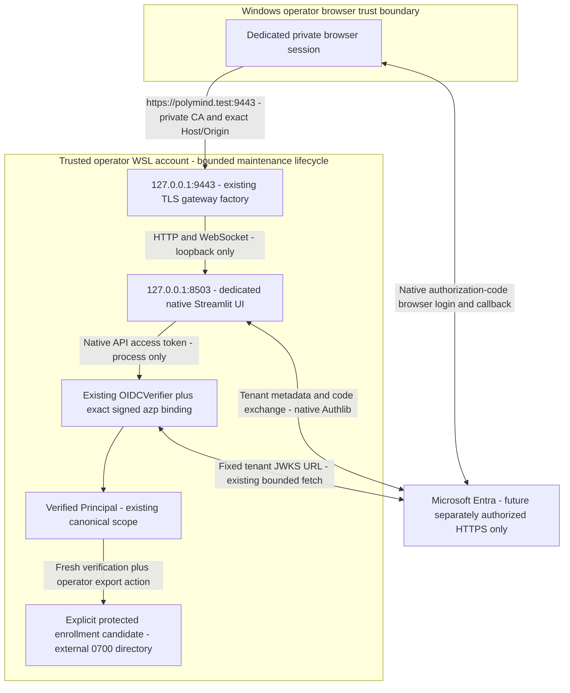

# Phase 19B — Local Identity Bootstrap Utility

27 November 2026. Offline engineering implementation and operator handoff.
**Operational Gate A remains BLOCKED. Actual Entra authentication is NOT_AUTHORIZED.**
Phase 19A COMPLETE; Phase 19B ACTIVE; Phase 19C NOT_STARTED.

## 1. Executive summary

A dedicated local maintenance utility breaks the engineering dependency between obtaining the
real API access-token subject and constructing the production runtime. It runs native Streamlit
behind the existing private TLS gateway on WSL loopback, verifies the native API token through
the existing OIDCVerifier plus an exact bootstrap browser-client binding, reuses verified
Principal canonical identity, and exports only explicitly authorized protected enrollment
candidate evidence. It never initializes production or enrolls a principal.

The existing five-service topology, authority schemas, production verifier, gateway factory,
Chat/Documents, provider boundary and financial/execution contracts are unchanged. No shared
production source, dependency, Dockerfile or Compose artifact changed. No local image build,
Azure activation, operational credential access or actual authentication occurred. The future
operator procedure is executable preparation, not executed operational evidence. Native execution
provides application-level input/environment separation, not a new OS filesystem or egress sandbox.

## 2. Repository and CI baseline

Complete root AGENTS.md was read; repository file discovery found no applicable nested AGENTS.md.
All required initial Git commands exited 0: `git status --short --branch`, `git rev-parse HEAD`,
`git log --oneline --decorate -10`, `git diff --stat`, `git diff --check`, and
`git diff --cached --name-only`. Initial tree/index were clean; status only
`## master...origin/master`. HEAD and local origin/master matched supplied checkpoint
**b5f16926100ca1712f85c39f5fc579fbad88829d**. No fetch/history/index mutation occurred.

Read-only `gh run view 45926112597 --repo Susanta2025-lab/estudio-polymind-llm-orchestration
--json headBranch,status,headSha,conclusion,event,name,startedAt,updatedAt,url` independently confirmed
[Estudio PolyMind CI](https://github.com/Susanta2025-lab/estudio-polymind-llm-orchestration/actions/runs/45926112597),
master checkpoint SHA, push, success, start 2026-11-27T02:03:50Z, updated 02:15:36Z; interval
11m46s. This validates the committed baseline, not the new uncommitted utility. Initial sandbox
network failure was followed by the execution-approved read-only command; no Azure/Entra call.

Last ten checkpoint subjects, in order: operational/Gate A reconciliation; OIDC preparation;
private HTTPS configuration; post-Azure evidence reconciliation; Phase19B foundation; local
launchers; Streamlit module-collision fix; Phase18 closure; authenticated document frontend;
Phase18 frontend/Azure readiness. The supplied baseline is accurate, with no intervening work.

## 3. Confirmed dependency and existing contracts

Inspected `security/identity.py`, `security/models.py`, `security/runtime.py`, `api/security.py`,
`deployment/phase19/runtime.py`, `storage.py`, `__main__.py`, `ui.py`, `gateway.py`, native secrets
inventory, reusable `ui/tls_gateway.py`, both native token consumers, Phase19 Compose, Docker
packaging/dependencies, local launchers, Entra/operations/evaluation docs and existing security/
deployment/UI tests. The preceding operational report's Gate A matrix, dependency analysis,
operator decisions, conditional Gates B–E and status/addendum govern remaining live gates;
private HTTPS and OIDC preparation reports retain their historical evidence.

RuntimeManifest requires nonempty exact enrollment and at least one SourceApproval. `build`
derives owner/tenant before security runtime/provider construction and requires every approved
source owner to match. Standard Compose waits for API health before UI, then UI before gateway.
Middleware can register an already verified principal only after API construction; it cannot
acquire the pre-initialization subject. Existing synthetic Documents issuer/fixtures and live
Foundry launcher are not an approved same-browser identity-only acquisition path. OIDCVerifier
can verify an acquired token without authorities but does not acquire it. The dependency and
absence of a supported acquisition workflow were therefore independently confirmed.

No `up --no-deps`, placeholder enrollment, fixture identity, ID-token/oid substitution or weakened
readiness is used. Production initialization stays gated on legitimate complete inputs.

## 4. Alternatives evaluated

| Criterion | A: native WSL (selected) | B: isolated Docker Compose | C: existing path |
|---|---|---|---|
| Isolation | Explicit child HOME/cwd/env, loopback, dedicated paths; trusted UID/root | Stronger possible mount/UID/rootfs/capability boundary | Production path requires initialization; synthetic issuer is ineligible |
| Credential custody | Operator-controlled temporary native files, no transfer/service mount | Additional secret mounts/UID mapping and container custody | Existing production secrets contract cannot solve startup cycle |
| Windows/callback | Reuses origin/registration; current NAT TCP reachability tested | Loopback publish needs separate Docker Desktop/WSL acceptance | Standard UI/gateway cannot become healthy first |
| Native OIDC/TLS/verifier | Existing installed dependencies/factories directly reused | Same code but needs bootstrap image/topology/provenance | Verifier reusable; secure acquisition/export/lifecycle absent |
| Footprint/complexity | One bounded launcher/worker, no image/network/volumes | Extra build/project/network/mount/teardown contracts | No sufficiently secure implemented complete mechanism |
| Reproducibility/tests | Fixed ports/trust, explicit input checks, synthetic native/TLS tests | Feasible in principle; not built/tested | Reuse of fixtures/live token CLI would violate scope |
| Production-state access | No authority imports/connections; no production path inputs | Could deny mounts more strongly | Production construction requires the missing owner/source |
| Browser/token risk | Dedicated private window, ephemeral cookie, cleanup; signed token cookies | Same browser-cookie risks remain | No reviewed minimized candidate export |
| Maintenance/teardown | 15-minute window, sibling shutdown, private file cleanup | More lifecycle components without needed benefit | Would need new functionality anyway |

Option A is the smallest sound implementation with existing dependencies and reported WSL
custody. Option B is architecturally feasible, but not selected, implemented, started or claimed
validated; it would not remove cookie/callback/operator-acceptance obligations. Option C cannot
meet requirements without the new bounded composition. Native isolation limitations remain
explicit rather than being disguised as container or destination-firewall guarantees.

## 5. Selected architecture, trust and networking



The implementation uses fixed approved non-secret tenant/API/browser anchors in bootstrap core;
it is not a configurable token-inspection platform. Browser Host remains polymind.test:9443,
WebSocket Origin remains https://polymind.test:9443, callback remains /oauth2callback and leaf
SAN DNS:polymind.test. TLS minimum 1.2; gateway enforces exact Host/Origin including missing WS
Origin denial, strips spoofed forwarded headers, sets no-store/security headers and Secure
cookies, forwards OAuth callback normally and sanitizes upstream connection failure as 503.
Production factory and entrypoint are unchanged.

`wslinfo --networking-mode` required execution approval after a sandbox syscall denial; actual
result **nat**. An execution-approved temporary Python listener at 127.0.0.1 on an ephemeral port
received only `synthetic-loopback` from native Windows PowerShell/.NET TcpClient connecting to
127.0.0.1; Windows exit 0. Listener/thread closed. No Windows configuration/store/key was read
or changed. This independently proves current Windows-to-WSL TCP reachability only, not browser
TLS, registered callback or OIDC acceptance. The operator must freshly check Windows and WSL
9443 before bootstrap/tunneling: distinct listener namespaces cannot be fully excluded by a WSL
bind. No external-interface listener, public forwarding or firewall exception was introduced.

The launcher holds the callback socket continuously before starting Streamlit and passes it
directly into aiohttp SockSite. 8503 is checked first and explicitly selected in Streamlit;
Streamlit itself must bind successfully, then health is checked while its child remains alive.
The internal port check is advisory: trusted same-account programs must not race the bind.
No automatic port selection or public bind fallback exists. Trusted local/root interference
cannot be eliminated by a native application; stop on Windows/WSL endpoint ambiguity.

## 6. Implementation inventory and lifecycle

| New implementation | Responsibility |
|---|---|
| `deployment/phase19/identity_bootstrap/__init__.py` | Inert package; importing starts nothing |
| `__main__.py` | Explicit check/serve, private input/TLS preflight, loopback reservation, native worker, bounded supervision |
| `core.py` | Fixed trust/native-config validation, existing verifier composition, exact azp, minimal schema |
| `files.py` | Descriptor-relative private Linux path/file validation and exclusive atomic export |
| `ui.py` | Native access-token selection, sanitized verification/export/logout states; no API client |

The only public lifecycle commands are `check <session> <evidence>` and separately authorized
`serve ... --authorize-entra`. Internal `_ui` is the supervised worker, not a standalone supported
operator workflow. No ordinary launcher/Compose hook, service registration or automatic restart.
Check is non-operational and performs no discovery/login/JWKS/authority construction. Serve
bounds startup to 30 seconds, then 900 seconds after HTTPS readiness; Ctrl-C/SIGTERM initiate
cleanup, gateway shutdown is bounded and the child receives TERM then KILL after five seconds
if needed. Gateway cleanup failure still reaches child cleanup. Uncatchable kill/host failure
requires operator reconciliation of scoped child/listeners and files; no guaranteed crash cleanup.

## 7. Native OIDC integration and pinned session behavior

Inspected installed Streamlit 1.58.0 `auth_util`, `user_info`, Starlette auth routes/server
configuration/session middleware/WebSocket origin implementation, bootstrap interface and
Authlib nonce handling. New code uses the same unnamed native `[auth]` contract, native
`st.login()`/`st.logout()`, and `st.user.tokens.get("access")` already used by production views.
No alternative OAuth implementation, token acquisition CLI or HTTP bearer-token input exists.
Native metadata/code exchange is not called by offline preflight or test login mocks.

Native Streamlit/Authlib owns OAuth state/nonce, authorization-code exchange and S256 PKCE when
provider metadata advertises it. Tests do not prove the actual tenant advertises PKCE or accepts
this client/secret/callback. Native user/token cookies are signed with itsdangerous, not encrypted;
access/ID-token data can be carried in the native token cookie even though only access is exposed
to this UI. Cookie names include `_streamlit_user`, `_streamlit_user_tokens`, optional chunks and
a separate OAuth session cookie. User/token cookie max-age is 30 days, HttpOnly/SameSite=Lax;
reused gateway adds Secure. Streamlit restores cookies across tabs; logout/new session does not
prove every existing tab logged out or provider-token revocation. Native API-token lifetime is
independently checked on every render/export; login state alone is never accepted.

## 8. Token-verification contract and browser binding

Existing OIDCSettings/OIDCVerifier enforce configured tenant-specific public-cloud v2 issuer/
JWKS, bare API UUID audience, RS256/trusted key/header/size/strength/cache bounds, issuer, tid,
ver=2.0, delegated space-delimited access_as_user, exact permitted role set PolyMind.L1Operator,
user identity, integer iat/nbf/exp ordering/current validity and nonempty subject. Existing
restrictions were preserved exactly; there is no newly invented maximum token-age policy or
clock leeway. ID/app/Graph/wrong-audience/malformed/extra-role tokens fail. OIDCVerifier catches
raw transport/key/claim errors into fixed authentication_required, without response bodies.

Production verifier does not check azp. Bootstrap requires it to equal the dedicated browser
client. It first calls existing verifier successfully, then parses that **same immutable string's
already cryptographically verified payload** to inspect azp. No standalone unsigned/unverified
claim path can produce a principal, candidate or UI success. This avoids modifying a shared
production interface simply to return another claim. Wrong/missing/malformed azp fails closed;
production verification semantics/permissions remain unchanged. Tests inject signed fixtures
and local fetch functions only; operational fetch remains the existing fixed HTTPS client.

## 9. Canonical identity derivation and equivalence

OIDCVerifier returns the existing sealed Principal. Its `scope.tenant` is
`stable_id('polymind-identity/1/tenant', issuer, tenant_identity)` and `scope.owner` is
`stable_id('polymind-identity/1/owner', issuer, tenant_identity, subject)`. Bootstrap uses these
fields directly. No algorithm/domain duplication, shared extraction or authority construction.
Tests compare fixed formulas, stable/domain-separated outputs and the actual production build
scope AST expression evaluated with pure Scope/stable_id only; production runtime is never
imported for this comparison. oid and unrelated ID-token data do not change scope; a different
API sub changes owner. Different tenant/issuer domains remain separated. RuntimeManifest and
production source-owner/enrollment validation are unchanged and covered by existing regressions.

## 10. Enrollment-candidate schema and secure export

Schema `phase19b-enrollment-candidate/1`, purpose `phase19b_identity_bootstrap`, exact fields:
issuer, tenant_id (directory tenant UUID), subject (API access-token sub), canonical_tenant_id,
canonical_owner_id, api_audience, verified_at_utc, token_expires_at_utc, execution_authorized=false,
plus schema_version/purpose. Only minimum identity evidence is serialized, with no raw token,
secret, cookie, authorization code, full payload/headers, email/name or oid.

Operator chooses a new approved absolute evidence directory on the terminal, then explicitly
checks authorization/selects export. No browser-supplied destination or automatic export.
Export requires literal boolean True and reverifies the current token immediately before writing;
it never exports a cached principal. Directory validation rejects Git, /mnt, relative/traversal,
symlink components, foreign ownership/writable ancestors and incompatible filesystem. Targets
must be operator-owned 0700; regular inputs/final artifact must be 0600 and one hard link. Existing
secure local_filesystem validation is reused; stricter descriptor traversal is local to this
utility rather than changing production private_path semantics.

O_EXCL/O_NOFOLLOW pending-file creation locks concurrent exports. Buffered complete write and
file fsync precede atomic link publication to fixed enrollment-candidate.json; link refuses every
existing final inode, including symlink/FIFO/directory/hardlink. Inode-checked cleanup removes
only this attempt's pending file; directory fsync records lifecycle. Ordinary errors and tested
KeyboardInterrupt do not expose partial final JSON. A crash after link/before unlink can leave
two links; fsync uncertainty can leave a complete candidate despite a reported error. Future
preflight refuses nonempty evidence. Trusted operator reconciliation, never blind retry or
automatic deletion, is mandatory. No claim of authenticity/independent approval/current validity
is made by a file hash or this unsigned artifact. Later enrollment requires protected provenance
and separate authorization; no candidate importer or production manifest writer was added.

## 11. Credential custody and browser/session isolation

No operational OIDC/TLS/CA/SSH/provider/`.env`/encrypted archive was inspected, decrypted, copied,
modified or used by Codex. All files exercised here were synthetic. The future runbook provides
operator-only GPG-to-stdin preparation, exact config validation, a fresh session-specific
CSPRNG cookie and exclusive private native TOML/leaf-key writes. Original encrypted configuration,
Entra secret and independently generated production cookie remain unchanged. No CA key is needed.

The separate cookie is a deliberate bounded maintenance exception, not rotation of production.
It prevents bootstrap signatures being accepted by production; stale same-origin cookies still
require explicit site-data cleanup. Dedicated private window, no competing tabs, logout, all
polymind.test site-data/chunk cleanup, browser closure, process/listener verification and exact
temporary plaintext removal are required. Tokens remain in native cookies/process memory as part
of native auth; no memory erasure, secure deletion, refresh or provider-revocation guarantee.
UI stores only owner binding/export status, clears it when identity changes or verification fails,
and never displays the subject/claims. Repeated/concurrent exports cannot overwrite evidence.

## 12. Network and filesystem isolation

Offline runner supplies a whitelist environment, fake HOME, offline/telemetry-off flags,
PYTHONDONTWRITEBYTECODE, OMP=1 and no inherited operational/provider/proxy settings. Existing
tests/conftest isolation disables implicit dotenv before collection. A temporary sitecustomize
guard denies external DNS/connect/connect_ex and non-loopback socket bind, while allowing scoped
loopback/Unix traffic. Tests inject synthetic JWKS/tokens; no dependency download or real discovery.
The subprocess integration explicitly blocks network/database calls and forbidden transitive
imports and restricts writes to the descriptor-relative pending evidence name.

Operational child environment is constructed afresh; HOME/cwd point only at the dedicated
session, native secrets.files is singular, no config.toml/extra files are allowed, and no provider
variables or `.env` loader are used. TLS credentials are read with no-follow descriptors and
passed to OpenSSL through anonymous Linux memfd paths mode 0600, avoiding a path reopen and
extra disk plaintext. Read/creation code closes descriptors on failure. No production roots,
mounts, authority names, provider inputs or execution clients are accepted.

These are application restrictions and test guards, not a production OS sandbox/firewall.
Trusted account/root can access other files/networks. For future authentication, native Entra
metadata/code exchange and fixed JWKS need HTTPS; browser needs Entra login/MFA resources and
the approved local origin. Destination-level operational egress is not established by this task:
use reviewed host/network controls or dedicated workstation/account as needed. Windows endpoint
ownership, browser trust, conditional access and manual revocation remain operator prerequisites.

## 13. Threat/failure analysis and zero-inference evidence

| Threat/failure | Denial or bound | Remaining trust/limit |
|---|---|---|
| Wrong token/client/tenant/role/claim | Existing verifier plus signed azp; no fallback | Actual Entra exchange untested |
| ID/oid/name substitution | Native access slot, API aud/scope, sealed Principal domains | Issuer/API/browser configuration must remain approved |
| Stale cookie/tab or expired token | Ephemeral cookie, render/export verification, identity-state clear | Dedicated window/site cleanup; no global revocation |
| Token/identity diagnostics | No claim display/export/token args, sanitized UI, discarded child/access logs | Native browser cookies/process memory remain sensitive |
| Export overwrite/races/partial data | Descriptor traversal, exclusive pending, fsync + atomic link, inode cleanup | Trusted UID/root; crash uncertainty reconciled privately |
| Production fallback/import | Import/SQLite/network/write guards on complete synthetic flow | Entire native account is not sandboxed |
| Public/spoofed browser endpoint | Loopback binds, fixed origin, exact Host/WS Origin | Windows namespace check/owner coordination still required |
| Port/child/upstream failure | Callback reservation, exact native port, health/alive supervision, 503 | No untrusted local process may race UI bind |
| Shutdown error/timeout | Nested cleanup, bounded gateway, TERM/KILL child | Host crash/SIGKILL requires scoped reconciliation |
| Consent/secret/PKI failure | Fixed configuration; no registration/provisioning mutation | Stop instead of changing tenant/client/permissions |

Instrumented fresh subprocess imports bootstrap core/files/UI/launcher, rejects production API,
config.settings, llm/rag/memory/governance/redis/chromadb, security runtime/authority/execution/chat,
operator/pilot/publication/SQLite job and production runtime modules, denies SQLite/network, then
executes invalid-token denial, signed verification, explicit UI candidate export and logout.
Write audit permits only this pending evidence artifact. Actual native worker startup/health/
shutdown is tested separately under external-network denial. Production fixture authorities in
other regression tests are synthetic and do not constitute operational state initialization.

Observed bootstrap production API starts/authority constructors/writes, Redis/Chroma connections,
provider construction/requests/inference, financial reservations and execution permissions: **0**.
No forbidden import triggers a fallback. No operational state root was supplied or accessed.

## 14. New unit/component/synthetic integration verification

Final new suite: **88 passed, 0 failed, 0 errors, 0 skipped; 2 warnings; 20.85 seconds**, exit 0.
Unit/component file has 85 cases; integration file has 3 cases. Counts overlap full regression.
Coverage includes signed valid/invalid claims/keys/algorithms/azp/JWKS; exact actual production
scope expression; stale same-token expiry before export; explicit authorization/schema/privacy/
permissions/links/unsafe paths/inputs/partial errors/KeyboardInterrupt/concurrency; native AppTest
login/config/access-slot/ID-only/expiry/logout/reruns/identity-change/no subject disclosure.

Real loopback integration uses synthetic leaf trust, TLS context, callback forwarding, Secure/
no-store headers, exact Host/Origin denial, missing/foreign WebSocket Origin, actual WS echo,
wrong-host TLS denial, occupied port, unavailable upstream and listener release. Existing TLS
regressions add trusted-chain/default-root denial, unsafe origin and missing/invalid credentials.
A supplemental loopback TLS test additionally passed a distinct synthetic CA → signed leaf
chain using root-only client trust, wrong-host denial and untrusted-root denial: 1 passed,
0 failures/errors/skips/warnings in 0.48 seconds, exit 0. Exact invocation:
`python /tmp/polymind-bootstrap-verification/run.py ca-chain /tmp/polymind-bootstrap-verification/test_ca_chain.py`.
No Windows trust store was changed; this supplementary case is not included in the 88 repository
cases or full-suite count. A real pinned Streamlit child is started, health-checked, bounded and stopped with ports released;
no native discovery/login/token request is made. Synthetic E2E verifies signature → principal →
canonical identity → explicit protected candidate → logout with all forbidden boundaries armed.
This is not actual Microsoft Entra browser OIDC acceptance.

Two warnings are the existing aiohttp NotAppKeyWarning at ui/tls_gateway.py:18, one per new
real proxy/native-startup integration. No warning category was suppressed.

Intermediate results/corrections, retained in temporary logs/XML:

- `initial`: 64 passed/12 failed in 6.27s, exit 1. Sandbox root ownership mapped to UID 65534
  prevented valid-path tests; UI harness also replaced the injected verifier. No production
  ownership rule was weakened. Execution-approved runner resolved host metadata; AppTest now
  injects at the actual render boundary, with cache clearing between fixtures.
- `initial-approved`: 75 passed/1 failed in 6.32s, exit 1; remaining UI harness injection fixed.
- `new-suite`: collection error/exit 2, duplicate unit/integration basename. Integration renamed
  test_identity_bootstrap_flow.py; no repository import mode changed.
- `new-suite-2`: 79 passed/2 warnings in 18.72s, exit 0.
- Engineering review added identity-change state clearing, stronger pending-failure cleanup,
  asynchronous child supervision/finally cleanup and nine focused cases. `reviewed-new` above
  passed all 88. No unrelated tests were changed to hide a failure.
- Initial host-inherited Ruff rules reported 53 findings (exit 1); no repository lint configuration
  exists. Explicit isolated Python correctness/import rules and formatter were applied to new
  files. An isolated fix invocation reported 48 findings (7 fixed, 41 remaining, exit 1); formatting
  resolved E701/E702, and two remaining import findings were fixed before the final passing check.
- An exploratory installed Streamlit module path and a historical routes.py path were absent;
  actual Starlette paths were discovered and inspected. No dependency was added.

## 15. Full regression, commands and environmental limits

Temporary evidence root: `/tmp/polymind-bootstrap-verification` (synthetic data only, outside Git).
The `run.py` wrapper executes existing Python with the network guard/whitelist described above:

```text
python -m pytest -q <selected paths, or none for full suite>
 --junitxml=/tmp/polymind-bootstrap-verification/<name>.xml
 --basetemp=/tmp/polymind-bootstrap-verification/<name>-state
 -o cache_dir=/tmp/polymind-bootstrap-verification/<name>-cache
```

Exact executed invocations:

```bash
python /tmp/polymind-bootstrap-verification/run.py reviewed-new \
 tests/unit/test_identity_bootstrap.py tests/integration/test_identity_bootstrap_flow.py
python /tmp/polymind-bootstrap-verification/run.py focused \
 tests/unit/test_security_entra.py tests/unit/test_security_identity.py \
 tests/unit/test_security_api.py tests/unit/test_phase19_deployment.py \
 tests/unit/test_phase19_tls.py tests/unit/test_phase19_oidc_template.py \
 tests/unit/test_phase19_chat_view.py tests/unit/test_documents_view.py \
 tests/unit/test_ui_api_client.py tests/unit/test_local_apps.py \
 tests/integration/test_phase19_operator.py tests/integration/test_phase19_execution_bridge.py \
 tests/integration/test_phase19_authority_lifecycle.py tests/unit/test_governance.py
python /tmp/polymind-bootstrap-verification/run.py full-final
```

Existing focused regressions: **340 passed, 0 failed/errors/skipped, 4 warnings, 212.98 seconds**,
exit 0. Warnings are the pre-existing aiohttp AppKey advisory in four existing proxy tests.
The earlier full run was deliberately interrupted (exit 130) after reviewed implementation
changes; it is not a completed full result. A fresh full-final run tests the reviewed tree.

Full offline regression: **3,417 passed, 0 failed, 0 errors, 0 skipped; 162 warnings;
1,451.22 seconds (24m11s)**, exit 0. JUnit independently records 3,417 tests, zero
failures/errors/skips and 1,451.137 seconds. This includes all 88 new repository cases and the
3,329 existing baseline cases. Source/test checksums remained unchanged through the full run.
Warnings: 156 existing pytest record_property/xunit2 advisories and 6 occurrences of the
existing aiohttp NotAppKeyWarning at ui/tls_gateway.py:18 (four existing tests, two new proxy
integration tests). No warning category was suppressed or unrelated test changed.

Additional exact commands:

```bash
ruff check --isolated --select E4,E7,E9,F,I deployment/phase19/identity_bootstrap \
 tests/identity_bootstrap_fixtures.py tests/unit/test_identity_bootstrap.py \
 tests/integration/test_identity_bootstrap_flow.py
ruff format --isolated --check deployment/phase19/identity_bootstrap \
 tests/identity_bootstrap_fixtures.py tests/unit/test_identity_bootstrap.py \
 tests/integration/test_identity_bootstrap_flow.py
PYTHONPYCACHEPREFIX=/tmp/polymind-bootstrap-verification/bytecode python -m compileall -q .
docker compose --env-file /dev/null -f docker-compose.yml config --quiet
DOCUMENT_DEMO_ROOT=/tmp/polymind-bootstrap-verification/inert-parser-path \
 docker compose --env-file /dev/null -f docker-compose.documents.yml config --quiet
docker compose --env-file deployment/phase19/compose.env.example \
 -f docker-compose.phase19.yml config --quiet
git diff --check
```

All exited 0; Ruff correctness/import rules pass and eight Python files are formatted. Repository
has no configured Ruff/mypy policy; isolated flags avoid unrelated host-wide lint configuration.
`mypy --version` fails via pyenv shim, exit 127; selected project interpreter has no mypy module.
**Type checking unavailable, not claimed passed; no installation or other environment reuse.**
No image build/topology startup/vendor workload was needed: production packaging/behavior unchanged,
new utility runs native. No operational/real-browser tests ran because authorization is absent.
External-bytecode compilation avoids unrelated ownership changes. No historical focused/full
result is substituted for the fresh regression required here.

## 16. Application image/deployment provenance assessment

| Question | Assessment |
|---|---|
| Does local bootstrap require an image build? | NO; existing native project environment |
| Shared production runtime/factory/config source changed? | NO; only new opt-in package plus tests/docs |
| Would a future Docker build include new files? | YES, COPY . includes maintenance package; tests/docs excluded, README prose differs |
| Existing production behavior changed? | NO; nothing imports/invokes new utility automatically |
| Azure-staged reviewed image must rebuild now? | NO; utility is local and does not alter its required production behavior |
| Is a hypothetical new image byte-equivalent? | NOT_CLAIMED; new package/prose changes image contents |
| Future rebuild/provenance reconciliation? | Required if later choosing to package/deploy utility/new image; separate authorization |

Historical Azure candidate remains `polymind:phase19-reviewed`, image ID
`sha256:9f386acf8bddcb5d01bb028151caae24b5df604f8a56c00b7b39c7e0f8298c02`, source revision
`7bf82dc2da4a9f29561a5f493b690502c0090eb0`. This is historical recorded provenance, not a fresh
Azure/image byte audit. It lacks the new utility, which production does not require. Its prior
operational acceptance limits remain. No Azure image was rebuilt/transferred/overwritten; no
pinned staged Compose/Redis/Chroma artifact was modified or replaced with portable vendor tags.

## 17. Future operator authentication runbook

The [dedicated guide](../../operations/phase_19_identity_bootstrap.md) supplies seven sequential
steps: reviewed revision/regression/environment/Windows and WSL ports/name/trust/SAN/PKI/custody;
operator-controlled GPG stdin restoration with separate cookie/native/TLS private inputs;
non-operational check then separately authorized bounded serve; approved native browser flow;
explicit fresh-verification minimized candidate; logout/site/process/listener/plaintext cleanup
with preserved encrypted originals/production cookie/evidence; and subsequent trusted provenance/
enrollment/source-owner review. Exact commands and preparation script are included.

The script is future operator work only. Source code/snippet syntax and synthetic procedure
validation are separate from operational use. The exact embedded preparation script additionally passed four synthetic checks in 0.53 seconds
(exit 0; no failures/errors/skips/warnings): private provisioning with changed bootstrap cookie
and unchanged synthetic production cookie, placeholder refusal, malformed TOML refusal and
existing-file preservation. Exact command:
`python /tmp/polymind-bootstrap-verification/run.py runbook-approved /tmp/polymind-bootstrap-verification/test_runbook.py`.
Its initial sandbox attempt had 3 passed/1 failed in 0.66 seconds (exit 1), due to the same root
ownership remapping; the approved rerun above passed without relaxing production validation.
Neither the runbook nor `--authorize-entra` grants external authentication permission. No operator is asked to paste identity/evidence/secrets.

## 18. Remaining Gate A blockers

Engineering now supplies a reviewed identity-only path; the real API subject is still unknown.
Separate authorized native Entra/browser/TLS acceptance and protected candidate provenance,
legitimate enrollment and owner-bound approved source are still required. Preserve all remaining
source bytes/hash/rights/classification/privacy/consent/retention, independent semantic review,
session/Chat authorization, provider configuration/custody/capabilities, actual tariff/budget/
shared quota/obligation reconciliation and fresh independent execution approvals. Preserve
independent encrypted recovery custody/restore evidence, manual revocation-risk acceptance,
trusted remote host/transfer prerequisites and separately approved Azure resource/cost/window,
production initialization/private deployment/recovery/capacity/cost/deallocation acceptance.
No historical price, token, source or permission is promoted to current authority.

## 19. Engineering self-review and separate pre-commit review

Engineering review traced both success and failure paths for token slot/cryptography/azp,
Principal derivation, no runtime imports/fallback, native cookie/state lifetime, explicit fresh
export and link/fsync/cleanup races, environment/home/dotenv/transport/lifecycle boundaries.
Findings fixed: stale export status after identity change; ensure child cleanup even if gateway
cleanup raises; async child supervision; capture newly created pending inode before permission
validation so validation failure can clean only that inode. Regression covers reviewed behavior.
No shared extraction/refactor/security relaxation/API contract change was necessary.

A separate pre-commit review inspected all sixteen candidate files, including complete new
source/tests/snippets and tracked documentation diffs. The temporary review checker verifies the
exact 5-modified/11-new inventory, unchanged HEAD, empty index, complete baseline prefixes in
five existing docs, all **217 historical prompt/report files byte-identical**, all **140 local
Markdown links present**, source/snippet syntax, new-file whitespace and no private-key/JWT
payload patterns. Manual review additionally checked authentication/identity/cookie/transport/
export races and crash uncertainty, secrets/.env/provider configuration, local path custody,
debug output, generated/temporary artifacts, dead code/new TODOs, dependencies, unrelated changes
and unintended API/security weakening. No unresolved implementation or candidate-file finding.
Mypy availability, native OS/egress isolation and real-browser/deployment acceptance remain
explicit limits, not silently promoted passes. Exact final checker:
`python /tmp/polymind-bootstrap-verification/review.py` (exit 0).

Current docs use dated append-only addenda in README/Entra/VM/architecture/plan, preserving all
previous text and historical prompt/report records. The new prompt is a clean minimized scope
record, not an operational identity inventory. The guide explains only implemented commands and
future authorized operations. No dependency/image/production configuration changes.

Complete changed-file inventory (5 modified, 11 new; 16 total):

```text
M  README.md
M  docs/security/entra_v2.md
M  docs/operations/phase_19_vm.md
M  docs/evaluation/phase_19_deployment_architecture.md
M  docs/evaluation/phase_19_implementation_plan.md
A? deployment/phase19/identity_bootstrap/__init__.py
A? deployment/phase19/identity_bootstrap/__main__.py
A? deployment/phase19/identity_bootstrap/core.py
A? deployment/phase19/identity_bootstrap/files.py
A? deployment/phase19/identity_bootstrap/ui.py
A? tests/identity_bootstrap_fixtures.py
A? tests/unit/test_identity_bootstrap.py
A? tests/integration/test_identity_bootstrap_flow.py
A? docs/operations/phase_19_identity_bootstrap.md
A? docs/codex/prompts/phase_19b_local_identity_bootstrap_utility.md
A? docs/codex/reports/phase_19b_local_identity_bootstrap_utility.md
```

`A?` means new/untracked, never staged. Final Git handoff below includes tracked diff statistics;
new files are reviewed separately and excluded from ordinary git diff --stat until staging.
Suggested future operator checkpoint: `feat: implement Phase 19B local identity bootstrap utility`.
No commit/push was executed.

## 20. Acceptance gates and final status contract

| Acceptance gate | Offline result and practical limit |
|---|---|
| 1 Baseline/dependency | PASS; exact checkpoint/CI and source-grounded cycle |
| 2 Architecture | PASS; minimal native WSL, no production construction; OS isolation limits stated |
| 3 Native auth/verifier | PASS synthetic/native interfaces; actual Entra acceptance NOT_AUTHORIZED |
| 4 Canonical identity | PASS; existing Principal and actual production scope expression |
| 5 Protected evidence | PASS; explicit fresh verification, minimized atomic exclusive private candidate |
| 6 Runtime isolation | PASS; forbidden imports/network/SQLite/writes armed, zero inference |
| 7 Session/transport | PASS offline components/procedure; current Windows TCP pass, real browser TLS/cookies pending |
| 8 Regression | PASS full 3,417; focused/new/lint/compile/Compose pass; mypy environmental limit explicit |
| 9 Runbook | PASS prepared and synthetic provisioning checked; operational use separately authorized |
| 10 Scope/provenance | PASS; no prohibited external/state action, unchanged production source/staged provenance |

These are **offline engineering acceptance** results. They do not close operational Gate A,
prove actual browser identity or authorize enrollment, VM activity, source approval or inference.

```text
PHASE19B_LOCAL_IDENTITY_BOOTSTRAP_UTILITY: OFFLINE_ENGINEERING_READY_WITH_DOCUMENTED_LIMITS

REPOSITORY_BASELINE: PASS_EXACT_b5f16926100ca1712f85c39f5fc579fbad88829d
LATEST_CI_RECONCILIATION: PASS_EXACT_COMMIT_SUCCESS_45926112597

IDENTITY_BOOTSTRAP_DEPENDENCY_CONFIRMED: YES
ARCHITECTURE_ALTERNATIVES_REVIEWED: A_B_C
SELECTED_BOOTSTRAP_ARCHITECTURE: NATIVE_WSL_LOOPBACK_STREAMLIT_REUSED_TLS_GATEWAY
LOCAL_WSL_WINDOWS_FEASIBILITY: PASS_CURRENT_NAT_SYNTHETIC_TCP_REAL_BROWSER_TLS_PENDING
LOCAL_DOCKER_FEASIBILITY: DESIGN_FEASIBLE_NOT_SELECTED_NOT_EXECUTED
PRODUCTION_RUNTIME_INDEPENDENCE: PASS_SYNTHETIC_IMPORT_NETWORK_WRITE_GUARDS

BOOTSTRAP_IMPLEMENTATION: COMPLETE_OFFLINE_SCOPE
NATIVE_STREAMLIT_OIDC_REUSE: YES_1_58_0_NO_REAL_EXCHANGE
EXISTING_ENTRA_VERIFIER_REUSE: YES_UNCHANGED
BROWSER_CLIENT_BINDING_REVIEW: PASS_BOOTSTRAP_EXACT_VERIFIED_AZP
API_ACCESS_TOKEN_VERIFICATION: PASS_SYNTHETIC_RS256_EXISTING_CONTRACT
WRONG_TOKEN_DENIAL: PASS_OFFLINE
CANONICAL_TENANT_DERIVATION: PASS_EXISTING_PRINCIPAL_SCOPE
CANONICAL_OWNER_DERIVATION: PASS_EXISTING_PRINCIPAL_SCOPE
PRODUCTION_IDENTITY_EQUIVALENCE: PASS_ACTUAL_BUILD_SCOPE_EXPRESSION_NO_RUNTIME_IMPORT

PROTECTED_ENROLLMENT_CANDIDATE_SCHEMA: phase19b-enrollment-candidate/1
EXPLICIT_EXPORT_AUTHORIZATION: REQUIRED_LITERAL_TRUE_AND_UI_ACTION
FRESH_TOKEN_VERIFICATION_BEFORE_EXPORT: PASS
SECURE_EVIDENCE_FILE_CREATION: PASS_DESCRIPTOR_NOFOLLOW_EXCLUSIVE_ATOMIC_PUBLICATION
DUPLICATE_EXPORT_PROTECTION: PASS_CONCURRENT_AND_REPEAT_NO_OVERWRITE
TOKEN_DISCLOSURE_PREVENTION: PASS_NO_UI_EXPORT_LOG_TOKEN_NATIVE_COOKIES_REMAIN_SENSITIVE
SENSITIVE_LOGGING_PREVENTION: PASS_FIXED_MESSAGES_CHILD_AND_ACCESS_LOGS_DISCARDED

PRIVATE_HTTPS_GATEWAY_REUSE: YES_FACTORY_UNCHANGED
TLS_VERIFICATION: PASS_SYNTHETIC_TLS_HOSTNAME_OPERATIONAL_WINDOWS_ACCEPTANCE_PENDING
EXACT_HOST_ENFORCEMENT: PASS_REUSED_FACTORY
WEBSOCKET_ORIGIN_ENFORCEMENT: PASS_EXACT_AND_MISSING_DENIAL
LOOPBACK_ONLY_BINDING: PASS_127_0_0_1
CALLBACK_ENDPOINT_EXCLUSIVITY: PASS_WSL_HELD_SOCKET_WINDOWS_CHECK_REQUIRED

OPERATIONAL_CREDENTIAL_PROVISIONING_PLAN: PREPARED_OPERATOR_ONLY_NOT_EXECUTED
BOOTSTRAP_COOKIE_ISOLATION: EPHEMERAL_BOOTSTRAP_ONLY_PRODUCTION_COOKIE_PRESERVED
SESSION_EXPIRY_HANDLING: PASS_RENDER_AND_FRESH_EXPORT_REVERIFY
LOGOUT_AND_CLEANUP: PASS_SYNTHETIC_RUNBOOK_REAL_BROWSER_CLEANUP_PENDING
NETWORK_ISOLATION: PASS_OFFLINE_GUARD_OPERATIONAL_DESTINATION_FIREWALL_NOT_ESTABLISHED
FILESYSTEM_ISOLATION: PASS_APPLICATION_PRIVATE_PATHS_NOT_OS_SANDBOX

PROVIDER_IMPORT_ISOLATION: PASS_FRESH_SUBPROCESS_FORBIDDEN_IMPORTS_ZERO
PRODUCTION_AUTHORITY_ISOLATION: PASS_IMPORT_SQLITE_WRITE_GUARDS_ZERO
ZERO_INFERENCE_VERIFICATION: PASS_ZERO_PROVIDER_IMPORTS_CALLS_RESERVATIONS
SYNTHETIC_END_TO_END_VERIFICATION: PASS_NO_REAL_BROWSER_ACCEPTANCE

NEW_UNIT_TESTS: PASS_85
NEW_INTEGRATION_TESTS: PASS_3
FOCUSED_REGRESSION: PASS_340_4_WARNINGS_212_98_SECONDS
FULL_OFFLINE_REGRESSION: PASS_3417_0_FAILURES_ERRORS_SKIPS_162_WARNINGS_1451_22_SECONDS
LINT_VERIFICATION: PASS_ISOLATED_CORRECTNESS_IMPORTS_AND_FORMAT_8_PYTHON_FILES
TYPE_CHECKING: UNAVAILABLE_MYPY_ABSENT_NO_INSTALLATION
COMPILATION_VERIFICATION: PASS_EXTERNAL_BYTECODE_CACHE

SHARED_PRODUCTION_CODE_CHANGED: NO
LOCAL_IMAGE_BUILD_REQUIRED: NO_NATIVE_EXECUTION
AZURE_PRODUCTION_IMAGE_REBUILD_REQUIRED: NO_FOR_THIS_LOCAL_UTILITY
AZURE_IMAGE_PROVENANCE_RECONCILIATION: HISTORICAL_ID_PRESERVED_NO_NEW_EQUIVALENCE_CLAIM

LOCAL_AUTHENTICATION_RUNBOOK: COMPLETE_PREPARED_NOT_EXECUTED
DOCUMENTATION_RECONCILIATION: COMPLETE_DATED_ADDENDA
HISTORICAL_RECORD_PRESERVATION: PASS_217_TRACKED_RECORDS_BYTE_IDENTICAL
PRE_COMMIT_REVIEW: PASS_16_FILES_140_LOCAL_LINKS_EMPTY_INDEX

ACTUAL_ENTRA_AUTHENTICATION: NOT_AUTHORIZED
ACTUAL_API_ACCESS_TOKEN_SUBJECT: NOT_ACQUIRED
ACTUAL_RUNTIME_ENROLLMENT: NOT_PERFORMED
ACTUAL_CREDENTIALS_ACCESSED_BY_CODEX: NO

AZURE_VM_ACTIVATED: NO
AZURE_OPERATIONS_PERFORMED: NO
ENTRA_MUTATIONS: NO
REMOTE_SSH_CONNECTIONS: 0
PRODUCTION_AUTHORITIES_INITIALIZED: NO
REAL_PROVIDER_REQUESTS: 0
REAL_INFERENCE_CALLS: 0
FINANCIAL_RESERVATIONS: 0
EXECUTION_PERMISSIONS_CREATED: 0
PUBLIC_EXPOSURE_INTRODUCED: NO

GATE_A_ENGINEERING_DEPENDENCY_RESOLUTION: OFFLINE_IMPLEMENTED_VERIFIED_READY_FOR_OPERATOR_REVIEW
GATE_A_OPERATIONAL_CLOSURE: BLOCKED
GATE_A_REMAINING_BLOCKERS: REAL_IDENTITY_ENROLLMENT_SOURCE_PRIVACY_REVIEWS_PROVIDER_CAPABILITIES_FINANCE_QUOTA_OBLIGATIONS_EXECUTION_CUSTODY_BACKUPS_REVOCATION_RISK_REMOTE_TRUST_TRANSFER_LIVE_ACCEPTANCE

GIT_STAGED: NO
GIT_COMMITTED: NO
GIT_PUSHED: NO

PHASE19A_STATUS: COMPLETE
PHASE19B_STATUS: ACTIVE
PHASE19C_STATUS: NOT_STARTED

NEXT_AUTHORIZED_OPERATOR_ACTION: REVIEW_OFFLINE_IMPLEMENTATION_AND_RUNBOOK
NEXT_ACTION_READINESS: READY_FOR_OPERATOR_REVIEW_SEPARATE_AUTHENTICATION_AUTHORIZATION_REQUIRED
```

## Final validation addendum and Git handoff

Final offline implementation is frozen and all required available checks above passed;
full-suite execution exit 0 was obtained before handoff. All five new runtime modules and three
new test/helper files match reviewed-source.sha256; no executable changes followed the full
run. Final pre-commit/history/link/whitespace review passes with an empty index and unchanged
checkpoint HEAD. Compilation/lint/format/three inert Compose parser results remain valid.
The four runbook and one distinct-CA supplementary cases passed separately; no live validation
was substituted. Type checking remains unavailable in the approved environment.

The remaining action is operator review of the uncommitted implementation and runbook. A real
local authentication session requires its own authorization and current prerequisites. No
actual credential/token, production authority, Azure/SSH/provider operation, financial
reservation or execution permission was used/created. No commit or push occurred. Operational
Gate A BLOCKED; Phase 19B ACTIVE; Phase 19C NOT_STARTED. Stop at this handoff.

```text
$ git status --short --branch
## master...origin/master
 M README.md
 M docs/evaluation/phase_19_deployment_architecture.md
 M docs/evaluation/phase_19_implementation_plan.md
 M docs/operations/phase_19_vm.md
 M docs/security/entra_v2.md
?? deployment/phase19/identity_bootstrap/
?? docs/codex/prompts/phase_19b_local_identity_bootstrap_utility.md
?? docs/codex/reports/phase_19b_local_identity_bootstrap_utility.md
?? docs/operations/phase_19_identity_bootstrap.md
?? tests/identity_bootstrap_fixtures.py
?? tests/integration/test_identity_bootstrap_flow.py
?? tests/unit/test_identity_bootstrap.py
exit 0

$ git diff --stat
 README.md                                           | 14 ++++++++++++++
 docs/evaluation/phase_19_deployment_architecture.md | 20 ++++++++++++++++++++
 docs/evaluation/phase_19_implementation_plan.md     | 19 +++++++++++++++++++
 docs/operations/phase_19_vm.md                      | 19 +++++++++++++++++++
 docs/security/entra_v2.md                           | 18 ++++++++++++++++++
 5 files changed, 90 insertions(+)
exit 0

$ git diff --check
(no output)
exit 0

$ git diff --cached --name-only
(no output)
exit 0
```
