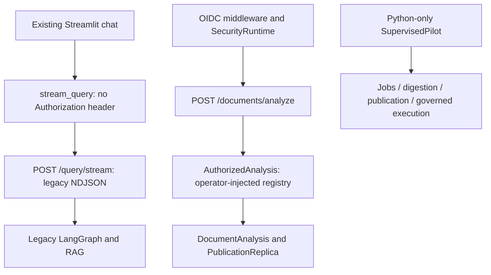
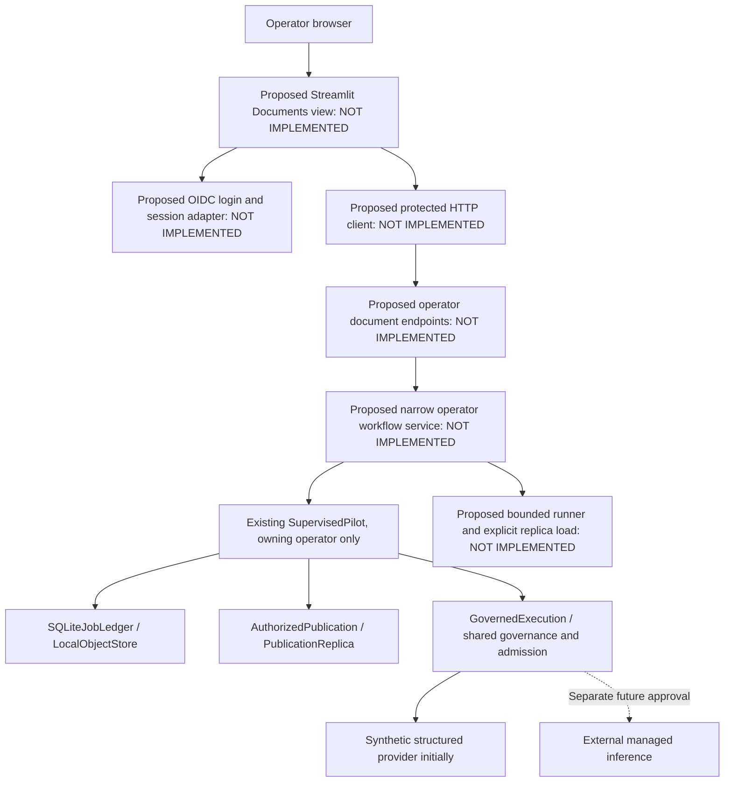

# Phase 18.1 — Frontend and API integration decision

Assessment date: 13 November 2026. Baseline: `faaddc271f5e3165e4707e72a0309cc1784a4c48`.
Decision proposed for operator review; no interfaces below have been implemented by this assessment.
Stage 18.1 assessment is complete; 18.2 Implementation and Verification and 18.3 Documentation and Closure are NOT STARTED.

## Decision and alternatives

Recommend **Option A: extend the existing Streamlit application with a separate Documents view**, initially accessible only to a verified owning operator. Run it locally with FastAPI, one controlled execution lane, synthetic sources/providers and existing single-host authorities. The product boundary is a private operator demonstration. This reuses Option C's bounded operating model without introducing a second application stack. Keep the existing Chat view and its legacy contracts intact; hide/disable that view in the OIDC document profile because the API intentionally denies its query routes.

| Criterion | A — Extend Streamlit | B — Dedicated web frontend | C — Small separate operator interface |
| --- | --- | --- | --- |
| Integration effort | Reuse Python environment, settings, requests, layout; add protected client and Documents view | Same backend integration plus frontend build, typed client, routing and authentication stack | Reuse Python services or FastAPI templates, but a second presentation surface |
| Security | Server-side API bearer calls; explicit per-session isolation and token/cookie review required | Opaque-cookie backend-for-frontend is a strong future option; introduces CSRF/session service and deployment work | Narrow operator allowlist is feasible; direct facade access still needs real identity and output guards |
| UX | Forms, status polling, expanders, source excerpts and Q&A fit; reruns require idempotency | Best flexibility for accessibility, complex citation panes and eventual multiple users | Adequate demonstration; fewer navigation/accessibility features and likely later replacement |
| Reliability | Backend owns jobs; reruns/reconnect cannot trigger work; polling survives tabs closing | Same backend lifecycle; client events cannot substitute for durable state | Operator-driven progression is simplest but weak unattended recovery |
| Infrastructure/maintenance cost | No new frontend runtime family; same image may initially run UI/API separately | Additional Node/build/dependency maintenance; hosting cost depends on static versus server rendering | Small templates/static client may be cheaper initially; duplicate UI has continuing cost |
| WSL/Docker/Kind | Existing Python/Docker workflow; optional Kind smoke test | Additional toolchain and images; compatible but more setup | Compatible, but no existing deployment for it |
| Azure/private AKS | UI service plus private API; backend persistence remains the real blocker | Compatible; neither React nor Next.js solves authority distribution | Compatible as private operator service; no public-product implication |
| Maintainability | Small protected client/service boundary can later support another frontend | Justified after multi-user/product requirements demonstrate need | Risk of demo-only coupling to privileged internals |
| Relative effort | About 12–20 focused engineer-days | About 22–35 days with a mature frontend skill set | About 8–14 days for a narrower result |
| Product readiness | Useful private synthetic document experience; external product deferred | Can support richer product later, but implementation alone does not establish readiness | Private demonstration only |

These are planning ranges, not delivery commitments: one engineer with Codex, existing test tooling, no issuer changes/cloud migration, working pinned dependencies, one owner/document lane, curated files, polling and non-streaming document Q&A. Authentication compatibility, recovery and negative security tests dominate uncertainty. Adding distributed Azure authorities is a separate substantial requirement and is excluded from the Stage 18.2 estimate. No new frontend framework is justified by the initial workflow.

## Existing and proposed components

Sources: [UI](../../ui/app.py), [client](../../ui/api_client.py), [API](../../api/app.py), [authorized services](../../security/services.py), [pilot](../../documents/pilot/service.py). Diagrams distinguish disconnected current composition from the proposed integration; no currently deployed portal is implied.

## Exact existing route inventory

Authentication notation: **edge** means `disabled`, legacy `static_bearer`, or verified `oidc_jwt` according to [settings](../../config/settings.py) and [middleware](../../api/security.py). A static token identifies no owner. **principal** requires `principal_context` and therefore OIDC even if legacy edge authentication is disabled. Action names below are existing [Action](../../security/models.py) names; the actual authority semantics matter more than enum names.

| Existing method/path | Input → output | Authentication and authorization | Composition, UI and coverage |
| --- | --- | --- | --- |
| GET `/` | None → application/version message | Unprotected | Existing health landing, no document UI |
| GET `/health` | None → `status: alive` | Unprotected | Liveness only |
| GET `/ready` | None → component statuses/models, 200/503 | Unprotected | Checks inference, memory, vector/BM25; OIDC requires ready runtime AND injected `authorized_analysis`; optional publication check. Not a complete document-worker readiness contract |
| GET `/metrics` | None → Prometheus text | Unprotected | Network-restrict; never route public ingress here |
| POST `/query` | `QueryRequest{query,session_id}` → route/model/answer/sources | edge; explicitly `unsupported_execution` in OIDC mode | Legacy graph only, no governed document shortcut |
| POST `/query/stream` | Same → metadata/chunk/done/error NDJSON | Same | Only current UI integration; retain stream protocol |
| GET `/memory/{session_id}` | Session string → history | edge; OIDC uses `ScopedMemory`, own `SESSION_READ` scope | No current UI history loading; document analysis itself does not persist chat history |
| POST `/documents/analyze` | `AnalysisRequest{query:1..4096,document_ids:1..32 UUIDs}` → generation, answer, evidence_status, citations, semantic_support | edge; OIDC `AuthorizedAnalysis` snapshot uses `DOCUMENT_ANALYZE`, same tenant, owner or live share; rejects mixed owning scopes | Registry must be injected and share runtime authority; non-OIDC optional `document_analysis`. No document UI |
| POST `/documents/{document_id}/shares` | UUID + `ShareRequest{grantee_id}` → grant_id | principal; `DOCUMENT_SHARE`: owner or tenant admin, registered enabled same-tenant grantee | Implemented, no UI; no anonymous invitations |
| DELETE `/documents/{document_id}/shares/{grantee_id}` | UUIDs → `status: revoked` | Same | Advances security epoch; no UI |
| DELETE `/documents/{document_id}` | UUID → tombstone state | principal; owner/admin `DOCUMENT_DELETE` | Revokes authority; not physical erasure |
| DELETE `/memory/{session_id}` | String → deleted status | principal; own `SESSION_WRITE` through `ScopedMemory` | UI Clear Chat currently only clears UI messages |
| GET `/usage` | `limit`/`offset` → own reservation records | principal; own `USAGE_READ`, bounded by ledger | Not a complete quota/limit/remaining-budget UI contract |
| GET `/docs`, `/redoc`, `/openapi.json` | Generated docs/schema | Conditional on `API_DOCS_ENABLED`, outside protected classes | Disable for private deployment; no new document capability |

There are **no existing HTTP job read/cancel, catalog, intake/upload, digest, citation navigation, pilot session, publication-management, login/callback/logout or emergency-stop endpoints**. `/jobs/` is a protected path class, not an implemented route. [API security tests](../../tests/unit/test_security_api.py) prove rejection paths; [UI tests](../../tests/unit/test_ui_api_client.py) cover the legacy request/parser. [Publication tests](../../tests/integration/test_publication_chroma.py), [job tests](../../tests/integration/test_document_jobs.py) and [pilot tests](../../tests/integration/test_supervised_pilot.py) cover Python boundaries, not a browser integration.

`SecurityAuthority._document` grants owner operations by ownership and same-tenant checks; READ/ANALYZE can also use an explicit share. It does not require a `DOCUMENT_READ` role claim for each owner operation. `PUBLICATION_MANAGE` and `TENANT_ADMIN` are checked against explicit permissions. `AuthorizedJobs.get` uses owner-scoped SQL plus `DOCUMENT_READ`; `cancel` uses a `DOCUMENT_DELETE` snapshot. Do not document `JOB_READ`/`JOB_CANCEL` enum members as the enforced permissions of that wrapper.

## Existing UI capability assessment

`ui/app.py` accepts free-form chat and a user-editable session ID defaulting to `default`. It stores only message role/content in `st.session_state`; Clear Chat resets that list and reruns, without clearing API memory or cancelling work. `stream_query` sends exactly one JSON POST with query/session_id, requests streaming, checks HTTP status, parses dictionary NDJSON events and closes responses. The UI handles metadata/chunk/done/error, incrementally renders Markdown and displays source/chunk/score metadata. Source metadata is not canonical document citation navigation; chat history loses source/model detail on rerender. Malformed JSON/events and requests failures become sanitized client exceptions, but unknown event types/end-without-done are not a complete success protocol. No Authorization header is sent, and API errors are collapsed into a generic connection message. There is no login, document selection, upload, job progress, digest viewer, selected-document analysis, share management, withdrawal or durable session recovery.

Static profile HTML uses `unsafe_allow_html=True`; that is not permission to render source/model content as active HTML. The future document view must use inert text/excerpts, safe links and bounded escaped fields, never embedded HTML, arbitrary images/iframes or executable model instructions.

## Reuse and protected composition

| Existing Python interface | Reuse decision and constraint | Missing adapter |
| --- | --- | --- |
| `extract`, `ObjectStore`, `LocalObjectStore` | Reuse canonical identities, strict native text/PDF detection, bounded immutable checksum-verified writes/reads | Server-approved catalog supplies bytes; isolated pilot parser for native PDF; no client paths/URLs |
| `DocumentJobs.admit`, `SQLiteJobLedger` | Reuse idempotency, DAG, outbox, lease/fence/manifest, cancellation/reconciliation | Bounded runner and status DTO; no ledger exposed to UI |
| `ManagedSynthesisInference`, `ManagedDigestionHandler`, `load_digest` | Reuse hierarchy, checkpoints, receipts, validation, COMPLETE/PARTIAL/FAILED | Explicit managed-prompt/11 profiles, fixture provider in offline runtime; do not change global v10 default |
| `AuthorizedPublication.run` + `PublicationService` | Operator-only plan/prepare/activate/rollback/revoke/reconcile | Explicit publish action; load new replica outside request-time retrieval; fail closed during cutover |
| `PublicationReplica`, `DocumentAnalysis`, `AuthorizedAnalysis` | Reuse generation pinning, selected dense/sparse retrieval, original excerpts, grounded Q&A/abstention | Runtime registry and HTTP composition; never use global legacy corpus for private Q&A |
| `SupervisedPilot` | Keep its owning verified operator, exact source/session approval binding, policy ceilings, reviewed presentation and execution hook | Narrow **operator-only** adapter, not reflection over facade methods or participant API |
| `GovernedExecution`, `RestrictedProvider`, `SQLiteInferenceAdmission`, `GovernanceLedger` | Reuse same authority objects/key/policy for synthesis and Q&A | Fixture-only runtime factory and sanitized usage summary; no UI-created allowance |

The pilot's constructor binds source approvals, authorities, model IDs, policies and explicit v11 profiles. `_operator` requires `PUBLICATION_MANAGE` and exact owning scope. Its default `fixture_execution_only` requires a fixture-marked provider and synthetic mode; real execution needs an independently approved hook. `SessionApproval.zero_paid_execution=True` is not a general live execution authorization. Retain these properties. Do not expose approval creation, `attach_review`, `associate_retained`, reconciliation, policy resets or metadata retirement to a general browser user.

For Stage 18.2 the operator selects a **server-provisioned synthetic source and synthetic session approval**. These records remain labeled fixtures; clicking Start grants neither external consent nor financial approval. Catalog initialization is explicit and fail closed on reopen. Source-specific session approvals are bounded (maximum three total sessions by the existing policy); exhaustion requires operator maintenance/new explicitly scoped test environment, never an automatic ledger reset. Stage 18.2 should not generalize this verification-purpose facade into a multi-user product service. Later user services can reuse lower-level ports without granting publication authority.

## Proposed HTTP contracts — NOT IMPLEMENTED

All contracts in this section, including DTOs, are **NOT IMPLEMENTED**. Prefixes remain under `/documents/` so existing protected path classification covers them. Fixed operator paths must precede dynamic document paths. Require a verified OIDC principal, a server enrollment allowlist, `PUBLICATION_MANAGE` and exact owning pilot scope on **every** operator operation. No request accepts owner, tenant, Principal, storage path, source URL, provider, model, budget, approval record or role.

| Proposed method/path — NOT IMPLEMENTED | Request and success response | Existing operation and side effects |
| --- | --- | --- |
| GET `/documents/operator/context` | No body → opaque owner/tenant IDs, allowed operator actions, expiry, synthetic mode, limits, enrollment status | Verify actual API access token/authority; do not infer identity from UI ID-token email/subject |
| GET `/documents/operator/sources` | No body → approved opaque IDs, safe name/type/hash, classification, expiry, eligibility/limits | Operator-filtered server catalog; no filesystem listing |
| POST `/documents/operator/sessions` | `{source_approval_id,request_key}` → 201 `{session_id,source_id,state}`; replay 200 | Reuse configured synthetic `SessionApproval`, `create_session`, `select_source`; durable request-key binding; mismatched replay 409, no duplicate source/job |
| POST `/documents/operator/sessions/{session_id}/start` | Empty body → 202 `{job_id,state}` | `start`; same job on replay. Queue only, never run whole document inside HTTP request |
| GET `/documents/operator/sessions/{session_id}` | No body → state DTO below | `status`, approved limits, minimized inventory summary and governance usage; read must not run steps, load indexes or call provider |
| POST `/documents/operator/sessions/{session_id}/publish` | `{expected_job_id}` → `{generation,state}` | Explicit operator `publish`; COMPLETE and coverage 1 required. Duplicate same accepted generation is idempotent; inconsistent active generation gives 409, never hidden republish |
| GET `/documents/operator/sessions/{session_id}/digest` | No body → bounded presentation packet | `present` via guarded sink; complete fields and original evidence/citations. No raw object/checkpoint export |
| POST `/documents/operator/sessions/{session_id}/questions` | `{query:1..4096,request_key}` → answer_id, generation, answer/evidence_status/citations/semantic_support | `question` and guarded delivery; durable replay retrieves accepted answer, not a second inference. Synthetic only initially |
| POST `/documents/operator/sessions/{session_id}/cancel` | Empty → 202 `{state,may_complete_and_bill}` | `AuthorizedJobs.cancel`; fences future commits, cannot guarantee upstream interruption/refund |
| POST `/documents/operator/sessions/{session_id}/close` | `{withdrawal:boolean}` → closure/inventory/purge residual summary | `close(withdrawal=...)`; output authority closes first; repeat safe, reconcile cancellation failure |
| POST `/documents/operator/stop` | Empty → stopped/reconciliation/in-flight summary | `stop`; global pilot emergency denial, not shutdown of unrelated services |

This is the minimum coherent **operator** surface for the selected journey; it deliberately has no browser upload, user provisioning or share creation. Existing share/delete/memory/usage routes remain unchanged. Canonical citation navigation uses the authorized digest/answer packet locally; no raw-file download endpoint is required. **For the Stage 18.2 document-demo composition, leave the generic `/documents/analyze` registry unconfigured and its existing unavailable behavior fail closed; use the session questions route, which reuses `DocumentAnalysis` internally through `pilot.question`.** Preserve separately composed authorized-analysis deployments outside this profile. A future direct analysis integration would need the same session-bound restricted provider/limits (as `PilotProvider.bind` does), so direct invocation could not bypass question counts, closure or execution hooks. No silent addition of a session field to `AnalysisRequest`.

**Proposed state DTO — NOT IMPLEMENTED:** `session_id`, optional `job_id`, source identity/hash, `session_state`, exact `job_state`/step stage, progress counters, `digest_status`, coverage, optional generation, normalized `outcome`, retry eligibility/admission wait, authorization expiry, configured limits, allowed actions, last update, request correlation ID, and retention residuals. Exclude authority paths, raw SQL/reservations, prompts and stack traces. Show financial totals/UNKNOWN outstanding obligations using authorized projections, not the entire ledger.

**Proposed errors — NOT IMPLEMENTED:** bounded `{detail,category,request_id,retry_after_seconds?}`; 401 login/expiry, 403 denied scope/enrollment, 409 state/replay/generation/reconciliation conflict, 413 actual byte limit, 422 unsupported/invalid source or bounded plan, 429 admission/limits, 503 unavailable authority/index/provider. No upstream bodies. Reuse existing sanitized handler conventions without changing existing route payloads. Fixture tests must distinguish financial denial, provider capacity and unsupported document. Insufficient evidence is an answer outcome, not a transport failure.

## Authentication and session design — NOT IMPLEMENTED

Use Streamlit's OIDC authorization-code login for the private operator UI, and send the resulting **API audience access token** server-to-server as Bearer on each FastAPI request. `st.user`/ID token alone cannot authorize API actions. Use a tenant-specific authority; request delegated API scope and existing role for Entra. The [existing verifier](../../security/identity.py) accepts only the exact Entra `PolyMind.L1Operator` role array and maps it only to `PUBLICATION_MANAGE`; it is not a generic multi-user role configuration. Generic OIDC uses explicit issuer-owned mappings. Operator enrollment additionally restricts exact verified `(issuer, tenant, subject)` identities; middleware currently registers any token accepted by the configured issuer, so issuer assignment restrictions plus an adapter allowlist are required.

The pinned `streamlit==1.58.0` and inspected installed source support exposed access tokens through `st.user.tokens`. [Streamlit login documentation](https://docs.streamlit.io/develop/api-reference/user/st.login) confirms access-token exposure is opt-in and handles state/nonce. [Authentication guidance](https://docs.streamlit.io/develop/concepts/connections/authentication) distinguishes identity from authorization. `Authlib` is not pinned in this repository; native login requires a compatible supported authentication dependency. Stage 18.2 may add only this justified, pinned dependency after compatibility/security review; no package is installed in this assessment.

Do not claim native login is a server-only opaque-token vault. Inspected Streamlit `web/server/starlette/starlette_auth_routes.py` stores exposed tokens in **signed HttpOnly browser cookies**, not encrypted server-side storage; its cookie code deliberately omits Secure and uses a long persistent lifetime. For the private synthetic baseline, TLS termination must enforce Secure, HttpOnly and appropriate SameSite for both identity/token cookies, restrict origin/host/WebSocket access and prohibit insecure backend access. Test cookie behavior against the exact pinned runtime. Never print `st.user`, tokens or secrets; never place tokens in localStorage, query URLs, chat history or process-global caches. If this cookie baseline cannot be demonstrated, fail the authenticated-browser gate; do not substitute a pasted shared operator token or weaken the API.

Enforce the shorter of API-token expiry, configured operator-session deadline and pilot-session expiry before rendering and each action; do not assume Streamlit's identity cookie expires with the API token. The [st.user reference](https://docs.streamlit.io/develop/api-reference/user/st.user) specifically requires application expiry handling. On expiry/logout, clear local packets, stop polling and close the workflow where authorized; if already expired, the durable runner must stop future admission/output and expose operator reconciliation on next authorized login. Clear UI is different from withdrawing, revoking, deleting backend memory or erasing retained objects. Logout cannot recall delivered content or instantly invalidate a stolen bearer token; authority disable/epoch invalidation is the emergency control.

Cookie-authenticated login/callback/logout needs state/nonce and CSRF/origin defenses; retain Streamlit XSRF/CORS protections, never wildcard credentialed CORS. Internal FastAPI document requests use explicit Authorization rather than an ambient browser cookie. Any future cookie-authenticated API/BFF must add CSRF tokens/origin checks for mutations and opaque, rotated, revocable server sessions. A production multi-user frontend should use that stronger BFF model or a separately reviewed token architecture before confidential/external exposure; accepting the limited private signed-cookie posture does not satisfy it.

For offline development, use a **test-only local OIDC fixture** with ephemeral test signing keys, explicit synthetic claims and loopback TLS metadata/JWKS. It must exercise login and real bearer validation without Azure/Graph/device login. Only test/development configuration may install it; production must reject its issuer and fixture execution flag. No execution-approval RSA artifact is created. Live Entra browser enrollment/consent/redirect changes remain separate operator decisions.

## Source-to-UI journey and authority

All frontend components/adapters in this table are **NOT IMPLEMENTED**; named Python services already exist. Test IDs refer to the [verification plan](phase_18_implementation_and_verification_plan.md).

| Step / frontend | Backend boundary and authorization | State/persistence | Errors, recovery, audit/privacy and tests |
| --- | --- | --- | --- |
| Login / mode notice | Proposed login/context; verifier + registered enrolled owner/operator | UI identity session; durable SecurityAuthority epochs; bearer expires | Deny foreign issuer/tenant/unapproved subject; clear packets on expiry; content-free login audit; T01/T02 |
| Approved source selector | Proposed catalog, `SourceApproval` exact bytes/rights/expiry | Operator catalog plus immutable hash; no client file path | Unsupported/expired/hash mismatch refuses before work; no filename analytics; T03 |
| Validate/select | `create_session`, `select_source`, isolated `intake`/`extract`; owning operator | PilotControl + immutable source/extraction/plan, request-key association | At most 1 MB, 4 pages, 4,000 extracted characters; native quality exclusions; no automatic OCR/retry; track conservative inventory; T03/T04 |
| Request / start | `start` creates durable idempotent job and capacity forecast | SQLiteJobLedger, pending dispatch, PilotControl job/deadline | Requested is UI pending HTTP, not completed job. Replay same request; reject quota before calls; T04/T09 |
| Queue/running/progress | Dedicated proposed runner invokes `step`; status read-only | Job/step leases/checkpoints are authoritative, UI only stores IDs | Poll 2–5 s with bounded backoff; close tab does not restart work; lock/outage shows unavailable, stale last-update; T05/T10 |
| Cancel / stop | `AuthorizedJobs.cancel`, pilot `stop` | Cancel request/fences + durable stopped control | Show CANCEL_REQUESTED separately; upstream may finish/bill; UNKNOWN blocks resume; audit opaque IDs; T06/T09 |
| Publish / digest | Explicit `publish`, `load_presentation`, `present`; operator privilege and final guards | Accepted digest/receipts, publication active generation + epoch | COMPLETE and coverage 1 only; partial/failed show accurate status without completed digest; failed cutover unavailable; T07/T10 |
| Evidence / citation pane | `PublicationReplica.citations`, guarded packet from original EvidenceIndex | Original version/extraction/block/span + generation | No arbitrary URL/file dereference; stale/revoked pin refuses; structural validity labeled separately from semantics; T07/T08 |
| Selected Q&A | Pilot `question` → DocumentAnalysis + governed session provider | Selected generation; immutable answer record; durable request-key replay | No selected source/evidence → abstention; timeout/429 sanitized, no paid auto retry; binding/expiry rechecked at release; T08/T09 |
| Close / withdrawal / reset | Pilot `close`, minimized `inventory`, existing memory delete when applicable | Closed session/output denial; cancellation/purge inventory, retained objects | Show PURGE_PENDING honestly; API withdrawal then clear local state; preserve financial/audit facts; T06/T11 |

## State, progress and failure design — NOT IMPLEMENTED

Use a bounded **single-host supervised runner**, separate from Streamlit reruns and HTTP lifetime, with one authorized job lane and no persistent refresh token. Bind runtime to the exact existing authorities and operator session; stop new calls at token/workflow deadline. A host-local process/thread supervisor may drive `SupervisedPilot.step`; it is orchestration over the existing durable ledger, not a new queue authority. Browser reads never call `step`. Reconnect queries the persisted session/job, not resubmits Start.

Persist narrow action intents/idempotency mappings for source selection, publish and question in a private local adapter database; no new ownership or financial authority. Bind keys to owner, session, action, payload hash and accepted result. Record intent before side effects, then reconcile accepted job/generation/answer identity. A crash with a question/provider intent of uncertain outcome must yield reconciliation-required; never replay a possible paid call. This small persistence addition is necessary because Streamlit reruns and HTTP retries are normal. It is not implemented by the existing generic UI client.

The runner must reconcile delivered-but-unfinished dispatch and expired leases using existing ledger methods before reopening a job. Do not count merely creating `LocalDispatcher` as crash recovery: the pilot marks dispatch delivered and `Worker.once` does not renew leases automatically. Future runner must either configure a lease longer than the bounded provider operation plus commit margin or safely renew it; prove stale-fence rejection with clock fixtures. Pause/reconcile UNKNOWN obligations before any resumption; no inference retry is enabled by a lease expiry. The pilot's max_attempts=1 means an interrupted already-claimed step can become terminal rather than automatically resume; distinguish safe pending-step redispatch/checkpoint reuse from retrying an uncertain/failed call. A terminal job stays terminal unless a separately authorized compatible resume operation is introduced; no retry-limit increase is included here. Recovery needs fresh verified authorization after process restart. Autonomous production recovery and an SLO are not claimed.

UI states are a projection of facts: Requested (unacknowledged action), QUEUED, Running (step RUNNING with exact stage), COMPLETED job plus COMPLETE digest, PARTIAL, FAILED, CANCEL_REQUESTED, CANCELLED, and session CLOSED/WITHDRAWN/EXPIRED/STOPPED. Separately show AUTHORIZATION_DENIED, PROVIDER_CAPACITY_UNAVAILABLE, DOCUMENT_UNSUPPORTED, EVIDENCE_INSUFFICIENT or RECONCILIATION_REQUIRED. A timeout in polling is not a failed job. No fabricated percent: use durable completed/total step counts and coverage with stage names. Retained complete artifacts do not imply current presentation permission.

For release, `pilot.present/question` guarded sinks are necessary but insufficient if a handler buffers a packet then returns after the guard ends. Carry the security snapshot plus session epoch and publication generation/epoch into **actual ASGI response release**, revalidating all three. Preserve the existing pilot `_release` lock order: **PilotControl session → SecurityAuthority snapshot → publication authority active-generation transaction**; no database lock spans upstream inference. Existing middleware guards only the authorization snapshot. Integrate a single ordered guard for operator responses rather than nesting a session lock inside its already-held security transaction or opening a second lock on the same SQLite file. Test close/revoke/cutover between facade return and transport send, and bounded timeout/deadlock handling. Streamlit must re-fetch/re-authorize protected packets before rendering on each rerun rather than replay content from `st.session_state`; already delivered browser content cannot be recalled.

## Security baselines and compatibility

| Control | Implemented foundation | Private-demo requirement — NOT IMPLEMENTED integration | Stronger multi-user production requirement |
| --- | --- | --- | --- |
| Identity/roles | RS256 access-token verifier, exact trust anchors, authority epochs | Login/token audience tests, enrolled owning operator only, expiry/logout, TLS/cookie hardening | Ordinary-user role/profile independent of L1Operator; BFF revocation/rotation, enrollment lifecycle and incident procedures |
| Owner/tenant | Canonical identity, grants, scoped SQL/retrieval | Negative UI/API tests and fixed operator service registry | Shared transactional authority and cross-replica release/revocation correctness |
| Data class | Pilot accepts synthetic/licensed_public approved retained nonpersonal | Synthetic only; source/provider processing approval distinct from public availability | Privacy/provider/residency/license decisions, lifecycle/erasure/backup residual acceptance before sensitive intake |
| Publication/citations | Generation pinning, original evidence, semantic_support=not_evaluated | Explicit operator publish; no publication privilege to ordinary users; inert navigation | Distributed generation convergence, index rebuild/restore and adversarial race evidence |
| Limits/parser | Actual-byte middleware limit, bounded pilot isolated parser | Catalog only; no browser upload; fit JSON body limit; parser is not a native-code syscall sandbox | Hardened hostile-file isolation, streaming upload quarantine/scanning and limits before upload enabled |
| Prompt injection | Tool-free trusted schema/instructions; untrusted source material boundary | Test malicious text/HTML/links, no tool invocation or network fetch from content | Broader attack corpus and scoped model data handling; no semantic-safety guarantee from schema validity |
| Financial | Owner/tenant reservations, shared RPM/TPM, concurrency, UNKNOWN retention | Credential-free fixture provider; guard every synthesis/Q&A path; usage projection; deny auto paid retry | Shared distributed admission and reconciliation, measured pricing/quota/drift alerts |
| Audit/secrets | Content-free bounded authority audit, sanitized errors, secret settings | No tokens/source/question text in logs/metrics; audit exhaustion 503; restrict `/metrics`, `/ready`, docs | Protected centralized retention/archive, backup/restore, workload identity and managed secret rotation |
| Withdrawal | Epoch tombstone, pilot session closure and conservative inventory | Close before UI reset; report retained originals/artifacts/answers/audit and PURGE_PENDING | Proven purge/tombstone replay across caches, indexes, object versions, provider retention and backups |

Preserve API request/response formats and all legacy static/local workflows; preserve NDJSON versus upstream SSE separation. Do not introduce provider branches into UI/graph/RAG, rename config or relabel existing immutable scope/schema/profile identities. New factories must reuse `SecurityRuntime.authority/governance/admission`; per-browser databases/providers would bypass global limits. No browser can access Redis, Chroma, SQL, raw checkpoints, storage paths or cluster administration. This decision creates no public-service, HA, large-document or semantic-verification claim.
