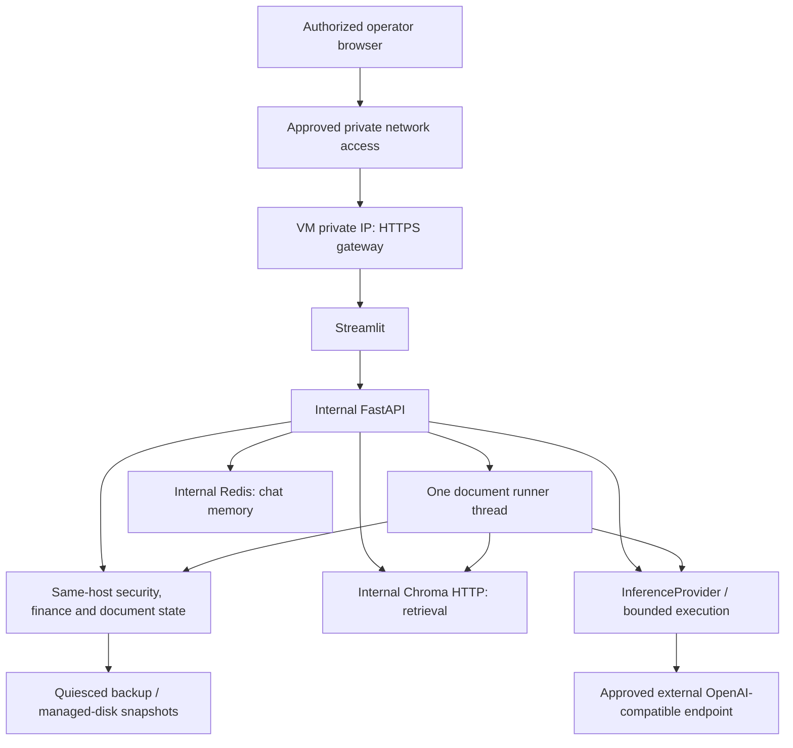

# Phase 19 deployment architecture — assessment decision

Current evidence: [27 November operational review](../codex/reports/phase_19b_operational_evidence_reconciliation_and_gate_a_readiness_review.md).
Earlier dated findings below are historical; the final addendum governs current readiness.

Current stage boundary — 21 November 2026: **19A COMPLETE; 19B ACTIVE** for offline
implementation, Azure deployment, live integration and validation; **19C NOT STARTED**
for final documentation and engineering closure. The dated assessment and implementation
sections below retain their historical stage assignments; the final continuation addendum
governs current work. No independent authorization gate changes.

Assessed 18 November 2026 against `master` at `b48dde4e4012f83c8fa2de99acbb54b8a59e0683`. This is a proposed deployment boundary, not an implemented profile or authorization to spend. Phase 19 has exactly three stages: 19A readiness, 19B deployment/integration, 19C validation/documentation. `AKS_NOT_REQUIRED` remains in force.

## Selected topology and capacity decision

Use one private Linux x86-64 VM, Docker Compose and attached managed disks formatted with a local filesystem such as ext4. Start the capacity evaluation at **2 vCPU / 8 GiB**. Prefer the lowest quoted burstable candidate, `Standard_B2as_v2`, only if measured sustained CPU, memory and recovery pass; otherwise evaluate `Standard_D2as_v5`, the lowest priced non-burstable option compared. No current aggregate workload measurement establishes either SKU as sufficient. No measured evidence justifies 4 vCPU / 16 GiB, a GPU, local Ollama models or self-hosted vLLM on this VM.

Redis and Chroma HTTP are required by the existing **production Settings contract**, not by the synthetic Documents fixture. Connections between containers satisfy the non-loopback production host requirement; a separately managed Redis or vector service is unnecessary. Actual Documents publication into the HTTP vector store must be composed and tested: the fixture currently uses `FixtureVectors`, `FixtureModel` and a trivial reranker. The diagram describes the eventual service dependencies, not a working integrated application today.

## Existing application boundaries and blocking differences

| Plane/profile | Verified entrypoint and behavior | Deployment implication |
| --- | --- | --- |
| Local Chat/RAG | `make chat-api`, `chat-ui`, `chat-dev` → `development/local_apps.py` → `api.app:app` and `ui/app.py`; private loopback ports 8001/8501, disabled auth, external local Ollama | Reuse graph, routing, RAG, memory adapters and NDJSON contracts. Local launcher must remain local. It is not the Azure launch script. |
| Local Documents | `python -m development.document_demo initialize/serve`; `development.document_demo.app:configured_app`; `ui/app.py` selects Documents only for `DOCUMENTS_PROFILE=synthetic` | Reuse workflow/services/runner, not the fixture bootstrap, automatic issuer or ephemeral approvals as production configuration. |
| Production Settings | `INFERENCE_PROVIDER=openai_compatible`, Redis, Chroma HTTP, enabled auth, disabled docs, absolute offline artifact directory; synthetic profile forbidden | Existing base Compose fixes `DEPLOYMENT_ENV=compose` and does not compose a real Documents runtime. Production validation cannot be bypassed by relabeling the fixture. |
| Governed Chat | `api/app.py::legacy_query_guard` and graph helpers deny OIDC; legacy UI client sends no authorization header | `FAIL` for a claim that existing Chat works under real OIDC through configuration alone. Keep denial until an independently reviewed bounded integration is accepted. Do not silently switch to disabled/static auth to claim OIDC readiness. |
| Real Documents | Fixture runtime injects `FixtureOperatorVerifier`, fixture inference/vectors; default execution permission requires fixture mode; operator DTOs/UI label usage as synthetic | `GAP`: a narrow non-fixture composition, real enrollment/auth, truthful usage labels and bound execution permission are required. Never mark a paid provider `pilot_fixture`. |

The two local launchers deliberately share ports and cannot run together unchanged. A Phase 19 profile must either select one plane explicitly or assign distinct internal ports/services. Initial **Documents-first private synthetic validation** is the smallest bounded scope. Concurrent real-model Chat and Documents remains blocked pending the Chat authorization/execution design; this scope choice needs operator review before 19B. Both applications' local behavior stays intact.

## Network and identity boundaries

The VM has **no public IP**. Reuse an approved existing private operator route and explicit egress if available; their existence and incremental cost are UNKNOWN. If unavailable, the report quotes a separate route-based P2S VPN candidate plus NAT Gateway. Those are access/egress resources, not additional application services. Only gateway public IPs are contemplated. Do not assume a free Bastion browser SSH session provides HTTPS browser tunneling.

Private HTTPS terminates on a reviewed reverse proxy, with a fixed private hostname, operator-trusted certificate, renewal custody, exact browser origins and OIDC callback. Over a tunnel, preserve hostname and TLS verification. Bind Streamlit/API only inside the Compose network or host loopback. NSG and host/Docker forwarding policy must deny Internet access to 22, 443, 8001, 8501, 6379, 8000 and fixture 9444; only the approved private client network can reach the TLS gateway/admin SSH. Do not publish API, worker, Redis or Chroma ports. Worker and SQLite require no network listener. `/health`, `/ready`, `/metrics`, memory and administrative paths remain internal even though some probes are unauthenticated.

Real browser login requires a tenant-specific Entra registration, exact redirect URI, delegated **API access token**, required scope/role, consent and registered owning-operator enrollment. `security/identity.py` already verifies RS256, tenant-specific v2 issuer/JWKS, API audience, `access_as_user` and exact `PolyMind.L1Operator` role. `st.user.tokens['access']` must contain that API token; an ID token or Microsoft Graph token is unsuitable. Existing local `openid documents` scope and automatic local issuer do not establish this. Session/token cookie handling, expiry, reauthentication, logout/revocation and return URLs require a real Entra browser acceptance test before use.

Allow only required outbound paths: DNS to the configured resolver; time synchronization; HTTPS to the pinned Entra issuer/JWKS and approved inference endpoint; reviewed OS security updates and immutable image distribution; backup/monitor destinations only if selected. Download embedding/reranking artifacts during the image build, never as an unbounded runtime startup dependency. Do not enable a provider destination in the synthetic validation lane. New Azure subnets require an explicit outbound method; private ingress alone does not provide egress. See [Azure outbound access](https://learn.microsoft.com/en-us/azure/virtual-network/ip-services/default-outbound-access).

## Durable storage and process ownership

Proposed bounded starting disks: **64 GiB Standard SSD LRS OS** and **64 GiB Standard SSD LRS data**. Build off-VM, deploy one immutable image shared by application services, retain at most two approved image versions and keep at least 20% disk space free. These capacities are planning limits, pending exact image/corpus growth measurement. Do not build the full ML image on a 2-vCPU VM as part of startup.

Use a stable data-disk mount such as `/srv/polymind` with stable container paths selected before initialization. These are proposed deployment paths, not dependencies on the assessment machine. Mount by durable disk identity; make service startup fail if the data disk is absent instead of creating empty authorities on the OS disk. Never put these authorities on Azure Files/NFS/SMB or temporary VM storage.

| Durable content | Existing implementation / required handling |
| --- | --- |
| Security, owner/tenant budgets, provider quota | `security.sqlite`, `governance.sqlite`, `admission.sqlite`; exact catalog/policy and provider quota key must remain bound across all consumers |
| Jobs, leases, dispatch/fences, checkpoints | `jobs.sqlite` plus immutable object records; a checkpoint is not browser memory |
| Operator actions and session controls | `actions.sqlite`, `pilot.sqlite`; accepted question answers, consumed approvals, deadlines, stop/closure and UNKNOWN intents survive restart |
| Canonical source/extraction/digest/provenance | `LocalObjectStore` on the data disk; no mandatory Azure Blob service in the current single-host design |
| Publication/index | `publication.sqlite`, canonical immutable publication artifacts, Chroma HTTP data; BM25/in-memory replicas rebuilt from the matching accepted generation; fixture `vectors.json` only in synthetic lane |
| Conversation memory | Redis persistent AOF on the same managed data disk; explicit memory/eviction/retention policy, no unbounded default growth or accidental deletion of governed history |
| Immutable ML artifacts | Revision-pinned MiniLM embedding and cross-encoder reranker baked under `/opt/polymind/models`; no four generation models on this host |
| Deployment secrets and certificates | Restricted host files mounted read-only, separate from Git/image and ordinary logs; coherent protected backup and independent credential custody |

Application UID/GID is **10001:10001**; private directories 0700, authority/secret files 0600 and restrictive umask. Vendor Redis/Chroma numeric users must be verified separately; image metadata does not establish them. Prepare only dedicated mounts for their tested non-root identities. Do not recursively change unrelated ownership. Application root filesystem read-only, bounded writable tmpfs, dropped capabilities, no privilege escalation, no Docker socket mount.

One locked API process owns **one `LocalRunner` thread** and the document writer domain. This worker is already independent of HTTP request/browser lifetime; do not add a Celery/queue service or scale it separately. Acquire the same host `runtime.lock` before opening/reopening authorities. A second API/runner owner must fail before admission or dispatch; bind every instance to the same lock inode/path. Short transactions by trusted maintenance/API readers are not permission for a second authoritative runner.

## Supervision, health and recovery

Existing ordinary Compose services use `unless-stopped`; the dedicated Documents service uses `restart: "no"`, a four-child fixture supervisor and 75-second stop grace. Neither proves unattended VM reboot recovery. Phase 19 needs Docker boot enablement plus a mount-aware systemd/Compose startup unit, explicit service health ordering, restart limits, and at least the existing shutdown grace. Keep one Uvicorn worker, no reload and one runner. Do not restart repeatedly to repair an unsettled financial operation.

Use distinct liveness and readiness. Chat `/ready` checks inference, memory, vector store and BM25; OIDC adds composed authorized-analysis readiness. It does not prove generation or every artifact load. Documents readiness additionally checks authority integrity, runner heartbeat, publication replica and unsettled/control state; retain those semantics in the real composition. Redis ping and a Chroma TCP check alone are insufficient application acceptance. Set rotated content-free Docker/journal logs with an aggregate storage bound and local heartbeat/disk/certificate checks; hosted log ingestion and alerts need a separate cost choice.

Before backup or shutdown, stop new intent and worker admission, wait for bounded in-flight operations, verify quiescence and financial/action states, then stop all writer services. Snapshot/copy the **complete** state with disk flush and preserved paths/modes. Same-disk backup copies do not protect against disk loss; managed-disk snapshots provide a separate recovery point. Snapshot price is based on occupied data/deltas, not an assertion of application consistency. See [incremental snapshot behavior](https://learn.microsoft.com/en-us/azure/virtual-machines/disks-incremental-snapshots).

Restore on an isolated host/path mapping, verify integrity and configuration bindings, retain revocations/consumed approvals/reservations and reconcile evidence newer than the backup. Financial UNKNOWN is an obligation, not zero cost. No automatic paid retry, row merge, counter reset or reinitialization is allowed. Fresh operator login and authorized replica reload may be required; readiness 503 can be correct. Whole-tree same-path local restore is supporting evidence; arbitrary stale restore, HA, disaster recovery RPO/RTO and rollback-resistant external truth are not yet established.

## Inference boundary

Preserve application/graph/RAG → `InferenceProvider` → existing Ollama/OpenAI-compatible adapter. For documents use bounded `execute(GenerationRequest)`, `CapabilityProfile`, managed v11 synthesis, schema subset conversion, full application validation, receipts/checkpoints and shared financial/admission authorities. Upstream SSE becomes provider-neutral tokens; Chat clients continue to receive PolyMind NDJSON.

A single approved deployment could serve multiple logical roles and both planes **only** after verifying its generation/streaming/schema capabilities and aggregating all consumers in shared RPM/TPM/financial admission. Distinct capability profiles remain necessary; a second deployment is not automatically necessary. Existing governed Chat and the real Documents composition remain the blockers, not a requirement for a new runtime. Provider-specific credentials, header choice and token lifecycle belong in infrastructure; no Azure-specific graph/UI branching.

Deployment, live inference and public exposure remain unauthorized. See the [readiness report](../codex/reports/phase_19a_readiness_report.md) and [bounded implementation plan](phase_19_implementation_plan.md).

## 19 November 2026 — Phase 19B offline implementation addendum

The preceding 19A observations remain historical assessment evidence. The dedicated
`docker-compose.phase19.yml` and `deployment/phase19/` now implement a private, mount-aware,
non-root five-service foundation using the existing application image, Redis and Chroma.
The gateway binds only host loopback; no API/cache/vector/worker port is published.
The worker remains one thread inside one locked API process. Stable `/state` paths,
private files, an ext4/xfs/btrfs production check, complete-authority reopen, bounded logs,
resource/restart/shutdown limits, and quiesced whole-tree backup/isolated restore are implemented.

The HTTP app and TLS proxy factories were extracted into `documents/operator/app.py` and
`ui/tls_gateway.py`; existing local import paths re-export them. Local launcher behavior and
provider-neutral inference contracts remain intact. Provider factory configuration now
supports mounted credential files and the existing adapter's `api-key` header option.

**Chat remains disabled**, with its OIDC denial unchanged. The separate non-fixture Documents
assembly requires real tenant-specific Entra configuration, approved source/capability/
financial inputs, real retrieval adapters and durable authorities. It deliberately denies
start/question execution: the retained session contract guarantees zero paid execution,
and no independent live permission bridge is implemented. This is a documented **GAP**, not
a production-ready paid composition. No default points to a fixture issuer or provider.

Offline evidence includes a healthy five-service synthetic overlay with real retrieval
models and Chroma HTTP publication, three synthetic inference attempts, and zero external
calls. Sampled aggregate memory peaked around 585 MiB; this tiny workload does not establish
an Azure capacity or credit baseline. Full results, resource limits and remaining blockers
are in the [19B report](../codex/reports/phase_19b_offline_implementation_and_verification.md);
operational commands are in [Phase 19 VM operations](../operations/phase_19_vm.md).
Neither VM candidate is selected. Azure provisioning, live inference and public exposure
remain unauthorized; Phase 19C is not started.

## 19 November 2026 — Integration Gap Resolution addendum

This supersedes the integration GAPs in the earlier dated observations without changing their
historical evidence. The existing five-service deployment and single-host authority layout remain.
One necessary custody input was added: independently managed trust, revocations and signed
permission files mounted read-only outside writable state. The application never receives an
approval signer private key. No financial schema, distributed service or inference runtime was added.

Governed Chat now has an explicit single-operator execution context: real OIDC verification,
closed conversation/source scopes, owner/tenant memory, canonical filtered dense/BM25/reranker
retrieval, LangGraph routing and the existing reservation/admission/settlement executor. Native
Streamlit API-token forwarding and guarded JSON/NDJSON routes preserve local legacy behavior.
Both transports share a durable intent key. Bounded SSE chunks retain usage/UNKNOWN handling;
readiness, page refresh and restart never submit model work. Legacy unbound OIDC guards remain.

Documents uses a separate `pilot-execution-session/2` approval plus an independently signed,
configuration-bound execution permission. Version-1 zero-paid approvals are unchanged and cannot
become billable. Scope, principal/source, model/capability, financial/quota bindings, deadlines,
revocation and durable call consumption are revalidated around dispatch and acceptance. Existing
expert-review gates remain: digest reviews precede external presentation, generated Q&A remains
pending until its own reviews validate, and accepted answers reload without regeneration.

Offline evidence exercises both paths with real Redis/Chroma and baked retrieval models, actual
signed test permissions and fake provider HTTP. It does not authorize a live record or model call.
See the appended [Integration Gap Resolution report](../codex/reports/phase_19b_offline_implementation_and_verification.md#integration-gap-resolution)
and [current operator instructions](../operations/phase_19_vm.md#integration-gap-resolution--19-november-2026).
The real Entra browser flow, current external model contract, independent live custody/reviews,
shared-consumer reconciliation and Azure capacity/access/spend gates remain unverified. Phase 19C
has not started; Azure provisioning, live inference and public exposure remain unauthorized.

## 21 November 2026 — Phase 19B live-deployment readiness continuation

The operator reclassified read-only discovery and offline verification against committed
`7bf82dc` as a dated Phase 19B continuation. Its [readiness report](../codex/reports/phase_19b_live_deployment_readiness_continuation.md)
owns current evidence and the A1–A5 approval packet. The five-service architecture and resolved
Chat/Documents integrations are unchanged. No Azure deployment or paid inference occurred.
West Europe subscription quota is currently **0 vCPUs for both Basv2 and DASv5 families**;
neither candidate is presently allocatable under that quota. D2as_v5 also reports zonal
restrictions in zones 1 and 3. These observations supersede unknown availability only, and
do not qualify capacity, select a replacement SKU/region, or authorize a quota request.

The revised current boundaries are 19A Readiness Assessment COMPLETE; 19B Offline
Implementation, Azure Deployment, Live Integration and Validation ACTIVE; 19C Final
Documentation and Engineering Closure NOT STARTED. Earlier dated stage assignments above
remain historical. Next resolve A1 subscription/resource/region/quota/private-access/spend
prerequisites, then perform only independently authorized deployment and validation in 19B.

## 24 November 2026 — Post-Azure evidence reconciliation

The operator's later executed evidence supersedes the undeployed/private-access/storage
GAPs above for the **infrastructure foundation only**: Spain Central `Standard_D2s_v4`,
2 vCPU/8 GiB, Ubuntu 24.04, no VM public IP, Tailscale/OpenSSH, two 64-GiB disks, persistent
ext4 mount and service recovery across reboot, Docker/Compose and imported images. The
original first-boot cloud-init FAIL remains historical; repaired SSH and later reboot
success do not change it. The VM was subsequently reported deallocated, without a fresh
Codex cloud query in this continuation.

The stable data UUID is `c95e5fce-443b-4d90-9160-8b67758f12d9` at `/srv/polymind`.
Device letters changed; never format or initialize that disk again. Application source
remains `7bf82dc`; the reviewed image is
`sha256:9f386acf8bddcb5d01bb028151caae24b5df604f8a56c00b7b39c7e0f8298c02`.
Azure network-disabled embedding/reranker execution passes as operator-reported evidence.
The root-owned `/opt/polymind/docker-compose.phase19.yml` is an Azure-staged digest-pinned
copy; tracked Compose retains portable vendor tags and is not that pinned artifact.

New local signed-fixture five-service integration and TLS/authority checks preserve the
existing architecture. No runtime, dependency, Dockerfile or packaging input changed.
Real Entra/browser, private certificate trust, provider/capabilities, approved pricing/shared
quota, independent permission, production authorities and Azure application/recovery/capacity
acceptance remain blocked. Compose isolation is not a verified outbound destination policy.
See the [dated reconciliation report](../codex/reports/phase_19b_post_azure_readiness_offline_validation_evidence_reconciliation.md)
and [next-session runbook](../operations/phase_19_vm.md#next-authorized-session--gates-ae).

## 25 November 2026 — Private HTTPS origin configuration

The selected Phase 19B private verification origin is `https://polymind.test:9443`;
callback `https://polymind.test:9443/oauth2callback`, Host `polymind.test:9443`,
WebSocket Origin `https://polymind.test:9443`, certificate SAN `DNS:polymind.test`.
Windows hosts mapping `127.0.0.1 polymind.test` preserves the browser-visible hostname;
Windows-native OpenSSH over the existing Tailscale route forwards Windows loopback 9443
to VM loopback 9443. Docker retains `127.0.0.1:9443:9443` and five services; no API,
Redis, Chroma or UI host port is added. WSL-to-Windows localhost forwarding is unverified.

Generic gateway/application logic is unchanged and configurable for another approved
private hostname. The Compose example selects this origin; a new inert native OIDC
field inventory supplies the matching callback and generic identifier/credential placeholders.
Neither is operational configuration. The independent native secrets/Entra/Compose values
must be compared before provisioning; template tests cannot validate private deployed files.
Dedicated private CA issuance, lifetimes/custody/revocation and actual Windows/browser trust
require operator review; only isolated temporary test certificates were used offline.

The operator reports the enabled API user role assignment matches the signed-in operator
and `PolyMind.L1Operator`; no real API token/browser authentication was verified. The dedicated
browser registration, consent, credentials and runtime API access-token subject remain pending.
See the [current Gate A runbook](../operations/phase_19_vm.md#25-november-2026--selected-private-https-origin-and-gate-a-update)
and [bounded verification report](../codex/reports/phase_19b_private_https_origin_configuration_and_integration_verification.md).
Provider neutrality, one API/runner, seven authorities, private persistence and independent
execution permissions remain intact. Phase 19A COMPLETE, 19B ACTIVE, 19C NOT STARTED;
VM operator-reported deallocated. No operational readiness or live authorization is implied.

## 26 November 2026 — Native OIDC configuration preparation

The dedicated browser application, exact selected Web redirect acceptance, enabled SP,
delegated API permission, Principal-only consent and confidential credential metadata are
now operator-reported verified, superseding earlier pending registration findings within that
scope. No tenant-wide consent was granted. The [OIDC preparation report](../codex/reports/phase_19b_streamlit_oidc_configuration_preparation.md)
records all identity distinctions, exact non-secret configuration and complete operator-only
provisioning/encryption/future SSH handoff procedures with fresh synthetic offline verification.

Installed Streamlit 1.58.0 supports the unnamed default provider used by Chat and Documents;
access-token exposure and existing API/enrollment contracts match. No runtime code, topology,
dependency or image change is necessary. The portable inventory remains generic and actual
configuration stays external. Populated native secrets, cookie custody, Azure provisioning,
real browser authentication and API access-token subject enrollment are not established;
actual secret encryption/access restriction is unverified. Operational cross-file comparison,
TLS/trust, all other authority/provider/finance gates and no-public-exposure boundaries remain.
VM operator-reported deallocated; no activation or inference authorization. Phase 19A COMPLETE,
19B ACTIVE, 19C NOT STARTED. Operator review and independent private preparation are next.

## 27 November 2026 — Operational evidence and bootstrap dependency

This is the current readiness record; earlier dated pending findings retain their historical
scope. The [operational reconciliation report](../codex/reports/phase_19b_operational_evidence_reconciliation_and_gate_a_readiness_review.md)
records OPERATOR_REPORTED_PASS for private native TOML/independent cookie creation, encrypted
staging/comparison/plaintext cleanup, approved direct-root PKI/root/leaf/CRL, local encrypted
CA backup, current-user Windows public-root trust, loopback hostname resolution and dedicated
SSH-key readiness. These do not establish actual credential exchange, independent backup
custody/recovery, browser revocation enforcement or deployed private HTTPS/authentication.

Operational Gate A is BLOCKED across identity enrollment/bootstrap, source/privacy/semantic
review, current provider/capabilities, finance/shared quota/obligations, independent execution
custody and remaining trust/recovery decisions. Runtime requires API-token sub plus an owner-bound
approved source before initialization; standard Compose gates UI on API readiness. No supported
identity-only acquisition workflow exists. Review a narrow separate bootstrap tool before
identity maintenance, preserving native OIDC/Entra checks and no production authority writes.
Existing no-inference configuration is conditional on legitimate full inputs; it is not bootstrap.
The prior BatchMode transfer is incompatible with a locked Windows identity/disabled agent;
the report prepares an interactive encrypted-only maintenance alternative, not deployed acceptance.

No runtime, topology, authority, dependency or image input changed. Five services, seven SQLite
authorities, provider neutrality, private Tailscale/OpenSSH, loopback-only9443 and Azure-pinned
artifacts remain intact. Actual runtime acceptance needs separately authorized Gates B–E;
no activation/production initialization/inference is authorized. VM reported deallocated.
19A COMPLETE; 19B ACTIVE; 19C NOT_STARTED. Next: offline operator review and decisions.
