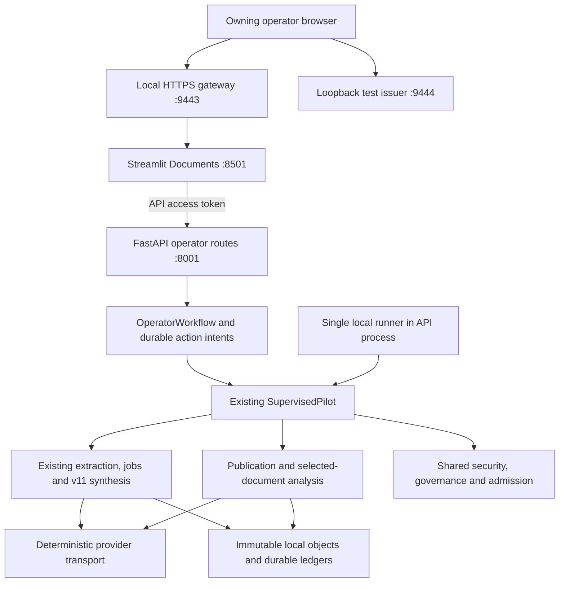

# Phase 18 local Documents operator guide

Reconciled 14 November 2026 against implementation commit `f7d091ad16a458c4d4a7403e3fe3ad2b47fafc67`. This guide describes the private **synthetic, owning-operator** application. The [completion decision](../evaluation/phase_18_engineering_completion_and_deferred_deployment.md) owns scope and acceptance; the [operator API reference](phase_18_operator_api.md) owns implemented HTTP contracts. The [Stage 18.2 report](../codex/reports/phase_18_2_implementation_and_verification.md) owns executed verification. Stage 18.3 inspected commands/source without starting services or repeating tests.

## Supported runtime and architecture

The existing Chat/RAG/LangGraph plane remains available under its own legacy configuration. Documents is an explicit development profile, selected by `DOCUMENTS_PROFILE=synthetic`; `DOCUMENTS_API_URL` defaults to `http://127.0.0.1:8001`. Its lifecycle command supplies these settings and disables implicit dotenv loading. Merely choosing that UI setting does not compose an API runtime. Use the supported lifecycle below rather than `make dev` or the default `api.app:app` entrypoint for Documents.



One `SecurityRuntime` supplies the same security, governance and admission instances to the pilot and analysis/publication boundaries. The development entrypoint composes the document plane without importing the legacy graph/provider factory. `FixtureHTTP` substitutes in-process responses behind the existing OpenAI-compatible provider; `https://fixture.invalid/v1` is a transport sentinel, never a network service. Embeddings, persistent vectors and ranking are synthetic substitutes. No Azure service, Redis server, Chroma server, real-provider fallback or GPU is required by this profile. Global managed-prompt/10 remains unchanged; this workflow explicitly uses managed-prompt/11.

The runner is a single thread owned by the locked API process, independent of HTTP requests and the browser WebSocket. Its default loop is two seconds. It observes durable provider-call history and waits at least 61 seconds after the last admitted call before another worker step. `WAITING_ADMISSION` is expected during processing. The UI polls every three seconds. These are development settings, not performance promises.

## Python initialization and startup

Use the project's isolated Python 3.10 environment (the image and CI use 3.10). From the repository root, activate the existing environment. For a new environment, the repository's supported dependency installation is:

```bash
python -m venv .venv
source .venv/bin/activate
pip install --no-deps -r requirements-ml-cpu.txt
pip install -r requirements.txt
```

The existing ML stack is substantial; reuse it when present. Authentication is pinned to `streamlit==1.58.0`, `Authlib==1.9.5`, `joserfc==1.7.7`, with `PyJWT[crypto]==2.15.0` and `cryptography==50.0.2`. Optional Playwright/Chromium harness tooling is separate and unnecessary for ordinary operation. No dependency installation is performed by this documentation stage.

Choose a **new, nonexistent private runtime** outside the repository. `/tmp` is appropriate for disposable local tests, not durable archival custody:

```bash
python -m development.document_demo initialize /tmp/polymind-documents
python -m development.document_demo serve /tmp/polymind-documents
```

Initialize creates the directory with restrictive permissions, ephemeral signing/TLS material, native Streamlit auth configuration, approved synthetic text/PDF fixtures and all authorities. It refuses an existing directory. It is not a reset or migration command. Do not edit approvals, prices, paths or dates in an initialized runtime. `DEPLOYMENT_ENV=production` is rejected by the CLI and runtime; the synthetic UI profile is also rejected by production settings.

Open **`https://localhost:9443`**. Use `localhost` exactly because host/origin and callback bindings are exact. Trust only the certificate generated for this disposable runtime, `tls.crt`, through a narrowly scoped browser testing exception or reviewed test trust. Verify its origin locally; never disable TLS verification globally or install an unknown CA system-wide. Internal requests explicitly verify this test certificate. Private keys, client/cookie secrets and identity configuration must remain private; do not print, paste, commit or share them.

The fixture issuer uses HTTPS `localhost:9444`. API `127.0.0.1:8001` and Streamlit `127.0.0.1:8501` are internal loopback services, not browser entrypoints. Do not expose them or the automatic-login test issuer to a network. Startup supervises issuer, API/runner, Streamlit and gateway children. A child exiting ends the supervised group; there is no automatic service restart policy.

Development lifetimes are independent:

| Item | Implemented lifetime / consequence |
| --- | --- |
| Source approval | One hour from initialization; eligibility is checked against current time |
| Session approval fixtures | 59 minutes from initialization, not from first login |
| API access token and issued ID token | 900 seconds from code exchange |
| Native Streamlit identity cookie | May persist for 30 days; not equal to API-token validity |
| Execution deadline | 600 seconds from initial accepted Start; replay does not extend it |
| Provider operation | At most 60 seconds; job lease is 120 seconds |
| Self-signed test TLS | Two days from provisioning |
| Fixture metadata-retention date | Seven days; no automatic retirement scheduler |

Reauthentication does not extend source/session approvals or deadlines. Expired/exhausted fixtures require a separately scoped new test runtime, retaining the previous history as required; never delete ledgers to renew authority. There is no certificate-renewal or approval-renewal CLI for an existing runtime.

## Login and complete operator workflow

1. Select **Log in**. Native Streamlit authorization-code login redirects to the loopback fixture issuer, which automatically authenticates one synthetic operator without a password. This deliberately proves protocol integration, not real-person authentication. API context must show **Verified enrolled operator** before use.
2. Select the server-approved `manual.txt` or `manual.pdf`. Review metadata, eligibility and limits. There is no upload widget, arbitrary path/URL intake or source-approval editor. Unsupported/hash-mismatched/expired/native-ineligible sources fail before provider work. Small size alone does not ensure eligibility.
3. Select **Create session** once. The server consumes a preprovisioned session approval, extracts the exact approved bytes, creates canonical immutable source/extraction/plan objects and registers document ownership. A durable action key binds the accepted result. Record the displayed opaque session ID privately for reconnect.
4. Select **Start durable job**. The backend forecasts capacity, admits one durable job with outbox/steps, records the deadline and grants the local runner the current verified principal in memory. A forecast reserves no money. Actual calls still require current security, pilot, financial and shared-provider admission. Browser refresh, closing the tab or polling cannot start another job.
5. Observe **Processing status**. Session, job, digest, worker and financial states are separate. Progress is durable completed/total step counters with stages, not an invented percent. A client timeout means the request result is unknown to the client; it does not mean the durable job failed. Reconnect before issuing new intent. `PARTIAL`, `FAILED`, `CANCEL_REQUESTED` and `CANCELLED` are not successful complete digests.
6. On validated `COMPLETE` and coverage fraction 1, select **Authorize publication**. This explicitly plans/prepares/activates an immutable generation and loads its matching replica; completion alone does not publish. Active-generation/security/session guards still control release.
7. Inspect **Complete document digest**: summary, findings, sections, synthesis claims, qualifications, contradictions, limitations, open questions, original evidence, coverage and citations appear as inert JSON. Canonical citations retain document/version/extraction/generation, physical PDF page or text span/lines and original excerpt. `semantic_support=not_evaluated` means structural provenance does not certify semantic entailment.
8. Ask a selected-document question, such as “What valve inspection is required?” Conservatively allow at least 61 seconds after the last synthesis call (or previous question) for the shared reservation window, while staying within the original 600-second execution deadline. The runner spaces its own steps; the question route executes synchronously and does not queue/wait automatically for admission. The document ID comes from the server session. The authored fixture answers supported valve questions and abstains otherwise; this is not a real-model quality demonstration. Accepted answers are durably bound to the request key/query, reauthorized and included in later digest reads. At most three question submissions apply; denied/failed submissions may still consume a slot and leave a pending action intent. Never use new keys as a retry workaround.
9. Choose **Cancel processing**, **Close session**, **Withdraw session**, **Clear frontend display**, **Log out** or **Operator emergency stop** according to the distinct effects below.

Pilot ceilings: three total sessions per initialized runtime, one OPEN session/one open job, one controlled execution lane, 1,000,000 source bytes, four native pages, 4,000 extracted characters, three synthesis attempts and three questions/six overall provider attempts. Per-call input reservation is at most 24,800 and output at most 3,000; tighter envelope, model, parser, financial and admission limits prevail. These are synthetic execution constraints, not a live spending grant. The fixed local EUR catalog is test arithmetic.

## State ownership and idempotency

| State | Authority / persistence | Disconnect and restart behavior |
| --- | --- | --- |
| Browser display, selected session ID and action keys | `st.session_state`, scoped to browser session | May be lost; no authoritative source/job/budget state here; protected packets are fetched again |
| Accepted create/publish/question actions | Private `actions.sqlite`, payload hash and accepted result | Accepted replay returns same identity/result; pending intent without result refuses automatic retry |
| Jobs, dispatch, leases/fences/checkpoints | `jobs.sqlite` and immutable `objects/` | Persist; runner reconciles ledger state; no automatic repeat of a possibly executed call |
| Financial reservation/usage and provider windows | `governance.sqlite`, `admission.sqlite` | Persist, including UNKNOWN/unsettled amounts; process counters cannot reset quotas |
| Session consumption/deadline/stop and execution intents | `pilot.sqlite`, bound to exact configuration | Persist; restart drops in-memory bearer grants and replicas |
| Publication generation and derived index | `publication.sqlite`, immutable objects, `vectors.json`; loaded replica is in memory | Activation persists; fresh authorized Start replay explicitly reloads permitted presentation |
| Identity, ownership, grants, disablement and epochs | `security.sqlite`; JWT verification is separate | Current authority remains decisive, including after restore; no browser ownership claims |
| Retention/residual inventory | Pilot/object/job/publication/action/audit/financial records | Closure retains records; no complete physical erasure guarantee |

Create replay uses the same source/key. Start reuses the existing job. Publish replay uses the same expected job/generation and refuses conflicts. Question replay uses the same key and exact query and returns its accepted answer, subject to current release permission. A different payload on the same key is a conflict. Pending create/publish/question intents require trusted investigation; even a pre-effect error can leave an unresolved action intent. There is no HTTP action-intent repair endpoint.

## Authentication and data protection

Authentication, enrollment, permissions and scope are four separate checks. Native login uses authorization code, PKCE S256, state/nonce and a one-time 60-second code. The API verifies RS256/key/issuer/API audience/purpose/time claims using configured loopback JWKS. The ID token audience is the UI client; the access token audience is `polymind-documents`. Only the latter is sent server-to-server as Bearer. The fixture verifier rejects app identities and additional roles. The workflow then requires exact `(issuer, tenant identity, subject)` enrollment, a user principal, `PUBLICATION_MANAGE` and the exact owning pilot scope. Valid authentication alone grants none of the other decisions.

Native identity/token cookies are **signed and browser-readable rather than encrypted opaque server-side sessions**. HttpOnly prevents ordinary page JavaScript access, not inspection/copying by the browser user. The TLS gateway adds Secure; the tested native identity/token cookies are HttpOnly and SameSite=Lax. XSRF remains Secure and deliberately JavaScript-readable for Streamlit's protocol. CORS/XSRF and exact host/origin/WebSocket checks remain enabled. Protected packets are re-fetched on rerenders rather than globally cached.

The loopback issuer is not Azure Entra production authentication. Ephemeral local certificates are not publicly trusted production certificates. Logout best-effort closes the selected backend session, clears local state and native cookies; it cannot revoke every copied bearer JWT. Durable security-authority disablement/epoch changes and workflow closure/stop are the applicable revocation mechanisms. There is no browser admin endpoint for principal disablement. Already delivered information cannot be recalled. A previously rendered packet may remain visible until a rerender; server denial protects subsequent release, not bytes already seen.

Actual send guards use the order **pilot session/configuration → security snapshot → publication generation/epoch**, with a bounded five-second transport send and no authority transaction spanning inference. Denial before headers returns 403; denial after response start terminates the body. An incomplete response is not a completed answer. Source/model text remains untrusted inert data, never authority or executable markup.

This remains an operator-only synthetic application. Ordinary users must not receive publication-management privileges. Public/confidential workloads require additional independent security/privacy review, a reviewed token/session design, real identity/enrollment, data/provider/retention decisions and target deployment evidence. The [Entra profile](../security/entra_v2.md) is a separate verifier contract, not a configured browser deployment here.

## Controls, faults and safe restart

| Action / condition | Exact operational boundary |
| --- | --- |
| Clear frontend display | Clears `doc_` browser-session keys only; loses reconnect/action keys; does not cancel, withdraw, erase or refund |
| Cancel | Requests durable job cancellation/fencing; 202 `CANCEL_REQUESTED` is not proof all in-flight work stopped; `may_complete_and_bill=true` |
| Close | Closes session presentation authority, then cancels eligible work; retained objects and accepted artifacts remain |
| Withdraw | Same boundary with `WITHDRAWN` state; repeated close/withdraw preserves the first terminal closure classification |
| Log out | Best-effort Close followed by native logout; expired credentials can prevent Close; copied bearer tokens are not universally revoked |
| Emergency stop | Durable pilot stop/epoch denial precedes best-effort cancellations; response identifies cancellation reconciliation and `MAY_COMPLETE_AND_BILL`, `refund_claimed=false` |
| Authority/audit/object/index failure | Fail closed or mark job failure; never silently recreate missing authority or show false COMPLETE |
| Publication failure/stale generation | Candidate or active state may survive; pending publish intent requires investigation; refuse mismatched/missing replica or release guard |
| UNKNOWN/unsettled execution | Keep reserved cost/tokens and execution history; deny unsafe continuation and investigate using trusted records |

Ctrl-C (or SIGTERM to the supervisor) stops its scoped child services. The API asks its runner to finish shutdown, with a 65-second join; the supervisor waits up to 70 seconds per child before killing an unresponsive child. Interruption can leave uncertain durable work. Quiescence must be verified before backup. Stop is not a refund or a command to delete data.

Restart with the same `serve` command and original absolute runtime path. Log in again, enter **Existing session ID → Reconnect**, inspect status, and select **Start durable job** only for permitted continuation/explicit replica load. This reuses the job and grants a fresh in-memory principal; it does not extend deadlines, restore withdrawn access or reset consumed approvals. An active published generation can make readiness unavailable after restart until its authorized replica reload. A closed/expired session cannot use Start to reopen presentation.

Ledger reconciliation handles dispatch, leases and fences; accepted compatible immutable checkpoints remain reusable. `max_attempts=1` means an interrupted claimed step may become terminal. ACTIVE/UNKNOWN operation or financial history may block continuation even after reauthorization. Do not promise autonomous recovery of a possibly executed call. Do not delete counters, reset a database, invent usage/refunds, repeat inference with a new key or change a lease to obtain success. Trusted financial reconciliation requires actual evidence and quiescence through existing authority interfaces; the browser has no settlement/reopen/repair endpoint.

For publication recovery, inspect accepted manifests/active generation and current revocations with trusted maintenance tooling. Only explicitly validated matching replicas may serve. Read/status never rebuilds an index. Do not roll back security epochs or activate a candidate to hide a pending intent. When no safe reconciliation is available, preserve the runtime and remain unavailable.

## Docker and Compose

Use the existing image and **only** `docker-compose.documents.yml` for this profile. It is separate from the legacy Compose API/UI/Redis/Chroma topology. Authorities bind absolute container paths; initialize at `/runtime/state` from the beginning, not at host paths that will later be moved.

Choose a new empty dedicated parent mount. From the repository root:

```bash
export DOCUMENT_DEMO_ROOT=/tmp/polymind-documents-container
mkdir -p "$DOCUMENT_DEMO_ROOT"
docker compose -f docker-compose.documents.yml config --quiet
docker compose -f docker-compose.documents.yml build
docker compose -f docker-compose.documents.yml run --rm --no-deps --workdir /app --user 0 documents chown 10001:10001 /runtime
docker compose -f docker-compose.documents.yml run --rm --no-deps --workdir /app documents python -m development.document_demo initialize /runtime/state
docker compose -f docker-compose.documents.yml up -d
```

The root one-shot changes ownership only of that dedicated mount's root; actual initialization/serving uses image UID/GID `10001:10001`. Do not point it at an unrelated directory. The host mapping is `$DOCUMENT_DEMO_ROOT/state` → `/runtime/state`. Reuse exactly that mapping for restart and restore. Private files may be unreadable to a different host UID; use an authorized scoped maintenance account, not broad chmod/chown.

```bash
docker compose -f docker-compose.documents.yml ps
docker compose -f docker-compose.documents.yml logs --tail=100 documents
docker compose -f docker-compose.documents.yml exec -T documents python -c 'import urllib.request; print(urllib.request.urlopen("http://127.0.0.1:8001/ready").read().decode())'
docker compose -f docker-compose.documents.yml restart documents
docker compose -f docker-compose.documents.yml down
```

Restart requires the same fresh authorization/reload as Python operation. `down` removes this Compose service/network and retains the bind state; do not add volume deletion or global cleanup. `restart: "no"` means no unattended restart guarantee. Log inspection is local: do not publish unsanitized logs or private runtime files. Readiness 503 after restart may be intentional until an active generation is explicitly reloaded; it is not permission to initialize again.

Only host `127.0.0.1:9443` and `127.0.0.1:9444` are published. Inside the container the TLS listeners bind all interfaces for Docker forwarding, while API/Streamlit stay loopback. The container has a read-only root, all capabilities dropped, no new privileges, a 64 MB UID-owned `/tmp` tmpfs and 75-second stop grace. The persistent bind holds identity, TLS, authority, object and index state. The API process `runtime.lock` excludes a second API/runner owner; do not scale this service or share SQLite over a network filesystem.

No real provider environment is passed by this Compose file. The supervisor also filters inherited credential/provider/security configuration before spawning children. Keep runtimes outside the build context; `.dockerignore` excludes `.env`, databases/sidecars, `.streamlit`, `.document-demo`, PEM/key files and browser outputs. Those patterns do not make arbitrary runtime-directory placement safe. The historical Stage 18.2 cached image was 3,042,328,251 bytes (about 3.04 GB); this is not a newly measured or optimized image. Build cache should remain enabled.

## Quiesced backup and original-path restore

First stop **all** services and verify there is no second writer or in-flight process. Investigate unresolved provider/financial/action intents; a snapshot preserves uncertainty rather than resolving it. Choose a new destination outside the runtime:

```bash
python -m development.document_demo backup /tmp/polymind-documents --destination /tmp/polymind-documents-snapshot
```

Backup takes the same `runtime.lock` as the API/runner, rejects an existing destination or a destination inside the runtime, and copies the entire tree. It does not independently prove financial settlement, synchronize a live issuer/UI, encrypt storage or validate a disaster-recovery point. Preserve private permissions, copy completion/integrity and protected custody; a failed partial copy is not a valid snapshot.

For Compose, after `down`, use a one-shot under the same mapping:

```bash
docker compose -f docker-compose.documents.yml run --rm --no-deps --workdir /app documents python -m development.document_demo backup /runtime/state --destination /runtime/snapshot
```

Here `/runtime/snapshot` is outside `/runtime/state` and maps to `$DOCUMENT_DEMO_ROOT/snapshot`. It must not already exist. This command copies only while the main service is stopped. Snapshot and original contain signing/client secrets: neither belongs in Git or an image.

There is **no `restore` CLI command**. Supported restoration is a trusted, quiesced whole-tree filesystem copy at the original absolute path, as exercised in Stage 18.2:

1. Stop all services. Preserve the current runtime separately without overwriting it. Establish that the snapshot is complete, compatible and has not lost newer consumed approvals, revocations/tombstones, settlements, UNKNOWN obligations or action results. If later activity exists, reconciliation is required before reopening; arbitrary stale rollback is unsupported.
2. Restore the complete snapshot to the original runtime location, preserving private modes/UID/GID. For Python that is the original absolute root (for example `/tmp/polymind-documents`); for Compose restore the complete host `state` tree under the same mount so it remains `/runtime/state` inside. Do not run Initialize, merge individual database rows, mix epochs or restore only objects/indexes.
3. Include `identity.json`, signing/TLS/auth files, `private/manifest.json`, `security.sqlite`, `governance.sqlite`, `admission.sqlite`, `jobs.sqlite`, `pilot.sqlite`, `actions.sqlite`, `publication.sqlite`, `vectors.json`, immutable `objects/` and any SQLite sidecars/other captured runtime files. Seven SQLite authorities must reopen as existing schema version 1, with the exact original policy/model/source/path binding.
4. Restart using Serve or Compose `up -d`. Missing/truncated/incompatible authority state is refused. Object/manifests and active generation/index compatibility must validate at their relevant load/release boundaries; startup alone is not exhaustive artifact validation.
5. Authenticate, reconnect and inspect consumed sessions, security and financial truth. Reauthorize permitted work using Start; explicitly reload/validate active publication. Withdrawn/closed/stopped or expired sessions remain denied. A snapshot does not renew certificates, approvals or execution windows. Keep the service closed on any uncertainty.

The tested restore boundary is a coherent local same-path snapshot without lost newer truth. There is no arbitrary stale-backup, multi-host disaster recovery, automatic RPO/RTO or rollback-resistant external authority guarantee.

## Retention and disposal

Logical Close/Withdraw denies future presentation; it is separate from principal revocation, metadata retirement and physical erasure. The trusted pilot can logically retire eligible metadata after its deadline, but that operation is not exposed by these eleven endpoints and does not remove private adapter answer records or SQLite residual pages. Immutable sources, extraction, checkpoints, receipts, accepted generations/indexes, action answers, audit, financial records and backups can remain. `PURGE_PENDING` and `physical_erasure=false` must be read literally.

Retain original test state/snapshots privately while audit or financial/reconciliation obligations remain. Disposal is a separate scoped operator decision covering the exact disposable runtime, backups, browser copies and retention needs; no automatic cleanup/delete command is supplied. Deleting a directory does not certify physical erasure or settle obligations. Do not delete historical evaluation evidence or unrelated Docker data. Previously delivered content and upstream/provider copies cannot be recalled or certified erased by this local adapter.

## Deployment handoff

`AKS_NOT_REQUIRED`. The selected initial cloud candidate remains a small private Linux VM with Docker and persistent local storage, subject to a separately reviewed resource/security/cost/authorization plan. **AKS was previously validated during Phase 16, but is not required for the initial Phase 18 document application deployment.** Azure deployment has not been performed; sizing, pricing, real Entra browser authentication, network/identity, production backup/monitoring/availability and distributed authorities remain unestablished. See the [deployment reconciliation](../evaluation/phase_18_1_azure_deployment_readiness.md#implementation-status--14-november-2026).
